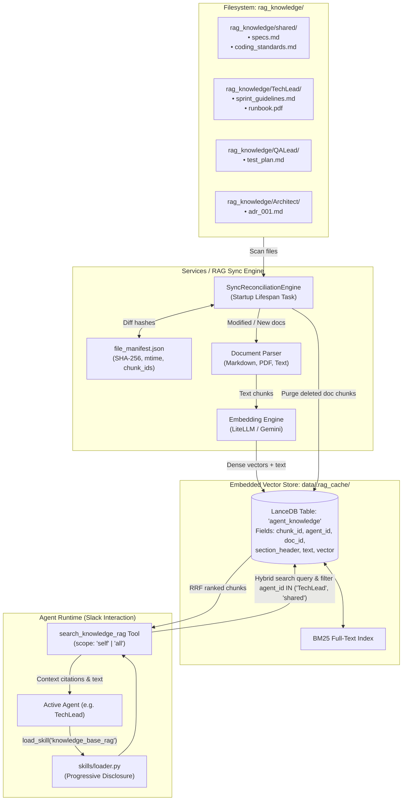

# Blueprint: Modular Agent-Oriented RAG Architecture

## 1. Executive Summary & Design Decisions

Based on your design concept, the conversation with Gemini, and your confirmed preferences:
- **Vector Database**: **LanceDB** (Embedded, serverless columnar format, native BM25 full-text + dense hybrid search, zero daemon overhead).
- **Embedding Provider**: **Cloud Embeddings via LiteLLM / Gemini** (`text-embedding-004`), reusing the project's existing `litellm` package and `GEMINI_API_KEY`.
- **Knowledge Organization**: **Hybrid Per-Agent Folders with a `shared/` Directory** (`rag_knowledge/{AgentName}/` + `rag_knowledge/shared/`).
- **Retrieval Model**: **Progressive Disclosure Tool** (`knowledge_base_rag` skill with `search_knowledge_rag` tool) rather than force-injecting context on every turn.
- **Sync & Reconciliation**: **Non-blocking Startup + Background Reconciliation** using SHA-256 content hashing to ensure zero redundant re-embeddings and chunk-level cleanup of deleted files.

---

## 2. System Architecture & Information Flow



---

## 3. Directory Layout

```
SlackAgenticPanel/
├── rag_knowledge/                        # Document root dropped by users/developers
│   ├── shared/                           # Shared knowledge accessible to all agents
│   │   ├── system_overview.md
│   │   └── coding_guidelines.md
│   ├── TechLead/                         # TechLead domain knowledge
│   ├── Architect/                        # Architect domain knowledge
│   ├── QALead/                           # QA Lead domain knowledge
│   └── SecurityArchitect/                # Security Lead domain knowledge
│
├── data/
│   ├── .rag_cache/                       # Internal database and manifest storage
│   │   ├── file_manifest.json            # SHA-256 hash index & chunk tracking
│   │   └── lancedb/                      # In-process LanceDB directory
│
├── services/
│   └── rag/                              # Modular RAG package
│       ├── __init__.py
│       ├── config.py                     # Constants, chunk limits, embedding model config
│       ├── manifest_manager.py           # Manages file_manifest.json state & diffing
│       ├── document_parser.py            # Markdown-aware & PDF semantic chunker
│       ├── embeddings.py                 # Async LiteLLM embedding batcher
│       ├── vector_store.py               # LanceDB connection, schema, FTS index, hybrid search
│       ├── sync_engine.py                # Startup diffing & background reconciliation loop
│       └── service.py                    # High-level RAG façade for search queries
│
└── skills/
    └── knowledge_base_rag/               # Declarative skill for agents
        ├── SKILL.md                      # Progressive disclosure prompt instructions
        └── tools.py                      # search_knowledge_rag tool definition
```

---

## 4. Key Component Implementation Details

### A. Document Hashing & Reconciliation Engine (`services/rag/sync_engine.py`)
1. **Manifest Record (`file_manifest.json`)**:
   ```json
   {
     "TechLead/deployment_runbook.md": {
       "agent_id": "TechLead",
       "sha256": "4a7d...b891",
       "mtime": 1727173200.5,
       "chunk_ids": [
         "TechLead_deployment_runbook_md_c001",
         "TechLead_deployment_runbook_md_c002"
       ],
       "indexed_at": "2026-09-24T12:00:00Z"
     }
   }
   ```
2. **Reconciliation Steps**:
   - **Step 1 (Scan)**: Recursively walk `rag_knowledge/`. Identify each file's owner from its parent folder name (e.g. `TechLead/` -> `TechLead`, `shared/` -> `shared`).
   - **Step 2 (Compare)**:
     - If file missing in manifest -> **NEW**: Chunk, embed, insert to LanceDB, write to manifest.
     - If file present and `sha256 != manifest[file].sha256` -> **MODIFIED**: Delete old `chunk_ids` from LanceDB (`table.delete(f"doc_id = '{doc_id}'")`), chunk new content, embed, insert, update manifest.
     - If file in manifest but deleted on disk -> **DELETED**: Delete all `chunk_ids` from LanceDB, remove entry from manifest.
     - If unchanged -> **NO-OP**: Skipped entirely (0 API calls, 0 overhead).
3. **Lifespan Integration**:
   Run in `main.py` inside `lifespan(app)` as an asynchronous task:
   ```python
   asyncio.create_task(rag_sync_engine.reconcile())
   ```
   This ensures FastAPI starts instantly and responds to Slack events with zero boot delay.

### B. LanceDB Schema & Hybrid Search (`services/rag/vector_store.py`)
- **PyArrow Table Schema**:
  ```python
  import pyarrow as pa

  SCHEMA = pa.schema([
      pa.field("chunk_id", pa.string()),
      pa.field("agent_id", pa.string()),          # e.g. "TechLead", "shared"
      pa.field("doc_id", pa.string()),            # e.g. "TechLead/runbook.md"
      pa.field("filename", pa.string()),          # e.g. "runbook.md"
      pa.field("section_header", pa.string()),    # e.g. "## Rollback Procedures"
      pa.field("text", pa.string()),              # Raw chunk text
      pa.field("vector", pa.list_(pa.float32(), 768)), # Embedding vector
      pa.field("updated_at", pa.float64())
  ])
  ```
- **FTS Index**:
  Created on the `text` column via `table.create_fts_index("text", replace=True)` to enable BM25 keyword search.
- **Hybrid Search Execution**:
  ```python
  # LanceDB hybrid search with Reciprocal Rank Fusion (RRF)
  results = (
      table.search(query, query_type="hybrid")
      .where(f"agent_id IN ('{agent_name}', 'shared')")
      .limit(top_k)
      .to_pandas()
  )
  ```

### C. Embedding Service (`services/rag/embeddings.py`)
Reuses `litellm` (already in `requirements.txt`):
```python
import litellm

async def get_embeddings(texts: list[str]) -> list[list[float]]:
    response = await litellm.aembedding(
        model="text-embedding-004",  # Or configured model
        input=texts
    )
    return [item["embedding"] for item in response.data]
```

### D. Progressive Disclosure Skill (`skills/knowledge_base_rag/`)
1. **`skills/knowledge_base_rag/SKILL.md`**:
   - Instructs agents when and how to look up company standards or their specialized runbooks.
2. **`search_knowledge_rag` Tool**:
   - Parameters:
     - `query`: Natural language query or specific technical term.
     - `scope`: `"self"` (agent's own docs only) or `"all"` (agent's own docs + `shared/`). Default is `"all"`.
     - `max_results`: Number of excerpts to retrieve (default: 4).
   - Returns markdown formatted citations with document name, section header, and text snippet.

---

## 5. Required Libraries to Add

The project already has `litellm`, `fastapi`, `pydantic`, `pypdf`, `pyyaml`, and `httpx`.
To implement this blueprint, we only need to add:

| Package | Recommended Version | Purpose |
| :--- | :--- | :--- |
| `lancedb` | `>=0.17.0,<1.0.0` | Embedded serverless vector DB with native BM25 hybrid search |
| `pyarrow` | `>=14.0.0,<20.0.0` | High-performance columnar memory & schema engine used by LanceDB |
| `tantivy` | `>=0.22.0` | Rust-based full-text indexing engine utilized by LanceDB for BM25 |
| `markdown-it-py` | `>=3.0.0,<4.0.0` | Semantic token-aware chunking for Markdown documents |
| `watchdog` *(Optional)* | `>=4.0.0,<6.0.0` | Filesystem watcher for runtime hot-reloading of new documents |

```text
# Additions to requirements.txt:
lancedb>=0.17.0,<1.0.0
pyarrow>=14.0.0,<20.0.0
tantivy>=0.22.0
markdown-it-py>=3.0.0,<4.0.0
```
