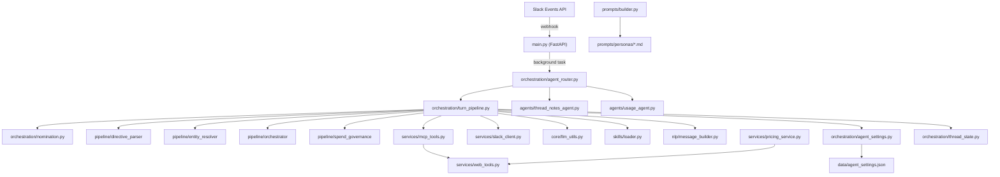

# SlackAgenticPanel — Comprehensive Codebase Review

## Architecture Overview



**SlackAgenticPanel** is a multi-agent orchestration platform that runs 17 AI persona agents (Visionary, Architect, Sceptic, etc.) in structured discussions via Slack threads. Each agent uses a different LLM provider (Gemini, OpenAI, Anthropic, Mistral) and can be equipped with skills (web research, codebase inspection, workspace authoring). The system supports sandwich/fixed orchestration modes, circuit breaker cost controls, progressive skill disclosure, and in-memory multi-turn discussion loops.

---

## 🟢 Strengths

| Area | Details |
|---|---|
| **Architecture** | Clean separation of concerns with well-defined packages (`core`, `orchestration`, `services`, `pipeline`, `nlp`, `prompts`, `skills`, `agents`) |
| **Domain Modeling** | Excellent use of dataclasses ([`Turn`](file:///c:/Users/Hp/Documents/agy2-projects/SlackAgenticPanel/core/domain.py#L6-L36), [`SessionContext`](file:///c:/Users/Hp/Documents/agy2-projects/SlackAgenticPanel/core/domain.py#L39-L63), [`SpeakerDecision`](file:///c:/Users/Hp/Documents/agy2-projects/SlackAgenticPanel/core/domain.py#L66-L85)) with serialization |
| **Turn Pipeline** | Stage-based pipeline ([`TurnPipeline`](file:///c:/Users/Hp/Documents/agy2-projects/SlackAgenticPanel/orchestration/turn_pipeline.py#L171-L201)) with 5 well-named stages makes the flow highly readable |
| **Error Handling** | Sophisticated error classification ([`classify_agent_error`](file:///c:/Users/Hp/Documents/agy2-projects/SlackAgenticPanel/core/llm_utils.py#L40-L119)) with retry/backoff, 503 rotation, rate-limit retry queuing |
| **Security** | Proper HMAC signature verification with replay attack protection ([`verify_slack_signature`](file:///c:/Users/Hp/Documents/agy2-projects/SlackAgenticPanel/core/slack_security.py#L11-L55)) |
| **Path Safety** | Directory traversal prevention in [`_resolve_safe_path`](file:///c:/Users/Hp/Documents/agy2-projects/SlackAgenticPanel/services/mcp_tools.py#L23-L38) |
| **Settings Persistence** | Atomic file writes, 7-day emergency backups, non-destructive failover in [`AgentSettingsManager`](file:///c:/Users/Hp/Documents/agy2-projects/SlackAgenticPanel/orchestration/agent_settings.py#L30-L76) |
| **Skills Framework** | Elegant progressive disclosure: agents start with only `load_skill`, then dynamically unlock specialized tools |
| **Deduplication** | Proper event deduplication with TTL-based cache eviction |
| **Test Coverage** | 21 test files covering router, pipeline, settings, security, NLP, skills, and integration scenarios |

---

## 🔴 Critical Issues

### 1. Late `import sys` in `config.py`

[`config.py:124`](file:///c:/Users/Hp/Documents/agy2-projects/SlackAgenticPanel/core/config.py#L124) imports `sys` at line 124, but it's used at **line 89** inside `get_system_agent_model()`. This means `get_system_agent_model` will raise a `NameError` at runtime.

```diff
- # line 89:
-     settings_mod = sys.modules.get("orchestration.agent_settings") ...
+ # Fix: move `import sys` to the top of the file
```

> [!CAUTION]
> This is a **runtime crash** waiting to happen whenever a system agent model is resolved before the module-level `import sys` at L124 executes — which happens when `config.py` is imported but `__getattr__` hasn't been called yet.

### 2. Unbounded In-Memory State Growth

[`ThreadStateManager`](file:///c:/Users/Hp/Documents/agy2-projects/SlackAgenticPanel/orchestration/thread_state.py#L11-L26) holds **12+ dictionaries** keyed by `(channel_id, thread_ts)` with **no eviction policy**. In a long-running deployment, these grow without bound.

Similarly, [`PROCESSED_EVENTS`](file:///c:/Users/Hp/Documents/agy2-projects/SlackAgenticPanel/main.py#L45) has a cleanup heuristic (>1000 entries, >10 min old), but `ThreadStateManager` has **none**. A busy workspace with hundreds of threads will leak memory indefinitely.

> [!WARNING]
> This is a production memory leak. You should add TTL-based eviction (e.g., clean up entries older than 30 minutes) or use a bounded LRU cache.

### 3. Duplicate Comment Numbering in `main.py`

[`main.py:144`](file:///c:/Users/Hp/Documents/agy2-projects/SlackAgenticPanel/main.py#L144) and [`main.py:151`](file:///c:/Users/Hp/Documents/agy2-projects/SlackAgenticPanel/main.py#L151) both say `# 4.` — the URL verification step should be numbered `# 5.` This signals a merge/copy-paste slip that could indicate missed logic flow auditing.

---

## 🟡 Design & Architecture Suggestions

### 4. The `agent_router.py` Re-Export Facade Is Too Large

You've already identified this in [DEFERRED.md](file:///c:/Users/Hp/Documents/agy2-projects/SlackAgenticPanel/DEFERRED.md), but [`agent_router.py`](file:///c:/Users/Hp/Documents/agy2-projects/SlackAgenticPanel/orchestration/agent_router.py) re-exports **~90 names** from `agent_settings`, `thread_state`, and `nomination`. This makes it hard to trace where things live and creates import cycles risk. [`main.py`](file:///c:/Users/Hp/Documents/agy2-projects/SlackAgenticPanel/main.py#L17-L39) alone imports 22 names from this one module.

**Suggestion**: Prioritize refactoring `main.py` to import from true sources. This is the highest-impact deferred item.

### 5. `turn_pipeline.py` Is 1,370 Lines — Decompose Further

Despite being well-structured into stages, the file is very long. Each stage method (particularly [`stage_validate_and_parse`](file:///c:/Users/Hp/Documents/agy2-projects/SlackAgenticPanel/orchestration/turn_pipeline.py#L256-L526) at ~270 lines and [`handle_error`](file:///c:/Users/Hp/Documents/agy2-projects/SlackAgenticPanel/orchestration/turn_pipeline.py#L1180-L1370) at ~190 lines) could be moved into separate strategy classes or dedicated modules.

**Suggestion**: Consider `orchestration/stages/validate.py`, `orchestration/stages/execute_llm.py`, etc.

### 6. `_get_hook` Pattern Is Fragile

The [`_get_hook`](file:///c:/Users/Hp/Documents/agy2-projects/SlackAgenticPanel/orchestration/turn_pipeline.py#L190-L195) pattern uses `sys.modules` introspection to support monkeypatching. This makes behavior invisible and hard to debug. You've noted this in `DEFERRED.md` item #3.

**Suggestion**: Replace with explicit dependency injection in the constructor. Tests should use constructor args, not `sys.modules` mutation.

### 7. Deprecated `DebateOrchestrator` Should Be Removed

[`debate_orchestrator.py`](file:///c:/Users/Hp/Documents/agy2-projects/SlackAgenticPanel/orchestration/debate_orchestrator.py) is explicitly marked as deprecated but still exists. If nothing imports it beyond backward compatibility, remove it.

### 8. Duplicate Deferred Files

Both [`DEFERRED.md`](file:///c:/Users/Hp/Documents/agy2-projects/SlackAgenticPanel/DEFERRED.md) (4.3KB) and [`DEFFERED.md`](file:///c:/Users/Hp/Documents/agy2-projects/SlackAgenticPanel/DEFFERED.md) (199B) exist. The latter is a typo/orphan — delete it.

---

## 🟡 Code Quality Issues

### 9. Redundant `os.environ` Assignment in `config.py`

[`config.py:16-27`](file:///c:/Users/Hp/Documents/agy2-projects/SlackAgenticPanel/core/config.py#L16-L27):
```python
if os.getenv("GEMINI_API_KEY"):
    os.environ["GEMINI_API_KEY"] = os.getenv("GEMINI_API_KEY")
```
This is a no-op. `load_dotenv()` at line 13 already sets `os.environ`. This pattern is repeated for 6 keys. Remove the entire block.

### 10. `CORS allow_origins=["*"]` in Production

[`main.py:64-69`](file:///c:/Users/Hp/Documents/agy2-projects/SlackAgenticPanel/main.py#L63-L69) uses `allow_origins=["*"]` with `allow_credentials=True`. This is a security risk in production — an attacker can make credentialed cross-origin requests.

> [!IMPORTANT]
> Restrict `allow_origins` to your actual Slack/frontend domain(s), or remove CORS entirely if the API is only called by Slack webhooks.

### 11. `@app.on_event("startup")` Is Deprecated

FastAPI deprecated `on_event` in favor of [lifespan handlers](https://fastapi.tiangolo.com/advanced/events/). At [`main.py:81-86`](file:///c:/Users/Hp/Documents/agy2-projects/SlackAgenticPanel/main.py#L81-L86):

```python
# Replace with:
from contextlib import asynccontextmanager

@asynccontextmanager
async def lifespan(app: FastAPI):
    enabled = load_enabled_agents()
    logger.info(f"[STARTUP] Loaded {len(enabled)} enabled debate agents.")
    asyncio.create_task(keep_loop_alive())
    asyncio.create_task(warm_up_pricing_cache())
    yield

app = FastAPI(lifespan=lifespan, ...)
```

### 12. Synchronous HTTP Calls in `web_tools.py`

[`web_search`](file:///c:/Users/Hp/Documents/agy2-projects/SlackAgenticPanel/services/web_tools.py#L19-L132) and [`fetch_web_page`](file:///c:/Users/Hp/Documents/agy2-projects/SlackAgenticPanel/services/web_tools.py#L135-L230) use synchronous `httpx.Client`. Since these are called inside `asyncio` task chains via `execute_mcp_tool`, they block the event loop.

**Suggestion**: Use `httpx.AsyncClient` or run the synchronous calls in `run_in_threadpool`.

### 13. Missing `__init__.py` Guard in `pipeline` and `prompts`

The pipeline package's [`__init__.py`](file:///c:/Users/Hp/Documents/agy2-projects/SlackAgenticPanel/pipeline/__init__.py) is minimal but fine. However, individual sub-packages (`directive_parser`, `entity_resolver`, `orchestrator`, `spend_governance`) should each have their own `__init__.py` with explicit exports for import clarity.

### 14. Magic String Proliferation for Orchestration Modes

Strings like `"sandwich"`, `"fixed"` appear in many places. Define an enum:

```python
class OrchestrationMode(str, Enum):
    SANDWICH = "sandwich"
    FIXED = "fixed"
```

### 15. `web_scrape` Is a Trivial Alias

[`web_scrape`](file:///c:/Users/Hp/Documents/agy2-projects/SlackAgenticPanel/services/web_tools.py#L233-L235) is a one-line alias for `fetch_web_page`. Consider removing it and using `fetch_web_page` directly.

---

## 🟡 Robustness & Reliability

### 16. No Timeout on LLM Tool Calling Loop

The tool calling loop in [`stage_execute_llm`](file:///c:/Users/Hp/Documents/agy2-projects/SlackAgenticPanel/orchestration/turn_pipeline.py#L917-L993) iterates up to `max_tool_iterations = 3` but has no **wall-clock timeout**. If each tool call + follow-up LLM call takes 30 seconds, a single turn could take 3+ minutes. Add an `asyncio.wait_for` timeout.

### 17. `.env` File in Git History Risk

[`.env`](file:///c:/Users/Hp/Documents/agy2-projects/SlackAgenticPanel/.env) (1,091 bytes) exists in the working tree and is `.gitignore`d, but the `.gitignore` only ignores `.env` and `.env.local`. If it was ever committed, secrets are in history. Verify with `git log --all -- .env`.

### 18. `keep_loop_alive` is a Windows-Specific Workaround

[`keep_loop_alive`](file:///c:/Users/Hp/Documents/agy2-projects/SlackAgenticPanel/main.py#L72-L78) runs `asyncio.sleep(0.5)` in a loop forever — a workaround for Windows ProactorEventLoop freezes. This should be guarded with `if sys.platform == "win32"` to avoid unnecessary overhead on Linux deployments.

### 19. `pricing_service.py` Uses Module-Level `PRICING_AGENT_MODEL`

[`pricing_service.py:13`](file:///c:/Users/Hp/Documents/agy2-projects/SlackAgenticPanel/services/pricing_service.py#L13) imports `PRICING_AGENT_MODEL` at module level. Due to `config.py`'s `__getattr__` trick, this resolves dynamically — but it's captured once at import time if used as a default argument. This may cause stale values if the model is changed at runtime.

---

## 🔵 Testing Gaps & Maintenance

### 20. Enormous `test_router.py`

[`test_router.py`](file:///c:/Users/Hp/Documents/agy2-projects/SlackAgenticPanel/tests/test_router.py) is **101 KB** — the largest file in the entire project. Split into:
- `test_router_single_turn.py`
- `test_router_multi_turn.py`
- `test_router_error_handling.py`
- `test_router_circuit_breaker.py`

### 21. Missing `README.md`

There is no `README.md` for the project. Add one with setup instructions, architecture overview, and API documentation.

### 22. `requirements.txt` Missing Upper Bounds

All dependencies use `>=` with no upper bound. A breaking change in `litellm` or `slack_sdk` could silently break the project. Consider pinning major versions:
```
litellm>=1.0.0,<2.0.0
slack_sdk>=3.20.0,<4.0.0
```

### 23. `.venv` Should Be in `.gitignore`

The `.gitignore` lists `venv/` and `ENV/` but not `.venv/`. Your project uses `.venv/` — add it to prevent accidental commits.

---

## Summary: Prioritized Action Items

| Priority | Item | Effort |
|---|---|---|
| 🔴 **P0** | Fix `import sys` placement in `config.py` (issue #1) | 2 min |
| 🔴 **P0** | Add TTL eviction to `ThreadStateManager` (issue #2) | 1 hour |
| 🟡 **P1** | Restrict CORS origins (issue #10) | 5 min |
| 🟡 **P1** | Make `web_tools.py` async or wrap in threadpool (issue #12) | 30 min |
| 🟡 **P1** | Replace deprecated `on_event("startup")` (issue #11) | 15 min |
| 🟡 **P1** | Remove redundant `os.environ` assignments (issue #9) | 5 min |
| 🟡 **P1** | Add wall-clock timeout to tool calling loop (issue #16) | 15 min |
| 🟡 **P2** | Guard `keep_loop_alive` for Windows only (issue #18) | 5 min |
| 🟡 **P2** | Add `.venv/` to `.gitignore` (issue #23) | 1 min |
| 🟡 **P2** | Delete orphan `DEFFERED.md` (issue #8) | 1 min |
| 🔵 **P3** | Refactor `main.py` to import from true sources (issue #4) | 2 hours |
| 🔵 **P3** | Decompose `turn_pipeline.py` into stage modules (issue #5) | 3 hours |
| 🔵 **P3** | Split `test_router.py` into focused test files (issue #20) | 2 hours |
| 🔵 **P3** | Replace `_get_hook` with DI (issue #6) | 2 hours |
| 🔵 **P3** | Add `README.md` (issue #21) | 1 hour |
| 🔵 **P3** | Pin dependency upper bounds (issue #22) | 15 min |
| 🔵 **P3** | Introduce `OrchestrationMode` enum (issue #14) | 30 min |
| 🔵 **P4** | Remove deprecated `DebateOrchestrator` (issue #7) | 15 min |
| 🔵 **P4** | Remove `web_scrape` alias (issue #15) | 5 min |
