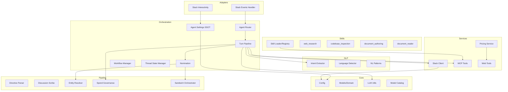

# SlackAgenticPanel — Codebase Analysis & Improvement Suggestions

## Executive Summary

SlackAgenticPanel is a **multi-agent orchestration platform** that integrates Slack as a conversation frontend with LLM backends (via LiteLLM) and MCP-based tooling. It powers structured "panel discussions" where multiple AI personas (Architect, Visionary, Sceptic, etc.) collaboratively analyze user prompts in Slack threads using configurable orchestration modes (Sandwich, Fixed).

The codebase is **well-structured at the macro level**, with clean domain separation across ~17 Python packages. The architecture shows thoughtful engineering: dependency-injected pipelines, declarative skill loading, atomic file writes, and a layered state management system. However, there are several areas where targeted improvements would meaningfully enhance reliability, maintainability, and scalability.

---

## Architecture Overview



---

## What's Working Well

| Area | Strength |
|---|---|
| **Turn Pipeline Architecture** | 5-stage mixin-based pipeline ([`turn_pipeline.py`](file:///c:/Users/Hp/Documents/agy2-projects/SlackAgenticPanel/orchestration/turn_pipeline.py)) with full DI — enables clean testing |
| **Declarative Skills System** | SKILL.md frontmatter + progressive disclosure via `load_skill` is elegant and extensible |
| **Thread State Decomposition** | Clean split into [`DiscussionStateStore`](file:///c:/Users/Hp/Documents/agy2-projects/SlackAgenticPanel/orchestration/state/discussion_store.py), [`TurnRetryStateStore`](file:///c:/Users/Hp/Documents/agy2-projects/SlackAgenticPanel/orchestration/state/retry_store.py), [`ThreadContextStore`](file:///c:/Users/Hp/Documents/agy2-projects/SlackAgenticPanel/orchestration/state/context_store.py) |
| **Atomic Persistence** | Workflow manager uses `tempfile` + `os.replace` for crash-safe writes |
| **Error Classification** | [`classify_agent_error()`](file:///c:/Users/Hp/Documents/agy2-projects/SlackAgenticPanel/core/llm_utils.py#L38-L117) provides structured retry logic per error type |
| **Security** | HMAC signature verification, path sandboxing in MCP tools, SSRF protections in web tools |
| **Test Coverage** | 34 test files covering integration, unit, and edge cases |

---

## Suggestions by Category

### 🔴 High Priority — Reliability & Correctness

#### 1. `slack_client.py` is a 1,622-line monolith

[`slack_client.py`](file:///c:/Users/Hp/Documents/agy2-projects/SlackAgenticPanel/services/slack_client.py) (63 KB) handles App Home rendering, thread history, file fetching, agent response posting, usage channel management, and Block Kit view construction — all in a single file. This is the largest source file by far and a maintenance bottleneck.

**Suggestion:** Split into focused modules:
```
services/
  slack/
    __init__.py              # Re-exports for backward compatibility
    client.py                # AsyncWebClient initialization, low-level API calls
    history.py               # fetch_thread_history, thread context
    files.py                 # fetch_thread_files, file download/processing
    posting.py               # post_agent_response, post_system_message, update
    app_home.py              # build_app_home_view, publish_app_home
    usage_channel.py         # get_or_create_usage_channel, post_usage_message
```

---

#### 2. `agent_settings.py` is 1,003 lines — SSOT responsibilities are overloaded

[`agent_settings.py`](file:///c:/Users/Hp/Documents/agy2-projects/SlackAgenticPanel/orchestration/agent_settings.py) (42 KB) combines agent CRUD, orchestration mode management, circuit breaker config, scribe toggle, workflow activation, backup/restore, and module-level function re-exports. Its `AgentSettingsManager` class handles at least 6 distinct responsibilities.

**Suggestion:** Extract coherent sub-managers:
- `AgentCRUDManager` — agent enable/disable, model changes, persona management
- `OrchestrationModeManager` — sandwich/fixed config, workflow activation
- `SettingsPersistence` — load/save/backup/restore, atomic writes, mtime tracking

---

#### 3. Unbounded in-memory state growth risk

[`ThreadStateManager`](file:///c:/Users/Hp/Documents/agy2-projects/SlackAgenticPanel/orchestration/thread_state.py#L18-L281) uses `dict[tuple[str, str], ...]` maps for all thread state. While there's a periodic cleanup task and TTL eviction, several satellite maps are **not cleaned** by `cleanup_thread()`:

- [`THREAD_NOTE_MSG_MAP`](file:///c:/Users/Hp/Documents/agy2-projects/SlackAgenticPanel/agents/thread_notes_agent.py#L18) in `thread_notes_agent.py`
- [`THREAD_LOCKS`](file:///c:/Users/Hp/Documents/agy2-projects/SlackAgenticPanel/agents/thread_notes_agent.py#L21) in `thread_notes_agent.py`
- [`usage_locks`](file:///c:/Users/Hp/Documents/agy2-projects/SlackAgenticPanel/agents/usage_agent.py#L41) and [`running_usage_tasks`](file:///c:/Users/Hp/Documents/agy2-projects/SlackAgenticPanel/agents/usage_agent.py#L42) in `ThreadUsageTracker`
- [`CHANNEL_NAME_CACHE`](file:///c:/Users/Hp/Documents/agy2-projects/SlackAgenticPanel/services/slack_client.py#L26) in `slack_client.py`

**Suggestion:** Either:
- Centralize cleanup by registering satellite stores as lifecycle hooks on `ThreadStateManager`
- Or use a `WeakValueDictionary` or LRU-bounded cache for satellite maps

---

#### !!++!! 4. Module-level backward-compatibility aliases are a ticking time bomb

[`thread_state.py`](file:///c:/Users/Hp/Documents/agy2-projects/SlackAgenticPanel/orchestration/thread_state.py#L286-L353) exports **68 module-level aliases** pointing to the singleton's bound methods. This creates a vast implicit API surface. Any refactor to `ThreadStateManager` silently breaks code importing these aliases.

**Suggestion:** 
- Add a deprecation log or `warnings.warn()` wrapper to these aliases
- Migrate callers to use `thread_state_manager.method()` directly
- Eventually remove the flat aliases in a future release

---

### 🟡 Medium Priority — Architecture & Design

#### 5. Dual prompt systems — `EXTRACTOR_SYSTEM_PROMPT` vs dynamic skill catalog

[`intent_extractor.py`](file:///c:/Users/Hp/Documents/agy2-projects/SlackAgenticPanel/nlp/intent_extractor.py#L17-L36) defines a hardcoded `EXTRACTOR_SYSTEM_PROMPT`, but the `IntentExtractor.system_prompt` property dynamically generates the prompt via [`skill_registry.build_extractor_catalog_prompt()`](file:///c:/Users/Hp/Documents/agy2-projects/SlackAgenticPanel/skills/loader.py#L207-L263). The hardcoded version is dead code unless the skill registry import fails.

**Suggestion:** Remove the hardcoded fallback prompt or explicitly document it as the emergency fallback. The current setup is confusing — the hardcoded prompt doesn't list the same actions as the dynamic one.

---

#### 6. `_get_hook()` resolution has 6 fallback layers — overly complex DI

[`TurnPipeline._get_hook()`](file:///c:/Users/Hp/Documents/agy2-projects/SlackAgenticPanel/orchestration/turn_pipeline.py#L192-L243) resolves dependencies through 6 layers: injected deps → hooks dict → router module → turn_pipeline module → default argument → canonical fallback map. This makes debugging difficult and is a sign that the DI boundaries haven't stabilized.

**Suggestion:** Collapse to 2 layers: (1) constructor-injected deps, (2) canonical fallback map. Remove the `sys.modules` probing and router monkeypatch layers.

---

#### 7. No abstract base class or Protocol for agent/pipeline contracts

The codebase uses duck typing extensively. For example, the `TurnPipeline` constructor accepts `Callable[..., Any]` for all its injected functions. There are no defined protocols for what a "Slack poster" or "history fetcher" looks like.

**Suggestion:** Define `typing.Protocol` contracts:
```python
class HistoryFetcher(Protocol):
    async def __call__(
        self, channel_id: str, thread_ts: str, *, bot_user_id: str | None = None
    ) -> list[dict[str, Any]]: ...

class SlackPoster(Protocol):
    async def __call__(
        self, channel_id: str, thread_ts: str, text: str, *, username: str, icon_url: str | None = None
    ) -> dict[str, Any]: ...
```

This gives you IDE autocompletion and catches contract mismatches at type-check time.

---

#### 8. Config module has circular import risk via `prompts.build_agent_prompt`

[`core/config.py`](file:///c:/Users/Hp/Documents/agy2-projects/SlackAgenticPanel/core/config.py#L9) imports from `prompts` at module top level (`from prompts import build_agent_prompt`), and [`prompts/builder.py`](file:///c:/Users/Hp/Documents/agy2-projects/SlackAgenticPanel/prompts/builder.py#L171-L197) imports from `skills` and `core.config`. This creates a fragile import graph where adding a new import to either module risks `ImportError`.

**Suggestion:** Move the prompt-building calls (`THREAD_NOTES_PROMPT`, `USAGE_AGENT_PROMPT`, `PRICING_AGENT_PROMPT`) out of `config.py`. These are not configuration values — they're runtime-constructed artifacts. Consider lazy initialization or a separate `prompt_constants.py`.

---

#### 9. `ExtractedIntent` uses mixed dataclass + manual `__init__` pattern

[`ExtractedIntent`](file:///c:/Users/Hp/Documents/agy2-projects/SlackAgenticPanel/core/models.py#L121-L305) is decorated with `@dataclass` but defines a custom `__init__` that accepts keyword arguments like `max_words`, `min_words`, `history`, `file_use`, `target_file`, `excluded_agents`, and `**extra_modifiers`. This bypasses dataclass field initialization and creates confusion about which fields are "real" vs property-based.

**Suggestion:** Either:
- Drop `@dataclass` and use a plain class with `__init__` + `__repr__`/`__eq__`
- Or use a `@classmethod` factory (e.g., `ExtractedIntent.from_user_directives(...)`) to handle the legacy parameter mapping, keeping the dataclass clean

---

### 🟢 Lower Priority — Code Quality & Maintainability

#### 10. Missing type annotations on `from_dict` / `to_dict` return types

All domain models (`Turn`, `SessionContext`, `DiscussionBrief`, `WorkflowPreset`, etc.) use `dict[str, Any]` for serialization. Consider using `TypedDict` definitions for these shapes, especially for `agent_settings.json` entries and API responses.

---

#### 11. Hardcoded import of `litellm.completion` should use the DI boundary

[`intent_extractor.py`](file:///c:/Users/Hp/Documents/agy2-projects/SlackAgenticPanel/nlp/intent_extractor.py#L106) and [`pricing_service.py`](file:///c:/Users/Hp/Documents/agy2-projects/SlackAgenticPanel/services/pricing_service.py#L11) call `litellm.completion` directly, bypassing the `execute_llm_with_retry` infrastructure. This means:
- No retry logic for intent extraction or pricing lookups
- No supersession checks
- No unified error classification

**Suggestion:** Route all LLM calls through `execute_llm_with_retry` or at minimum through a shared wrapper that provides retries and error classification.

---

#### 12. `requirements.txt` should pin `pyyaml` explicitly

[`skills/loader.py`](file:///c:/Users/Hp/Documents/agy2-projects/SlackAgenticPanel/skills/loader.py#L13) imports `yaml`, but `pyyaml` is not listed in [`requirements.txt`](file:///c:/Users/Hp/Documents/agy2-projects/SlackAgenticPanel/requirements.txt). It's likely pulled transitively via `litellm`, but this is fragile.

**Suggestion:** Add `pyyaml>=6.0,<7.0` to requirements.txt.

---

#### 13. `language_detector.py` maps Bosnian and Serbian to "Croatian"

[`LANGUAGE_NAME_MAP`](file:///c:/Users/Hp/Documents/agy2-projects/SlackAgenticPanel/nlp/language_detector.py#L20-L50) normalizes "bosnian", "bosanski", "serbian", "srpski" all to `"Croatian"`. While these languages are mutually intelligible, this conflation may be undesirable depending on your user base and could be politically sensitive.

**Suggestion:** Consider mapping to a neutral umbrella term like `"BCS"` (Bosnian-Croatian-Serbian), or preserving the detected distinction while treating them equivalently at the prompt-formatting level.

---

#### 14. No structured logging / tracing correlation

All logging uses plain string formatting (`f"[MODULE] message {var}"`). For a multi-agent system processing concurrent threads, correlating logs to specific thread discussions is challenging.

**Suggestion:** Adopt structured logging with `structlog` or Python's `logging` with a custom JSON formatter. Include `channel_id`, `thread_ts`, `agent_key`, and `generation` as structured fields. This also enables log aggregation and alerting.

---

#### 15. Missing `py.typed` marker and no `pyproject.toml`

The project uses `requirements.txt` but has no `pyproject.toml`, no `py.typed` marker, and no type-checking CI step. Given the extensive use of type hints throughout the codebase, this is low-hanging fruit.

**Suggestion:** Add a minimal `pyproject.toml` with `[tool.mypy]` or `[tool.pyright]` configuration and a `py.typed` marker for tooling support.

---

## Technical Debt Summary

| Item | Effort | Impact | Priority |
|---|---|---|---|
| Split `slack_client.py` (1,622 lines) | 🔨 Medium | Maintainability | 🔴 High |
| Split `agent_settings.py` (1,003 lines) | 🔨 Medium | Maintainability | 🔴 High |
| Centralize satellite state cleanup | 🔨 Low | Reliability | 🔴 High |
| Deprecate module-level thread state aliases | 🔨 Low | Maintainability | 🔴 High |
| Remove dead `EXTRACTOR_SYSTEM_PROMPT` | 🔨 Trivial | Clarity | 🟡 Medium |
| Simplify `_get_hook()` fallback chain | 🔨 Low | Debuggability | 🟡 Medium |
| Add `Protocol` contracts for DI | 🔨 Low | Type Safety | 🟡 Medium |
| Break circular import in `config.py` ↔ `prompts` | 🔨 Low | Robustness | 🟡 Medium |
| Clean up `ExtractedIntent` mixed pattern | 🔨 Medium | Clarity | 🟡 Medium |
| Route all LLM calls through retry infra | 🔨 Low | Reliability | 🟢 Lower |
| Add `pyyaml` to requirements.txt | 🔨 Trivial | Correctness | 🟢 Lower |
| Language map political sensitivity | 🔨 Trivial | Correctness | 🟢 Lower |
| Structured logging with correlation IDs | 🔨 Medium | Observability | 🟢 Lower |
| Add `pyproject.toml` + type checking CI | 🔨 Low | Quality | 🟢 Lower |

---

## Codebase Metrics

| Metric | Value |
|---|---|
| **Source modules** | ~45 Python files |
| **Test files** | 34 |
| **Largest file** | [`slack_client.py`](file:///c:/Users/Hp/Documents/agy2-projects/SlackAgenticPanel/services/slack_client.py) — 1,622 lines (63 KB) |
| **Second largest** | [`agent_settings.py`](file:///c:/Users/Hp/Documents/agy2-projects/SlackAgenticPanel/orchestration/agent_settings.py) — 1,003 lines (42 KB) |
| **Agent personas** | 17 debate agents + 6 system agents |
| **Skills** | 12 declarative skills |
| **Dependencies** | 12 direct (FastAPI, LiteLLM, Slack SDK, httpx, etc.) |
| **Orchestration modes** | 2 (Sandwich, Fixed) |
