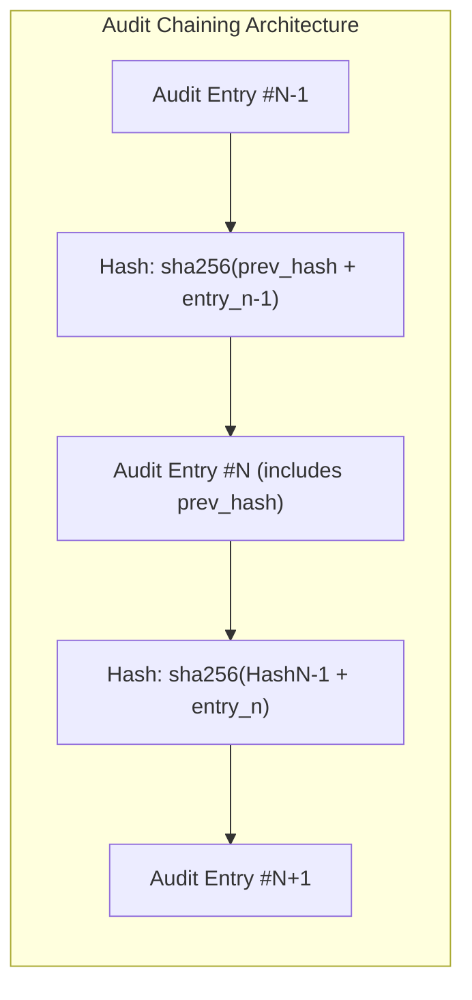

# Audit Logging & Cryptographic Integrity

This document details **Izvor**'s non-repudiable audit logging system, cryptographic hash-chaining architecture, and automated integrity validation guards.

---

## 🔒 Architectural Overview

Enterprise governance requires an immutable record of system events, administrative changes, and security actions. Izvor implements a hash-chained, HMAC-signed JSON Lines (JSONL) audit log managed by [`services/audit_logger.py`](file:///c:/Users/Hp/Documents/agy2-projects/Izvor/services/audit_logger.py).



Every audit file is organized monthly (e.g., `audit/audit_2026_10.jsonl`). Each line is a self-contained JSON object bound cryptographically to its predecessor.

---

## ⛓️ Hash Chaining & HMAC Signatures

### 1. Sequential Hash Binding
Each record contains:
- `sequence_number`: Monotonically increasing 64-bit integer.
- `prev_hash`: The cryptographic SHA-256 hash of the immediately preceding log line. For the first record of a log file, `prev_hash` is initialized with a known genesis seed.
- `current_hash`: Calculated as:
  $$\text{current\_hash} = \text{SHA-256}(\text{prev\_hash} + \text{canonical\_json\_payload})$$

### 2. HMAC Key Continuity
When `AUDIT_HMAC_SECRET` is configured:
- An HMAC signature is calculated for each record.
- If the secret is rotated improperly or a third party modifies any historic line, the entire downstream hash chain becomes invalid.

---

## 🛡️ Continuous Integrity Validation Guards

To detect tampering, file truncation, or key discrepancies immediately, Izvor runs two validation layers:

### 1. Startup Verification
During server boot in [`main.py`](file:///c:/Users/Hp/Documents/agy2-projects/Izvor/main.py#L112-L166), [`AppIntegrityValidator.check_audit_log_integrity()`](file:///c:/Users/Hp/Documents/agy2-projects/Izvor/core/integrity_checks.py) scans all historical and active audit files:
- Verifies line-by-line hash continuity.
- Verifies sequence number monotonicity (no missing or skipped lines).
- Confirms HMAC secret continuity.
- If corruption or key mismatches are discovered, startup raises a critical alert and notifies the administrative Slack channel immediately.

### 2. Scheduled Background Guard (`periodic_audit_integrity_guard`)
- Configured in [`main.py:L71-L100`](file:///c:/Users/Hp/Documents/agy2-projects/Izvor/main.py#L71-L100).
- Runs automatically every **12 hours** (43,200 seconds).
- Validates that logs written during runtime remain unaltered and undamaged on disk.

---

## 🚨 Emergency Alerts on Integrity Breaches

If any violation occurs (e.g., an unauthorized edit or corrupted disk sector), [`send_admin_audit_alert`](file:///c:/Users/Hp/Documents/agy2-projects/Izvor/services/audit_logger.py) formats and posts a high-priority incident notice to the administrative Slack channel:

```
🚨 *CRITICAL SECURITY ALERT: Audit Chain Tampering Detected*
------------------------------------------------------------
• Violation: Hash mismatch at sequence #142 in audit_2026_10.jsonl
• Expected Hash: 4f8a9b...
• Computed Hash: e12c44...
• Action: Immediate administrative audit inspection required.
```

---

## ⚡ Performance & Amplification Defense

### 1. In-Memory Tail Caching & Reverse Seek
- **Tail Caching**: `AuditLogger` maintains in-memory tracking of the current sequence number and latest cryptographic entry hash (`_cached_last_state`), enabling $O(1)$ sequential appends without disk re-reading.
- **Cold Boot Reverse Seek**: When initializing on an existing audit partition, `get_last_state()` inspects the end of the partition file via reverse byte seek rather than parsing all preceding records into RAM.

### 2. Amplification Defense & Sliding-Window Burst Suppression
- Incoming unverified Slack requests encountering HMAC signature mismatches generate `AUTH_FAILURE` audit records.
- To prevent audit log exhaustion attacks or disk flooding, [`core/slack_security.py`](file:///c:/Users/Hp/Documents/agy2-projects/Izvor/core/slack_security.py) implements a 60-second sliding-window burst limiter.
- Up to 5 discrete failure events are logged per client IP within each 60-second window; subsequent failures are counted and logged as an aggregated summary event upon window expiration.

