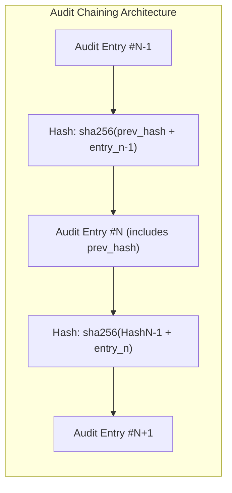

# Audit Logging & Cryptographic Integrity

This document details **Izvor**'s non-repudiable audit logging system, cryptographic hash-chaining architecture, and automated integrity validation guards.

---

## 🔒 Architectural Overview

Enterprise governance requires an immutable record of system events, administrative changes, and security actions. Izvor implements a hash-chained, HMAC-signed JSON Lines (JSONL) audit log managed by [`services/audit_logger.py`](file:///c:/Users/Hp/Documents/agy2-projects/Izvor/services/audit_logger.py).



Every audit file is organized monthly (e.g., `audit/audit_2026_10.jsonl`). Each line is a self-contained JSON object bound cryptographically to its predecessor.

---

## ⛓️ Hash Chaining & HMAC Signatures

### 1. Sequential Hash Binding
Each record contains:
- `seq`: Monotonically increasing 64-bit integer sequence number.
- `prev_hash`: The cryptographic SHA-256 hash of the immediately preceding log line. For the first record of a log file, `prev_hash` is initialized with a known genesis seed.
- `entry_hash`: Calculated as:
  $$\text{entry\_hash} = \text{SHA-256}(\text{prev\_hash} + \text{canonical\_json\_payload})$$

### 2. HMAC Key Continuity
When `AUDIT_HMAC_SECRET` is configured:
- An HMAC signature is calculated for each record.
- If the secret is rotated improperly or a third party modifies any historic line, the entire downstream hash chain becomes invalid.

---

## 🛡️ Continuous Integrity Validation Guards

To detect tampering, file truncation, or key discrepancies immediately, Izvor runs two validation layers:

### 1. Startup Verification
During server boot in [`main.py`](file:///c:/Users/Hp/Documents/agy2-projects/Izvor/main.py#L112-L166), [`AppIntegrityValidator.check_audit_log_integrity()`](file:///c:/Users/Hp/Documents/agy2-projects/Izvor/core/integrity_checks.py) scans all historical and active audit files:
- Verifies line-by-line hash continuity.
- Verifies sequence number monotonicity (no missing or skipped lines).
- Confirms HMAC secret continuity.
- If corruption or key mismatches are discovered, startup raises a critical alert and notifies the administrative Slack channel immediately.

### 2. Scheduled Background Guard (`periodic_audit_integrity_guard`)
- Configured in [`main.py:L71-L100`](file:///c:/Users/Hp/Documents/agy2-projects/Izvor/main.py#L71-L100).
- Runs automatically every **12 hours** (43,200 seconds).
- Validates that logs written during runtime remain unaltered and undamaged on disk.

---

## 🚨 Emergency Alerts on Integrity Breaches

If any cryptographic or hash continuity violation occurs (e.g., an unauthorized edit, truncated records, or a missing/mismatched secret key), [`send_admin_audit_alert()`](file:///c:/Users/Hp/Documents/agy2-projects/Izvor/services/audit_logger.py#L716-L775) formats and dispatches a high-priority incident notice.

### 1. Alert Routing & Delivery Hierarchy
Audit alerts follow a strict three-tier routing strategy:
1. **Primary Delivery (Direct Message via Slack)**:
   - Izvor resolves the designated administrator via `SLACK_ADMIN_USER_IDS` and invokes `open_dm_channel()`.
   - The security alert is delivered as a private, high-visibility 1-on-1 direct message directly to the administrator.
2. **Fallback Delivery (`SLACK_TEST_CHANNEL_ID` / `#bot-testing`)**:
   - If `SLACK_ADMIN_USER_IDS` is unset or empty, or if Slack's `conversations.open` API fails to open an administrative DM, the alert automatically falls back to `SLACK_TEST_CHANNEL_ID` (the `#bot-testing` channel) so that breach notices are never lost.
3. **Application Logs & Admin Dashboard**:
   - Every breach triggers a `logger.critical()` entry (e.g., `[SECURITY STARTUP]` or `[SECURITY GUARD]`).
   - The `/admin` web interface status reflects the failure upon subsequent checks.

### 2. Exact Slack Message Layout
Alerts sent to Slack are posted by the `Security Audit Guard` persona and follow this exact structure:

```text
🚨 *[SECURITY CRITICAL] Periodic Audit Guard Integrity Breach*
Periodic scan identified corruption or tampering in the active audit trail.
• *Violations:* `Hash mismatch at sequence #142 in audit_2026_10.jsonl`
• *Files:* `audit/audit_2026_10.jsonl`
👉 _Action Required: Run `python -m services.audit_logger --verify` for forensic diagnostics._
```

### 3. Differentiating Production Alerts vs. Test Payloads
Because test suites and live scenarios both interact with Slack channels during integration testing, use the following matrix to identify real production breach alerts:

| Alert Category | Title / Identifier | Payload Characteristics | Origin | Action Required |
|:---|:---|:---|:---|:---|
| **Production Breach** | `Periodic Audit Guard Integrity Breach` | Contains verified `Violations` and corrupted `Files` paths | [`main.py:L101`](file:///c:/Users/Hp/Documents/agy2-projects/Izvor/main.py#L101) (periodic 12h guard) | **CRITICAL**: Immediate forensic inspection and snapshot comparison. |
| **Production Breach** | `Startup Audit Integrity Alert: Secret Mismatch (...)` | Contains `Status`, `Warning`, `Last File`, `Last Seq`, and `Errors` | [`main.py:L158`](file:///c:/Users/Hp/Documents/agy2-projects/Izvor/main.py#L158) (startup boot check) | **CRITICAL**: Confirm `AUDIT_HMAC_SECRET` rotation or restore audit logs. |
| **Production Warning** | `AUDIT_HMAC_SECRET Discrepancy (...)` | Contains `Status`, `Warning`, `Last File`, and `Last Seq` | [`main.py:L175`](file:///c:/Users/Hp/Documents/agy2-projects/Izvor/main.py#L175) (startup boot check) | **HIGH**: Key mismatch detected between historic records and runtime environment. |
| **Production Breach** | `Startup Audit Log Integrity Violation` | Contains `Violations` list and `Files` | [`main.py:L193`](file:///c:/Users/Hp/Documents/agy2-projects/Izvor/main.py#L193) (startup boot check) | **CRITICAL**: Immediate disk inspection and chain repair. |
| **Synthetic Test** | `Test Security Breach` | Message: `This is an automated test alert in English.` Details: `line: 42`, `file: audit_2026_10.jsonl` | [`tests/test_audit_logger.py`](file:///c:/Users/Hp/Documents/agy2-projects/Izvor/tests/test_audit_logger.py#L251) | None (mock test artifact; isolated by `monkeypatch`). |
| **E2E Scenario** | `E2E Test Runner` scenarios | Contains scenario markers like `E2E-101`, test persona names, and simulation tags | [`e2e_testing_harness/test_e2e_suite.py`](file:///c:/Users/Hp/Documents/agy2-projects/Izvor/e2e_testing_harness/test_e2e_suite.py) | None (automated E2E verification traffic in `#bot-testing`). |

---

## 🔍 Forensic CLI Verification & Diagnostics

When an alert fires or during compliance auditing, administrators can run the built-in audit CLI directly:

### 1. Integrity Verification (`--verify`)
Scans all monthly JSONL files in the audit directory, checking hash chaining, monotonically increasing sequence numbers, and HMAC signatures:

```bash
python -m services.audit_logger --verify
```

**Expected Healthy Output:**
```text
=== Izvor Audit Log Integrity Verification ===
Scanned Files:    audit_2026_10.jsonl
Total Records:    1520
Last Seq Number:  1520
Last Entry Hash:  a8b79f2c140938...
HMAC Key Status:  MATCH (AUDIT_HMAC_SECRET valid across all records)

[VERIFIED] All cryptographic audit chains are fully intact. No tampering detected.
```

To restrict verification to a specific month:
```bash
python -m services.audit_logger --verify --month 2026-10
```

### 2. Secret Key Continuity Check (`--check-secret`)
Validates whether the runtime `AUDIT_HMAC_SECRET` matches the key used to sign the latest record in the log file:

```bash
python -m services.audit_logger --check-secret
```

### 3. Log Statistics Overview (`--stats`)
Displays log directory sizing, event counts, latest sequence number, and partition file breakdown:

```bash
python -m services.audit_logger --stats
```

### 4. Create Archival Snapshot (`--snapshot`)
Generates an immutable `.tar.gz` snapshot of the active audit trail and updates the SHA-256 manifest:

```bash
python -m services.audit_logger --snapshot
```

---

## ⚡ Performance & Amplification Defense

### 1. In-Memory Tail Caching & Reverse Seek
- **Tail Caching**: `AuditLogger` maintains in-memory tracking of the current sequence number and latest cryptographic entry hash (`_cached_last_state`), enabling $O(1)$ sequential appends without disk re-reading.
- **Cold Boot Reverse Seek**: When initializing on an existing audit partition, `get_last_state()` inspects the end of the partition file via reverse byte seek rather than parsing all preceding records into RAM.

### 2. Amplification Defense & Sliding-Window Burst Suppression
- Incoming unverified Slack requests encountering HMAC signature mismatches generate `AUTH_FAILURE` audit records.
- To prevent audit log exhaustion attacks or disk flooding, [`core/slack_security.py`](file:///c:/Users/Hp/Documents/agy2-projects/Izvor/core/slack_security.py) implements a 60-second sliding-window burst limiter.
- Up to 5 discrete failure events are logged per client IP within each 60-second window; subsequent failures are counted and logged as an aggregated summary event upon window expiration.

