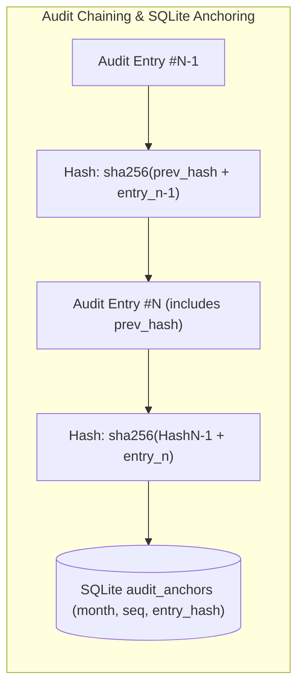

# Audit Logging & Cryptographic Integrity

This document details **Izvor**'s non-repudiable audit logging system, cryptographic hash-chaining architecture, SQLite head-hash anchoring (`audit_anchors`), and automated integrity validation guards.

---

## 🔒 Architectural Overview

Enterprise governance requires an immutable record of system events, administrative changes, and security actions. Izvor implements a hash-chained, HMAC-signed JSON Lines (JSONL) audit log managed by [`services/audit_logger.py`](file:///c:/Users/Hp/Documents/agy2-projects/Izvor/engine/services/audit_logger.py), paired with SQLite head-hash anchors in `data/izvor.db`.



Every audit file is organized monthly (e.g., `data/audit/audit_2026_10.jsonl`). Each line is a self-contained JSON object bound cryptographically to its predecessor, and the latest `(month, seq, entry_hash)` is anchored in the SQLite `audit_anchors` table.

---

## ⛓️ Hash Chaining, HMAC Signatures & SQLite Anchors

### 1. Sequential Hash Binding
Each record contains:
- `seq`: Monotonically increasing 64-bit integer sequence number.
- `prev_hash`: The cryptographic SHA-256 hash of the immediately preceding log line. For the first record of a log file, `prev_hash` is initialized with a known genesis seed.
- `entry_hash`: Calculated as:
  $$\text{entry\_hash} = \text{SHA-256}(\text{prev\_hash} + \text{canonical\_json\_payload})$$

### 2. HMAC Key Continuity
When `AUDIT_HMAC_SECRET` is configured:
- An HMAC signature is calculated for each record.
- If the secret is rotated improperly or a third party modifies any historic line, the entire downstream hash chain becomes invalid.

### 3. SQLite Head-Hash Anchoring (`audit_anchors`)
A classic weakness of file-only hash chains is **tail truncation** (where an attacker deletes the last $K$ lines of a JSONL file or deletes the entire file so the remaining prefix still looks internally valid).
- Every write to `audit_YYYY_MM.jsonl` updates the `audit_anchors` table in SQLite (`data/izvor.db`) with `(month, seq, entry_hash, anchored_at)`.
- During integrity verification, `verify_audit_logs()` compares the JSONL file's final `(seq, entry_hash)` against the SQLite anchor. If the file has fewer records than `audit_anchors.seq`, lacks a matching `entry_hash`, or is missing on disk while an anchor exists, verification immediately flags a critical **Tail Truncation / Anchor Mismatch** violation.

---

## 🛡️ Continuous Integrity Validation Guards

To detect tampering, file truncation, or key discrepancies immediately, Izvor runs two validation layers:

### 1. Startup Verification
During server boot in [`main.py`](file:///c:/Users/Hp/Documents/agy2-projects/Izvor/main.py#L164-L224), [`AppIntegrityValidator.check_audit_log_integrity()`](file:///c:/Users/Hp/Documents/agy2-projects/Izvor/engine/orchestration/integrity_checks.py) scans all historical and active audit files:
- Verifies line-by-line hash continuity and sequence monotonicity.
- Verifies `audit_anchors` head-hash consistency against SQLite.
- Confirms HMAC secret continuity.
- If corruption, truncation, or key mismatches are discovered, startup raises a critical alert and notifies all configured Slack administrators immediately.

### 2. Scheduled Background Guard (`periodic_audit_integrity_guard`)
- Configured in [`main.py:L79-L108`](file:///c:/Users/Hp/Documents/agy2-projects/Izvor/main.py#L79-L108).
- Runs periodically (default: **12 hours** / `43200.0` seconds, dynamically loaded from `audit_integrity_check_interval_seconds` in `system_settings.json`).
- Validates that logs written during runtime remain unaltered and match SQLite `audit_anchors`.

---

## 🚨 Emergency Alerts on Integrity Breaches

If any cryptographic, anchor, or hash continuity violation occurs, [`send_admin_audit_alert()`](file:///c:/Users/Hp/Documents/agy2-projects/Izvor/engine/services/audit_logger.py) formats and dispatches a high-priority incident notice.

### 1. Multi-Admin Alert Routing & Delivery Hierarchy
Audit alerts follow a strict three-tier routing strategy:
1. **Primary Delivery (Direct Message to All Configured Slack Admins)**:
   - Izvor iterates through **all** administrator IDs configured in `SLACK_ADMIN_USER_IDS`, opens a DM channel (`open_dm_channel(admin_id)`), and delivers the security alert to every administrator.
2. **Fallback Delivery (`SLACK_TEST_CHANNEL_ID` / `#bot-testing`)**:
   - If `SLACK_ADMIN_USER_IDS` is unset or empty, or if all DM deliveries fail, the alert automatically falls back to `SLACK_TEST_CHANNEL_ID` (`#bot-testing`) so that breach notices are never lost.
3. **Application Logs & Admin API**:
   - Every breach triggers a `logger.critical()` entry and surfaces in `GET /api/audit/status`.

### 2. Exact Slack Message Layout
Alerts sent to Slack are posted by the `Security Audit Guard` persona and follow this exact structure:

```text
🚨 *[SECURITY CRITICAL] Periodic Audit Guard Integrity Breach*
Periodic scan identified corruption or tampering in the active audit trail.
• *Violations:* `Hash mismatch at sequence #142 in audit_2026_10.jsonl`
• *Files:* `data/audit/audit_2026_10.jsonl`
👉 _Action Required: Run `python -m services.audit_logger --verify` for forensic diagnostics._
```

### 3. Differentiating Production Alerts vs. Test Payloads
Use the following matrix to identify real production breach alerts:

| Alert Category | Title / Identifier | Payload Characteristics | Origin | Action Required |
|:---|:---|:---|:---|:---|
| **Production Breach** | `Periodic Audit Guard Integrity Breach` | Contains verified `Violations` and corrupted `Files` paths | [`main.py:L100`](file:///c:/Users/Hp/Documents/agy2-projects/Izvor/main.py#L100) (periodic integrity guard) | **CRITICAL**: Immediate forensic inspection and snapshot comparison. |
| **Security Alert** | `SECURITY_ALERT` / `GUARDRAIL_FAIL_CLOSED_BLOCKED` | Semantic prompt injection detection record or fail-closed block | [`services/security/guardrail.py`](file:///c:/Users/Hp/Documents/agy2-projects/Izvor/engine/services/security/guardrail.py) | **HIGH**: Review user prompt and threat actor profile. |
| **Privilege Alert** | `UNAUTHORIZED_DIRECTIVE_ATTEMPT` | Non-admin user attempted `/grant_skill`, `/revoke_constraint`, or `=off` override | [`orchestration/stages/directive_handlers.py`](file:///c:/Users/Hp/Documents/agy2-projects/Izvor/engine/orchestration/stages/directive_handlers.py) | **MEDIUM**: Review user activity in thread. |
| **Production Breach** | `Startup Audit Integrity Alert: Secret Mismatch (...)` | Contains `Status`, `Warning`, `Last File`, `Last Seq`, and `Errors` | [`main.py:L183`](file:///c:/Users/Hp/Documents/agy2-projects/Izvor/main.py#L183) (startup boot check) | **CRITICAL**: Confirm `AUDIT_HMAC_SECRET` rotation or restore audit logs. |
| **Production Warning** | `AUDIT_HMAC_SECRET Discrepancy (...)` | Contains `Status`, `Warning`, `Last File`, and `Last Seq` | [`main.py:L200`](file:///c:/Users/Hp/Documents/agy2-projects/Izvor/main.py#L200) (startup boot check) | **HIGH**: Key mismatch detected between historic records and runtime environment. |
| **Production Breach** | `Startup Audit Log Integrity Violation` | Contains `Violations` list and `Files` | [`main.py:L218`](file:///c:/Users/Hp/Documents/agy2-projects/Izvor/main.py#L218) (startup boot check) | **CRITICAL**: Immediate disk inspection and chain repair. |
| **Synthetic Test** | `Test Security Breach` | Message: `This is an automated test alert in English.` Details: `line: 42`, `file: audit_2026_10.jsonl` | [`tests/test_audit_logger.py`](file:///c:/Users/Hp/Documents/agy2-projects/Izvor/tests/test_audit_logger.py) | None (mock test artifact; isolated by `monkeypatch`). |
| **E2E Scenario** | `E2E Test Runner` scenarios | Contains scenario markers like `E2E-101`, test persona names, and simulation tags | [`e2e_testing_harness/test_e2e_suite.py`](file:///c:/Users/Hp/Documents/agy2-projects/Izvor/e2e_testing_harness/test_e2e_suite.py) | None (automated E2E verification traffic in `#bot-testing`). |

---

## 🔍 Forensic CLI Verification & Diagnostics

When an alert fires or during compliance auditing, administrators can run the built-in audit CLI directly:

### 1. Integrity Verification (`--verify`)
Scans all monthly JSONL files in the audit directory, checking hash chaining, monotonically increasing sequence numbers, SQLite `audit_anchors`, and HMAC signatures:

```bash
python -m services.audit_logger --verify
```

**Expected Healthy Output:**
```text
=== Izvor Audit Log Integrity Verification ===
Scanned Files:    audit_2026_10.jsonl
Total Records:    1520
Last Seq Number:  1520
Last Entry Hash:  a8b79f2c140938...
HMAC Key Status:  MATCH (AUDIT_HMAC_SECRET valid across all records)

[VERIFIED] All cryptographic audit chains are fully intact. No tampering detected.
```

To restrict verification to a specific month:
```bash
python -m services.audit_logger --verify --month 2026-10
```

### 2. Secret Key Continuity Check (`--check-secret`)
```bash
python -m services.audit_logger --check-secret
```

### 3. Log Statistics Overview (`--stats`)
```bash
python -m services.audit_logger --stats
```

### 4. Create Archival Snapshot (`--snapshot`)
```bash
python -m services.audit_logger --snapshot
```

---

## ⚡ Non-Blocking Async Logging & Amplification Defense

### 1. Non-Blocking `log_audit_event_async` & Tail Caching
- **Async Offloading**: Hot-path async callers can use `log_audit_event_async()` to offload disk writes and SQLite anchor updates to a background thread without blocking the asyncio event loop.
- **Tail Caching & Reverse Seek**: `AuditLogger` caches `(seq, entry_hash)` in memory (`_cached_last_state`) for $O(1)$ sequential appends and uses reverse byte seek on cold boot.

### 2. Amplification Defense & Sliding-Window Burst Suppression
- Configured via `security_burst_limits` in `system_settings.json` and enforced in [`core/slack_security.py`](file:///c:/Users/Hp/Documents/agy2-projects/Izvor/engine/core/slack_security.py).
- Up to 5 discrete `AUTH_FAILURE` events are logged per client IP within each 60-second window (and 25 globally); subsequent failures are aggregated into a consolidated summary event upon window expiration.
