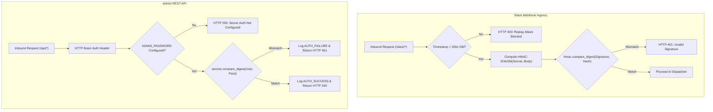

# Security & Authentication Architecture

This document details the security posture, authentication protocols, and cryptographic defenses implemented across **Izvor**.

---

## 🛡️ Defense-in-Depth Model

Izvor enforces security across two distinct attack surfaces:
1. **Public Webhook Ingress**: Validating requests originating from the Slack API platform.
2. **Administrative REST API**: Authenticating operators accessing `/api/*` endpoints.



---

## 📡 Slack Ingress: HMAC-SHA256 Signature Verification

Every incoming HTTP request to `/slack/events` or `/slack/interactivity` is inspected by [`core/slack_security.py`](file:///c:/Users/Hp/Documents/agy2-projects/SilvanAgora/core/slack_security.py).

### 1. Timestamp Freshness (Anti-Replay)
The header `X-Slack-Request-Timestamp` is compared against current system epoch time:
```python
if abs(time.time() - int(timestamp)) > 300:
    raise HTTPException(status_code=400, detail="Request timestamp out of bounds.")
```
Requests older than 5 minutes are discarded immediately to protect against recorded replay attacks.

### 2. Signature Computation
The raw request body is concatenated into the canonical format:
$$\text{Signature Base} = \text{"v0:"} + \text{timestamp} + \text{":"} + \text{raw\_body}$$
An HMAC-SHA256 digest is generated using `SLACK_SIGNING_SECRET`.

### 3. Constant-Time Comparison
The calculated digest is compared against `X-Slack-Signature` using `hmac.compare_digest` to eliminate timing side channels.

---

## 🔑 Administrative API: HTTP Basic Authentication

Administrative operations (inspecting registered skills, viewing audit integrity diagnostics, and triggering RAG index reconciliation) are served under `/api/*` and protected by HTTP Basic Auth in [`main.py`](file:///c:/Users/Hp/Documents/agy2-projects/SilvanAgora/main.py#L211-L270).

### 1. Mandatory Password Enforcement
If `ADMIN_PASSWORD` is not configured in `.env`, the server logs a critical warning on startup. Any request attempting to access `/api/*` is immediately blocked with HTTP 500/401 to ensure the endpoint cannot default to an unauthenticated state.

### 2. Timing Attack Defense
Authentication credentials are validated using `secrets.compare_digest`:
```python
is_correct_username = secrets.compare_digest(credentials.username.encode("utf8"), ADMIN_USERNAME.encode("utf8"))
is_correct_password = secrets.compare_digest(credentials.password.encode("utf8"), ADMIN_PASSWORD.encode("utf8"))
```

### 3. Non-Repudiable Audit Logging
Both successful logins and failed attempts emit immediate audit trail records to the non-repudiable log via [`services/audit_logger.py`](file:///c:/Users/Hp/Documents/agy2-projects/SilvanAgora/services/audit_logger.py):
- `AUTH_FAILURE` records log the actor IP, target endpoint, and timestamp with severity `CRITICAL`.
- `AUTH_SUCCESS` records capture the operator identity and session start.
