# Security & Authentication Architecture

This document details the security posture, authentication protocols, privilege boundaries, atomic HITL state transitions, and cryptographic defenses implemented across **Izvor**.

---

## 🛡️ Multi-Layer Defense-in-Depth Model

Izvor enforces rigorous security controls across all ingress, orchestration, execution, and storage layers:

```mermaid
graph TD
    subgraph Ingress Security
        SlackPOST["Slack Request (/slack/*)"] --> TimeCheck{Timestamp < 300s?}
        TimeCheck -->|No| ReplayRejection["HTTP 400: Replay Blocked"]
        TimeCheck -->|Yes| HMACCalc["HMAC-SHA256 Signature Verification"]
        HMACCalc -->|Mismatch| SigRejection["HTTP 401: Invalid Signature"]
        HMACCalc -->|Match| IngressOK["Pass to Event / Interactivity Handler"]
    end

    subgraph Administration & Interactivity Security
        AdminReq["API Request (/api/*)"] --> BasicAuth["HTTP Basic Auth Header"]
        BasicAuth --> ConstantTimeCompare{"secrets.compare_digest"}
        ConstantTimeCompare -->|Mismatch| AuthFailAudit["Log AUTH_FAILURE & HTTP 401"]
        ConstantTimeCompare -->|Match| AuthSuccessAudit["Log AUTH_SUCCESS & HTTP 200"]
        Interactivity["Slack Interactivity Payload"] --> ActionSpec["ActionSpec Whole-Payload Pre-Auth"]
        ActionSpec -->|Unauthorized| DenyAction["Fail Closed & Log AUTH_FAILURE"]
        ActionSpec -->|Authorized| AllowMutation["Execute Action / Atomic HITL Transition"]
    end

    subgraph Execution & Tool Isolation
        UserPrompt["User Prompt & Directives"] --> OriginTagger["Tag Directive Origin: 'slash' vs 'inferred'"]
        OriginTagger --> PrivBoundary{"Privileged Directive?"}
        PrivBoundary -->|Yes| AdminCheck{"origin=='slash' AND is_slack_admin?"}
        AdminCheck -->|No| BlockPriv["Block & Log UNAUTHORIZED_DIRECTIVE_ATTEMPT"]
        AdminCheck -->|Yes| SafeExecute["Execute & Log ADMIN_DIRECTIVE_EXECUTED"]
        PrivBoundary -->|No| SafeExecute
        AttachedFile["Slack Attached Files"] --> ExtSanitizer["Neutralize Unsafe Extensions (.txt) & Wrap <untrusted_file_content>"]
        AgentOutput["Agent Output"] --> Sanitizer["Neutralize <!channel>, <!here>, <!everyone>"]
    end
```



---

## 📡 Slack Ingress: HMAC-SHA256 Signature Verification

Every incoming HTTP request to `/slack/events`, `/slack/actions`, or `/slack/interactivity` is inspected by [`core/slack_security.py`](file:///c:/Users/Hp/Documents/agy2-projects/Izvor/engine/core/slack_security.py).

### 1. Timestamp Freshness (Anti-Replay)
The header `X-Slack-Request-Timestamp` is compared against current system epoch time:
```python
if abs(time.time() - int(timestamp)) > 300:
    raise HTTPException(status_code=400, detail="Request timestamp out of bounds.")
```
Requests older than 5 minutes are discarded immediately to protect against recorded replay attacks.

### 2. Signature Computation & Constant-Time Comparison
The raw request body is concatenated into `v0:{timestamp}:{raw_body}`, signed with `SLACK_SIGNING_SECRET` via HMAC-SHA256, and verified using `hmac.compare_digest`.

---

## 🔑 Administrative API & Interactivity Pre-Authorization

### 1. HTTP Basic Auth on `/api/*`
Administrative REST endpoints (`/api/*`) in [`main.py`](file:///c:/Users/Hp/Documents/agy2-projects/Izvor/main.py) require HTTP Basic Authentication validated via `secrets.compare_digest`. If `ADMIN_PASSWORD` is unset, all `/api/*` requests fail closed with HTTP 500/401.

### 2. Whole-Payload `ActionSpec` Interactivity Gate
In [`adapters/slack/interactivity.py`](file:///c:/Users/Hp/Documents/agy2-projects/Izvor/engine/adapters/slack/interactivity.py), every Slack interactive `action_id` and modal `callback_id` is registered in `ACTION_REGISTRY` with an `ActionSpec(handler, admin_required=True)`. The dispatcher pre-authorizes **all** actions in an incoming payload before executing any handler, preventing partial execution of mixed payloads.

### 3. Atomic Single-Statement HITL State Transitions
Human-in-the-Loop approvals in [`services/hitl.py`](file:///c:/Users/Hp/Documents/agy2-projects/Izvor/engine/services/hitl.py) (`approve_request`, `deny_request`, `consume_approval`) use atomic single-statement SQLite `UPDATE ... WHERE request_id = ? AND status = ?` transitions with `cursor.rowcount == 1` verification. This eliminates check-then-act (TOCTOU) race conditions if two admins click Approve/Deny simultaneously, and binds approvals to a SHA-256 hash of the tool parameters (`params_hash`).

---

## 🔒 Privilege Boundaries, File Neutralization & Prompt Safety

### 1. Dual Gate on Privileged Directives (`origin == "slash"` + `is_slack_admin`)
All directive actions in [`TurnContext`](file:///c:/Users/Hp/Documents/agy2-projects/Izvor/engine/orchestration/turn_pipeline.py) carry an explicit `origin` attribute (`"slash"` vs `"inferred"`). In [`orchestration/stages/directive_handlers.py`](file:///c:/Users/Hp/Documents/agy2-projects/Izvor/engine/orchestration/stages/directive_handlers.py), privileged directives (`/grant_skill`, `/grant_skill_for_all`, `/revoke_skill_for_all`, `/revoke_constraint`, and disabling constraints via `=off`) require **both**:
1. Explicit slash invocation (`origin == "slash"`).
2. Slack Workspace Admin authorization (`is_slack_admin(ctx.user_id)`).
Unauthorized attempts are blocked and emit an `UNAUTHORIZED_DIRECTIVE_ATTEMPT` audit event.

### 2. Slack Upload Extension Neutralization (`SAFE_DOWNLOAD_EXTENSIONS`)
When downloading files attached to Slack threads in [`services/slack/files.py`](file:///c:/Users/Hp/Documents/agy2-projects/Izvor/engine/services/slack/files.py):
- Only whitelisted document extensions (`.txt`, `.md`, `.csv`, `.json`, `.pdf`, `.docx`, `.xlsx`, `.pptx`) are stored with their original extension.
- Any executable or code file extension (e.g., `.py`, `.sh`, `.exe`, `.bat`, `.js`) is automatically neutralized by appending `.txt` (e.g., `exploit.py.txt`) and stored with restrictive `0o600` file permissions.
- Extracted file text is wrapped in `<untrusted_file_content>` tags before prompt injection.

### 3. Single-Pass PII Masking & Unmasking
[`services/rag/pii_masker.py`](file:///c:/Users/Hp/Documents/agy2-projects/Izvor/engine/services/rag/pii_masker.py) provides `async_mask()` (offloading regex scanning of large texts to a worker thread) and single-pass `unmask()` using a unified alternation regex. Single-pass unmasking prevents recursive token-expansion attacks where one synthetic token's original value contains another synthetic token string.

### 4. LanceDB SQL Filter Validation (`_sql_literal`)
In [`services/rag/vector_store.py`](file:///c:/Users/Hp/Documents/agy2-projects/Izvor/engine/services/rag/vector_store.py), all metadata filter values passed to LanceDB `where` clauses are validated against a strict `[A-Za-z0-9_.\-/]+` allowlist in `_sql_literal()` to prevent filter-expression injection.

### 5. Slack Output Sanitization
Outgoing Slack messages are posted via [`services/slack/messages.py`](file:///c:/Users/Hp/Documents/agy2-projects/Izvor/engine/services/slack/messages.py) with `unfurl_links=False` and `unfurl_media=False`, and broadcast mentions (`<!channel>`, `<!here>`, `<!everyone>`) are neutralized.

---

## 🗄️ Path Traversal, Web SSRF & Sandbox Isolation

- **Fail-Closed `ToolPrincipal`**: [`SkillLoader`](file:///c:/Users/Hp/Documents/agy2-projects/Izvor/engine/skills/loader.py) verifies [`ToolPrincipal`](file:///c:/Users/Hp/Documents/agy2-projects/Izvor/engine/core/domain.py) before executing any tool.
- **Filesystem Confinement**: `validate_resource_filename` in [`services/local_tools.py`](file:///c:/Users/Hp/Documents/agy2-projects/Izvor/engine/services/local_tools.py) confines operations to `agents_resources/`, blocks Windows device names (`CON`, `PRN`, `AUX`, `NUL`, `COM1–9`, `LPT1–9`) and NTFS ADS (`:`), protects `DEFAULT_PROTECTED_WRITE_PATHS`, and caps writes at `max_write_bytes` (1 MB).
- **Outbound Web SSRF & DNS-Rebinding Protection**: [`services/web_tools.py`](file:///c:/Users/Hp/Documents/agy2-projects/Izvor/engine/services/web_tools.py) uses `PinnedIPTransport` to pin resolved public IPs, blocks private IPv4/IPv6/NAT64 ranges, strips query strings on untrusted domains, and enforces a per-turn web fetch cap (`max_fetches_per_turn: 10`).

---

## 🔍 Log Credential Sanitization & Data Protection

[`core/logging_filters.py`](file:///c:/Users/Hp/Documents/agy2-projects/Izvor/engine/core/logging_filters.py) registers `CredentialRedactionFilter` on Python's root logger during startup, automatically redacting Slack tokens (`xoxb-*`, `xapp-*`, `xoxp-*`), OpenAI/Anthropic/Gemini/Mistral API keys, and private keys before log emission.

---

## 🛡️ Semantic Prompt Injection & Jailbreak Guardrail

[`services/security/guardrail.py`](file:///c:/Users/Hp/Documents/agy2-projects/Izvor/engine/services/security/guardrail.py) evaluates incoming prompts against known adversarial injection vectors (`guardrail_signatures`):
1. **Bounded Embedding Cache**: Caches prompt embeddings in an LRU cache (`guardrail_embedding_cache_size: 500`).
2. **Cosine Similarity Evaluation**: Flags prompts exceeding the similarity threshold (`0.85`) and emits a `SECURITY_ALERT` audit record.
3. **Configurable Fail-Mode (`guardrail_fail_mode`)**:
   - `"open"` (Default): Logs a warning and allows the turn if the vector store or embedding provider is unreachable.
   - `"closed"`: Fails closed, blocks the turn, posts a user-visible notice to Slack, and logs a critical `GUARDRAIL_FAIL_CLOSED_BLOCKED` audit event.

---

## 🚦 Denial of Service (DoS) Defense & Audit Rate-Limiting

Managed in [`core/slack_security.py`](file:///c:/Users/Hp/Documents/agy2-projects/Izvor/engine/core/slack_security.py) and configured via `security_burst_limits` in `system_settings.json`:
- **Sliding-Window Throttling**: Monitors `AUTH_FAILURE` events over a `60.0`-second window.
- **Thresholds**: Up to `5` discrete failure events per client IP (`auth_failure_burst_limit`) and `25` globally (`global_auth_failure_burst_limit`), with tracker memory bounded at `1000` entries (`max_tracker_entries`). Excess failures are aggregated into a single summary event.
