# Security & Authentication Architecture

This document details the security posture, authentication protocols, privilege boundaries, and cryptographic defenses implemented across **Izvor**.

---

## 🛡️ Multi-Layer Defense-in-Depth Model

Izvor enforces rigorous security controls across all ingress, orchestration, execution, and storage layers:

```mermaid
graph TD
    subgraph Ingress Security
        SlackPOST["Slack Request (/slack/*)"] --> TimeCheck{Timestamp < 300s?}
        TimeCheck -->|No| ReplayRejection["HTTP 400: Replay Blocked"]
        TimeCheck -->|Yes| HMACCalc["HMAC-SHA256 Signature Verification"]
        HMACCalc -->|Mismatch| SigRejection["HTTP 401: Invalid Signature"]
        HMACCalc -->|Match| IngressOK["Pass to Event Handler"]
    end

    subgraph Administration Security
        AdminReq["API Request (/api/*)"] --> BasicAuth["HTTP Basic Auth Header"]
        BasicAuth --> ConstantTimeCompare{"secrets.compare_digest"}
        ConstantTimeCompare -->|Mismatch| AuthFailAudit["Log AUTH_FAILURE & HTTP 401"]
        ConstantTimeCompare -->|Match| AuthSuccessAudit["Log AUTH_SUCCESS & HTTP 200"]
        Interactivity["Slack Interactivity Action"] --> AdminUserCheck{"is_slack_admin(user_id)?"}
        AdminUserCheck -->|Fail| DenyAction["Fail Closed & Log Warning"]
        AdminUserCheck -->|Pass| AllowMutation["Permit Settings Mutation"]
    end

    subgraph Execution & Tool Isolation
        UserPrompt["User Prompt & Directives"] --> OriginTagger["Tag Directive Origin: 'slash' vs 'inferred'"]
        OriginTagger --> PrivBoundary{"Privileged Skill + origin=='inferred'?"}
        PrivBoundary -->|Yes| BlockPriv["Block Privilege Escalation"]
        PrivBoundary -->|No| SafeExecute["Allow Tool Execution"]
        AttachedFile["Slack Attached Files"] --> FileWrapper["Wrap in <untrusted_file_content>"]
        FileWrapper --> SafePrompt["Inject into Prompt Builder"]
        AgentOutput["Agent Output"] --> Sanitizer["Neutralize <!channel>, <!here>, <!everyone>"]
        Sanitizer --> PostSlack["Post with unfurl_links=False"]
    end
```



---

## 📡 Slack Ingress: HMAC-SHA256 Signature Verification

Every incoming HTTP request to `/slack/events` or `/slack/interactivity` is inspected by [`core/slack_security.py`](file:///c:/Users/Hp/Documents/agy2-projects/Izvor/core/slack_security.py).

### 1. Timestamp Freshness (Anti-Replay)
The header `X-Slack-Request-Timestamp` is compared against current system epoch time:
```python
if abs(time.time() - int(timestamp)) > 300:
    raise HTTPException(status_code=400, detail="Request timestamp out of bounds.")
```
Requests older than 5 minutes are discarded immediately to protect against recorded replay attacks.

### 2. Signature Computation
The raw request body is concatenated into the canonical format:
$$\text{Signature Base} = \text{"v0:"} + \text{timestamp} + \text{":"} + \text{raw\_body}$$
An HMAC-SHA256 digest is generated using `SLACK_SIGNING_SECRET`.

### 3. Constant-Time Comparison
The calculated digest is compared against `X-Slack-Signature` using `hmac.compare_digest` to eliminate timing side channels.

---

## 🔑 Administrative API: HTTP Basic Authentication

Administrative operations (inspecting registered skills, viewing audit integrity diagnostics, and triggering RAG index reconciliation) are served under `/api/*` and protected by HTTP Basic Auth in [`main.py`](file:///c:/Users/Hp/Documents/agy2-projects/Izvor/main.py).

### 1. Mandatory Password Enforcement
If `ADMIN_PASSWORD` is not configured in `.env`, the server logs a critical warning on startup. Any request attempting to access `/api/*` is immediately blocked with HTTP 500/401 to ensure the endpoint cannot default to an unauthenticated state.

### 2. Timing Attack Defense
Authentication credentials are validated using `secrets.compare_digest`:
```python
is_correct_username = secrets.compare_digest(credentials.username.encode("utf8"), ADMIN_USERNAME.encode("utf8"))
is_correct_password = secrets.compare_digest(credentials.password.encode("utf8"), ADMIN_PASSWORD.encode("utf8"))
```

### 3. Non-Repudiable Audit Logging
Both successful logins and failed attempts emit immediate audit trail records via [`services/audit_logger.py`](file:///c:/Users/Hp/Documents/agy2-projects/Izvor/services/audit_logger.py):
- `AUTH_FAILURE` records log the actor IP, target endpoint, and timestamp with severity `CRITICAL`.
- `AUTH_SUCCESS` records capture the operator identity and session start.

---

## 🔒 Privilege Boundaries & Prompt Safety

### 1. Directive Origin Tagging (`slash` vs `inferred`)
All directive actions in [`TurnContext`](file:///c:/Users/Hp/Documents/agy2-projects/Izvor/orchestration/turn_pipeline.py) are typed as [`ActionDirective`](file:///c:/Users/Hp/Documents/agy2-projects/Izvor/core/models.py), carrying an explicit `origin` attribute:
- **`origin: "slash"`**: Explicitly invoked by human operators via deliberate slash commands or bracketed syntax (e.g., `/grant_skill_for_all`, `[rounds: 3]`).
- **`origin: "inferred"`**: Inferred heuristically by NLP / LLM extraction from natural conversational text.
- **Enforcement**: Inferred directives are strictly prohibited from activating privileged operations (such as global skill grants, revocations, or system mutations). Attempts by adversarial conversational prompts to execute privileged actions fail closed and emit audit alerts.

### 2. Untrusted File Wrapping (Indirect Prompt Injection Defense)
Content from files uploaded to Slack threads is wrapped with explicit boundary markers before injection into the prompt context:
```xml
<untrusted_file_content filename="report.pdf">
... raw file content ...
</untrusted_file_content>
```
System prompts instruct models to treat contents within `<untrusted_file_content>` strictly as passive reference data rather than executable operational instructions.

### 3. Slack Output Sanitization
To prevent prompt-injected agents from causing disruption or social engineering in Slack channels:
- **Link Unfurl Suppression**: Outgoing Slack messages are posted with `unfurl_links=False` and `unfurl_media=False`.
- **Broadcast Mention Neutralization**: Output text is pre-scanned and neutralized so that tokens like `<!channel>`, `<!here>`, or `<!everyone>` are stripped or escaped before dispatch.

---

## 🗄️ Path Traversal & Sandbox Isolation

To safeguard host infrastructure:
- **Sandboxed File Operations**: Agent-accessible file tools operate strictly within `agents_resources/` and are forbidden from escaping to `system_resources/` or root project directories.
- **Protected Write Paths**: Core directories (`core/`, `orchestration/`, `data/settings/`, `audit/`) are registered in `DEFAULT_PROTECTED_WRITE_PATHS` and locked against runtime modification by LLM tool calls.
- **Fail-Closed Tool Authorization**: [`SkillRegistry`](file:///c:/Users/Hp/Documents/agy2-projects/Izvor/skills/registry.py) blocks unauthorized tool calls by default.
