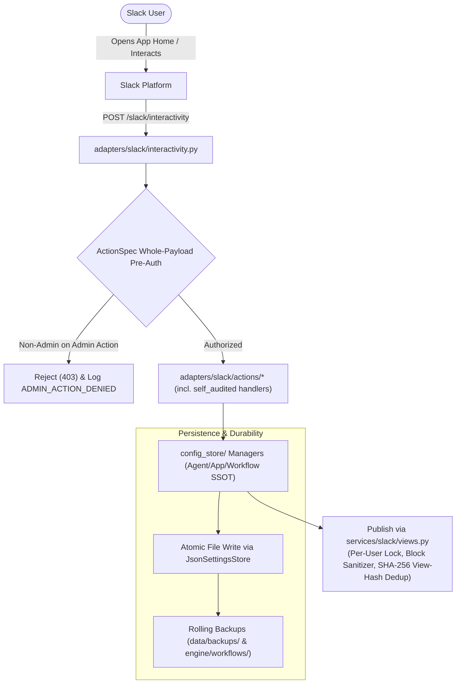

# Slack App Home Administration & Settings SSOT

This document details the administrative interface provided via the **Slack App Home** tab, its modular view/action architecture, how server-side authorization is enforced, and how state persistence and backup failovers operate.

---

## 🏠 The App Home Interface

Izvor provides an interactive configuration dashboard embedded directly within Slack’s App Home tab. Administrators can modify the deliberation engine's behavior in real time without restarting the server or editing config files manually.

The App Home view builder in [`services/slack_home/`](file:///engine/services/slack_home/__init__.py) delegates rendering across three modular tab builders in [`services/slack_home/`](file:///engine/services/slack_home/):

- [`services/slack_home/agents_tab.py`](file:///engine/services/slack_home/agents_tab.py): Persona enablement, model selection, system prompt editors, skill assignments, and concise output toggles.

- [`services/slack_home/workflows_tab.py`](file:///engine/services/slack_home/workflows_tab.py): Orchestration topology selector, Sandwich chains, Fixed sequences, Parallel Dialectic specialists, and preset backup/restore modals.

- [`services/slack_home/governance_tab.py`](file:///engine/services/slack_home/governance_tab.py): Spend circuit breakers, daily budgets, Consensus Convergence Fast-Forward toggle, Scribe notes toggle, Weekly Pricing update toggle, skill expiration TTL, and Workspace Baseline Context.

---

## 🛡️ Strict Server-Side Access Control (`ActionSpec` Pre-Authorization)

To prevent unauthorized workspace members from tampering with agent settings, model selections, or budget circuit breakers:

- **`is_slack_admin(user_id)` Gate**: Defined in [`core/config.py`](file:///engine/core/config.py), resolving authorized admin IDs from `SLACK_ADMIN_USER_IDS` in `.env`.

- **Whole-Payload `ActionSpec` Pre-Authorization**: [`adapters/slack/interactivity.py`](file:///engine/adapters/slack/interactivity.py) maps every interactive `action_id` and modal `callback_id` to a declarative `ActionSpec(handler, admin_required=..., self_audited=...)`. Before executing **any** action in a multi-action Slack payload, the dispatcher verifies authorization across all actions in the batch (logging `ADMIN_ACTION_DENIED` on failure). Handlers that emit custom structured audit records set `self_audited=True` to guarantee single-outcome async audit emission (`log_audit_event_async`) without double-logging.

- **Anti-IDOR Scribe Download Verification & View Publishing**: [`scribe_actions.py`](file:///engine/adapters/slack/actions/scribe_actions.py) validates that payload channel ownership matches the requested button target (returning HTTP `403` and logging `UNAUTHORIZED_SCRIBE_DOWNLOAD` on mismatch). App Home updates go through [`services/slack/views.py`](file:///engine/services/slack/views.py) (`publish_app_home`), which enforces event-loop-scoped per-user `asyncio.Lock` serialization, Block Kit sanitization (`sanitize_slack_blocks`), and bounded SHA-256 view-hash deduplication, backed by a lazy token-aware `AsyncWebClient` and rate-limited metadata helpers in [`services/slack/client_core.py`](file:///engine/services/slack/client_core.py).

- **Modular Action Handlers**: Validated requests are routed to specialized modules in [`adapters/slack/actions/`](file:///engine/adapters/slack/actions/):

  - [`agent_actions.py`](file:///engine/adapters/slack/actions/agent_actions.py)

  - [`governance_actions.py`](file:///engine/adapters/slack/actions/governance_actions.py)

  - [`hitl_actions.py`](file:///engine/adapters/slack/actions/hitl_actions.py)

  - [`scribe_actions.py`](file:///engine/adapters/slack/actions/scribe_actions.py)

  - [`workflow_presets.py`](file:///engine/adapters/slack/actions/workflow_presets.py)

---

## 🎛️ Configurable Controls

The App Home dashboard organizes controls into structured blocks (strictly capped at <100 blocks to comply with Slack Block Kit limits):

### 1. Active Personas Roster (`agents_tab.py`)

- **Enable / Disable Toggles**: Enable or disable any of the **16 debate personas**.

- **Model Overrides & Custom Prompts**: Assign custom LLM models and edit system instructions per persona.

- **Assigned Skills & Concise Output Toggles**: Configure default persona skills and toggle `is_short_output`.

### 2. Discussion Topology & Workflows (`workflows_tab.py`)

- **Topology Selection**: Switch between **Sandwich Mode** (`sandwich`), **Fixed Mode** (`fixed`), and **Parallel Dialectic Mode** (`scatter_gather`) *(Admin-only)*.

- **Chain & Pool Configuration**: Configure Sandwich Start/End chains, Fixed speaker order, or Parallel Dialectic specialists and closing synthesizer *(Admin-only)*.

- **Workflow Presets**:

  - **Preset Selection & Loading (`select_workflow_preset`, `load_workflow_preset_button`)**: Restricted strictly to **workspace administrators** (`admin_required=True` in `ACTION_REGISTRY`), preventing non-admin workspace members from altering the workspace-wide active workflow preset.

  - **Preset Creation & Deletion (`save_workflow_preset_button`, `delete_workflow_preset_button`)**: Restricted strictly to **workspace administrators** (`admin_required=True`).

  - **Turn 1 Workflow Snapshotting**: At Turn 1, each thread freezes a local snapshot of the active workflow configuration (`workflow_id`, `mode`, `sandwich_config`, `fixed_config`). This guarantees that concurrent thread deliberations are isolated and unaffected if another user switches the workspace preset in App Home.

### 3. Governance, Scribe & Dialectical Controls (`governance_tab.py`)

- **Consensus Convergence Fast-Forward (`fast_forward_on_convergence`)**: Toggle (`🟢 ON` / `🔴 OFF`) whether consecutive `signal_consensus_convergence` calls trigger the Challenger + Arbitrator stress-test gate to fast-forward to `end_chain`.

- **Live Discussion Scribe (`scribe_Consolidation_enabled`)**: Toggle automated live and final Scribe synthesis notes (`ThreadNotesAgent`).

- **Weekly Model Pricing Update (`weekly_pricing_update_enabled`)**: Toggle automatic 7-day background pricing refreshes.

- **Thread Skill Expiration (`skill_expiration_hours`)**: Configure the default TTL in hours for dynamic `/grant_skill` grants.

- **Workspace Baseline Context**: Edit the global organization/workspace context injected into deliberations.

- **Spend Governance & Circuit Breakers**:

  - **Circuit Breaker Toggle (`circuit_breaker_enabled`)**: Enable or disable per-thread USD thresholds.

  - **Per-Thread USD Spend Limit (`circuit_breaker_threshold_usd`)**: Dollar threshold that pauses a thread.

  - **Daily Workspace Budget (`daily_budget_usd`)**: Global 24-hour UTC spend cap (enforced unconditionally across all turns).

---

## 💾 Single Source of Truth (SSOT) & Atomic Persistence

Configuration persistence is managed through [`AgentSettingsManager`](file:///engine/config_store/agent_settings.py), [`AppSettingsManager`](file:///engine/config_store/app_settings.py), and [`SystemSettingsManager`](file:///engine/config_store/system_settings.py), backed by the generic [`JsonSettingsStore[T]`](file:///engine/config_store/settings_store.py):

### 1. Atomic Disk Writes

To prevent file corruption during concurrent updates:

- Settings are serialized to a temporary file (`.tmp`) and flushed to disk.

- The temporary file is atomically replaced using `os.replace`.

### 2. Settings Files & Rolling Backups in `data/backups/`

Settings are partitioned across the 3-tier architecture and backed by rolling snapshots in `data/backups/`:

- **Debate Panel Settings**: [`config/settings/agent_settings.json`](file:///config/settings/agent_settings.json) → `data/backups/agent_settings_backup.json`

- **Engine System Agent Settings**: [`engine/settings/system_agent_settings.json`](file:///engine/settings/system_agent_settings.json) → `data/backups/system_agent_settings_backup.json`

- **System Operational Settings**: [`config/settings/system_settings.json`](file:///config/settings/system_settings.json) → `data/backups/system_settings_backup.json`

- **Slack UI Runtime State**: [`data/state/app_settings.json`](file:///data/state/app_settings.json) → `data/backups/app_settings_backup.json`

### 3. Non-Destructive Failover

If a primary settings file in `config/settings/`, `engine/settings/`, or `data/state/` is missing or corrupted on startup, `JsonSettingsStore` automatically recovers from the corresponding backup snapshot in `data/backups/` before falling back to validated Pydantic defaults.

