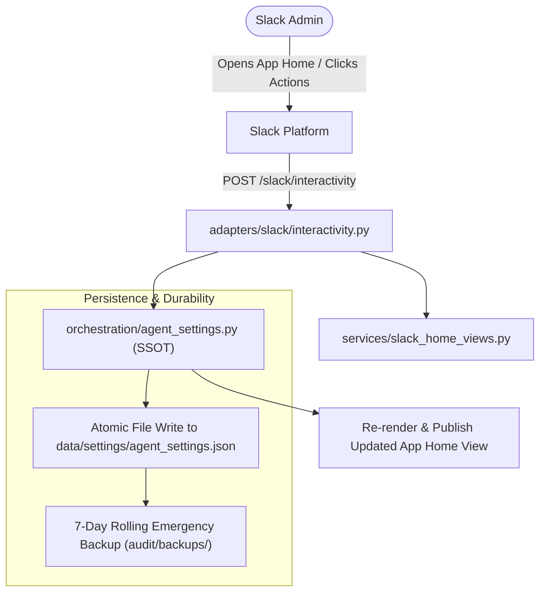

# Slack App Home Administration & Settings SSOT

This document details the administrative interface provided via the **Slack App Home** tab, how real-time configuration is managed, and how state persistence and backup failovers operate.

---

## 🏠 The App Home Interface

Izvor provides an interactive configuration dashboard embedded directly within Slack’s App Home tab. Administrators can modify the deliberation engine's behavior in real time without restarting the server or editing config files manually.

---

## 🎛️ Configurable Controls

The App Home view ([`services/slack_home_views.py`](file:///c:/Users/Hp/Documents/agy2-projects/Izvor/services/slack_home_views.py)) organizes controls into several sections:

### 1. Active Personas Roster
- **Multi-Select Checkboxes**: Enable or disable any of the 16 debate personas.
- **Model Overrides**: Assign custom LLM models per persona.
- **Concise Output Toggles**: Toggle `is_short_output` for personas to keep their arguments brief.

### 2. Discussion Topology & Workflows
- **Topology Selection**: Switch between **Sandwich Mode** and **Fixed Mode**.
- **Start & End Chains**: Specify which personas open and close debates in Sandwich mode.
- **Preset Selection**: Load curated workflow presets (e.g. Architecture Review, Product Strategy, Quick Brainstorm).

### 3. Debate Limits & Pacing
- **Maximum Discussion Rounds**: Limit total turns before closing synthesis begins.
- **Word Count Caps**: Set global default minimum and maximum word counts.

### 4. Spend Governance & Circuit Breakers
- **Circuit Breaker Toggle**: Turn budget limits on or off.
- **Per-Thread USD Spend Limit**: Define the dollar threshold that triggers automatic discussion pause.

---

## 💾 Single Source of Truth (SSOT) & Atomic Persistence

All configuration changes are handled through [`AgentSettingsManager`](file:///c:/Users/Hp/Documents/agy2-projects/Izvor/orchestration/agent_settings.py):

### 1. Atomic Disk Writes
To prevent file corruption during concurrent updates:
- Settings are written to a temporary file (`agent_settings.json.tmp`).
- The temporary file is atomically replaced using `os.replace`.

### 2. Rolling 7-Day Backups
Every modification generates a timestamped copy stored in `audit/backups/`. Files older than 7 days are automatically pruned.

### 3. Non-Destructive Failover
If `data/settings/agent_settings.json` is missing or corrupted on startup, Izvor automatically recovers by inspecting the latest valid snapshot in `audit/backups/` before falling back to default factory presets.
