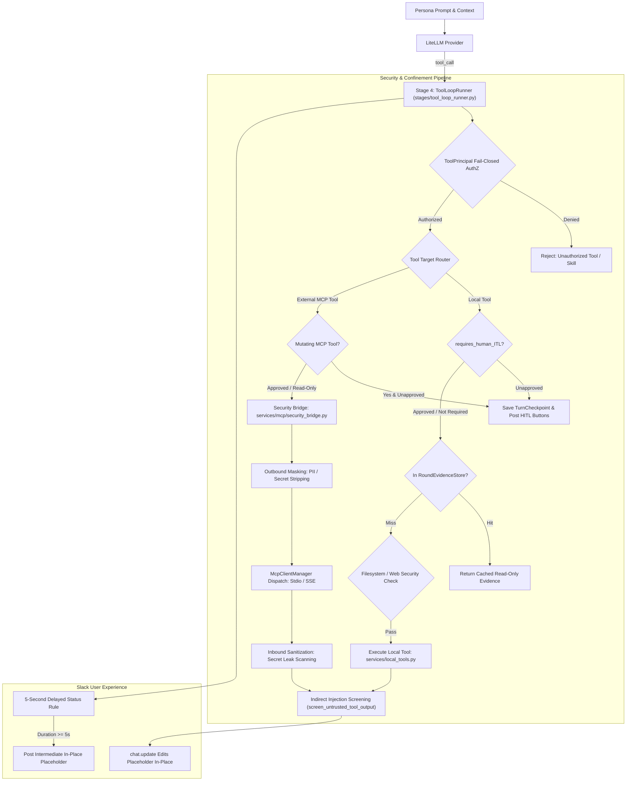

# Model Context Protocol (MCP) & Tool Execution Security

This document details **Izvor**'s tool execution architecture, Model Context Protocol (MCP) integration, `ToolPrincipal` fail-closed authorization, filesystem sandboxing, outbound web security (`PinnedIPTransport`), and non-blocking Slack progress updates.

---

## 🛠️ Tool Architecture: Local Sandboxed Tools vs External MCP Servers

Izvor provides two distinct, defense-in-depth tool execution layers:

1. **Local Sandboxed Tools ([`services/local_tools.py`](file:///engine/services/local_tools.py))**:
   Built-in, in-process tools for reading/writing documents in `agents_resources/` and web tools ([`services/web_tools.py`](file:///engine/services/web_tools.py)) with strict SSRF defenses.
2. **External Model Context Protocol (MCP) Client Subsystem ([`services/mcp/`](file:///engine/services/mcp/)):**
   Full external MCP client integration connecting Izvor to external MCP servers (via `stdio` or `sse`), discovering tools dynamically, and converting them to LiteLLM-compatible function schemas.



---

## 🔌 External MCP Client Integration (`services/mcp/`)

External MCP servers are configured in [`config/settings/system_settings.json`](file:///config/settings/system_settings.json) under `"mcp_servers"`.

### 1. Server Configuration Example
```json
{
  "mcp_servers": {
    "github": {
      "enabled": true,
      "transport": "stdio",
      "command": "npx",
      "args": ["-y", "@modelcontextprotocol/server-github"],
      "env": {
        "GITHUB_PERSONAL_ACCESS_TOKEN": "${GITHUB_TOKEN}"
      },
      "mutating_tools": ["create_issue", "push_files"],
      "timeout_seconds": 30.0,
      "outbound_pii_masking": true
    }
  }
}
```

### 2. Windows Subprocess Hardening (`windows_process.py`)
- **Job Object Confinement**: On Windows hosts, child subprocesses spawned by `stdio` transport are bound to a Win32 Job Object with `JOB_OBJECT_LIMIT_KILL_ON_JOB_CLOSE`. When Izvor exits or is terminated, all descendant Node.js or Python MCP servers are automatically reaped by the Windows kernel.
- **Environment Sanitization (`build_safe_stdio_env`)**: Child MCP servers inherit only clean OS variables (`PATH`, `SYSTEMROOT`, `TEMP`, etc.) and explicitly configured `env`. Sensitive Izvor host secrets (`SLACK_BOT_TOKEN`, `SLACK_SIGNING_SECRET`, `AUDIT_HMAC_SECRET`, `ADMIN_PASSWORD`) are unconditionally stripped.

### 3. Tool Namespacing & Schema Translation (`schema_translator.py`)
- Tools discovered from external MCP servers are automatically namespaced: `mcp__{server_name}__{raw_tool_name}` (e.g., `mcp__github__create_issue`).
- Translated into standard LiteLLM function calling schemas compatible with OpenAI, Anthropic, and Gemini.

### 4. Declarative Skill Bindings (`SKILL.md`)
Skills can expose tools from external MCP servers by specifying `mcp_server` and optional `mcp_tools` in their frontmatter:
```markdown
---
name: github_expert
display_name: GitHub Expert
description: Expert GitHub integration and repository manager
mcp_server: github
mcp_tools:
  - search_repos
  - create_issue
---
```
When `load_skill` is invoked by an authorized agent, Izvor discovers tools from `mcp_server` on-demand and dynamically unlocks them in LiteLLM for subsequent turns.

### 5. Roadmap R-04 Defenses (`security_bridge.py`)
- **Outbound Masking**: Arguments sent to external MCP servers are scanned by `PIIMasker`, preventing host tokens or sensitive entities from leaking to third-party MCP endpoints.
- **Inbound Secret Scanning**: Responses from MCP servers are checked by `scan_output_for_secrets()`. Any response containing leaked credentials (e.g. AWS keys, tokens) is immediately blocked.
- **Mandatory HITL Gate for Mutating Tools**: Any tool listed in `mutating_tools` or marked with `destructiveHint=True` triggers Slack approval buttons before execution.


---

## 🔐 Fail-Closed `ToolPrincipal` Authorization & Indirect Screening

Every tool execution in **Stage 4 ([`ToolLoopRunner`](file:///engine/orchestration/stages/tool_loop_runner.py))** is bound to an immutable [`ToolPrincipal`](file:///engine/core/domain.py) identity object containing:
- `agent_key`: The persona requesting the tool call.
- `user_id`: The human Slack user who initiated the turn.
- `thread_ts`: The active Slack thread identifier.
- `allowed_skills`: The set of skills explicitly authorized for this agent in this thread (combining `agent_settings.json` baseline skills, `global: true` skills like `control_plane`, and active `ThreadSkillsManager` grants).

[`SkillRegistry`](file:///engine/skills/registry.py) verifies `ToolPrincipal` before any tool handler is invoked. If `ToolPrincipal` is missing or the tool does not belong to `allowed_skills`, execution fails closed immediately. Before returning any external tool result (`fetch_web_page`, `web_search`, `read_document`, MCP outputs) to the LLM context, `ToolLoopRunner` runs [`guardrail_service.screen_untrusted_tool_output()`](file:///engine/services/security/guardrail.py) (heuristic detection, plus optional embedding check when `guardrail_indirect_embedding_enabled: true`), neutralizing injected payloads and logging `INDIRECT_INJECTION_DETECTED`.

---

## 🛡️ Filesystem Sandboxing & Protected Write Paths

Allowing language models to read or write files carries security risks if unconstrained. Izvor enforces multi-layered isolation in [`services/local_tools.py`](file:///engine/services/local_tools.py):

### 1. Workspace Segregation: `agents_resources/` vs `system_resources/`
All agent-accessible file operations (`list_documents`, `read_document`, `write_document`) are strictly confined to `agents_resources/`.
- Attempts to read or write within `system_resources/` or root project directories are rejected with a security denial.

### 2. Filename, Symlink & Write Hardening (`validate_resource_filename`)
Before accessing the filesystem, `validate_resource_filename()` and tool handlers enforce:
- Supports safe Unicode filenames while rejecting path traversal sequences (`..`), null bytes (`\x00`), control characters (`ord < 32` / `127`), trailing dots/spaces, and symlink escapes outside `agents_resources/`.
- `list_documents()` explicitly skips any symlink or child entry whose resolved target escapes `agents_resources/`.
- Blocks **Windows reserved device names** (`CON`, `PRN`, `AUX`, `NUL`, `COM1`–`COM9`, `LPT1`–`LPT9`, with or without extensions) and **NTFS Alternate Data Streams (ADS)** (`:`).
- `read_document()` truncates oversized payloads safely at `MAX_READ_DOCUMENT_CHARS = 50000` (with explicit truncation metadata).
- `write_document()` caps payloads at `max_write_bytes` (default: `1048576` bytes / **1 MB**) and writes atomically via `tempfile.mkstemp` + `os.fsync` + `os.replace()`.

### 3. Protected Write Paths (`DEFAULT_PROTECTED_WRITE_PATHS`)
Configured in [`config_store/system_settings.py`](file:///engine/config_store/system_settings.py) (and extensible via `workspace_write_blacklist_additional`), the following critical locations cannot be modified by any tool execution:
- `.env` (environment secrets and API tokens)
- `.git/` (version control repository integrity)
- `data/audit/` (tamper-evident audit logs and backups)
- `system_resources/` (internal project configurations)
- `config/settings/agent_settings.json`, `engine/settings/system_agent_settings.json`, `config/settings/system_settings.json`, `data/state/app_settings.json`, `data/state/presidio_skill_exclusions.json`

---

## 🌐 Outbound Web Security & SSRF Defense

Implemented in [`services/web_tools.py`](file:///engine/services/web_tools.py) and configured via `web_security` in `system_settings.json`, outbound `web_search` and `fetch_web_page` calls enforce:
1. **DNS-Rebinding Defense (`PinnedIPTransport`)**: Resolves hostnames once, validates all resolved IPv4 and IPv6 addresses against private/loopback/link-local/multicast/reserved ranges (including IPv4-mapped IPv6 and NAT64 `64:ff9b::/96`), and pins the TCP connection directly to the validated IP while preserving TLS SNI and `Host` headers.
2. **Port, Scheme, Redirect & Slowloris Hardening**: Enforces `allowed_ports` (`[80, 443]`, including implicit default ports on `http`/`https`), validates every redirect hop against SSRF rules, **fails closed** on missing/empty or non-text `Content-Type` headers, bounds streamed reads with a monotonic wall-clock deadline against Slowloris attacks, synchronizes `ddgs` engine configuration via `_DDGS_ENGINE_LOCK`, and supports `allowed_domains` + `strip_query_on_untrusted_domains`.
3. **Per-Turn Web Request Budget (`max_fetches_per_turn: 5`)**: Tracks outbound web requests per turn via a `contextvars.ContextVar` counter, rejecting excessive requests within a single turn.

---

## ⏱️ Wall-Clock Execution Timeout & Iteration Cap

Izvor bounds tool calling loops with two limits in [`config/settings/system_settings.json`](file:///config/settings/system_settings.json):
- **`max_tool_iterations`** (default: `3`): Maximum sequential tool-calling rounds per agent turn. When the final allowed iteration completes (`iteration >= max_tool_iterations`) without pausing, [`ToolLoopRunner`](file:///engine/orchestration/stages/tool_loop_runner.py) skips a redundant tool-enabled follow-up completion and proceeds straight to tool-free synthesis in [`TurnFinalizer`](file:///engine/orchestration/stages/turn_finalizer.py).
- **`tool_call_loop_timeout_seconds`** (default: `60.0` seconds): Maximum wall-clock time for the iterative tool loop and the bounded timeout for final tool-free synthesis (`resolve_synthesis_timeout()`). If exceeded or if final synthesis fails, execution terminates safely and populates a clear timeout or synthesis-failure fallback notice.

---

## 💬 The 5-Second Delayed Status UX

Posting immediate status messages for every tool call creates Slack notification noise and UI flicker. Izvor implements the **5-Second Delayed Status Rule** in [`orchestration/stages/tool_status.py`](file:///engine/orchestration/stages/tool_status.py):

1. **Fast Calls (< 5 seconds)**:
   If the tool call completes quickly (e.g., cached `RoundEvidenceStore` hit or quick file read), no intermediate placeholder message is posted. The completed answer is delivered directly.
2. **Slow Calls (≥ 5 seconds)**:
   If tool reasoning or external network search takes longer than 5 seconds, an intermediate message is posted under the agent's identity:
   > _🔍 *Visionary* is searching the web for industry benchmarks..._
3. **In-Place Resolution**:
   When the tool completes, Izvor calls Slack’s `chat.update` API to edit the placeholder in-place with the final markdown response. This leaves zero redundant messages in the Slack thread.
