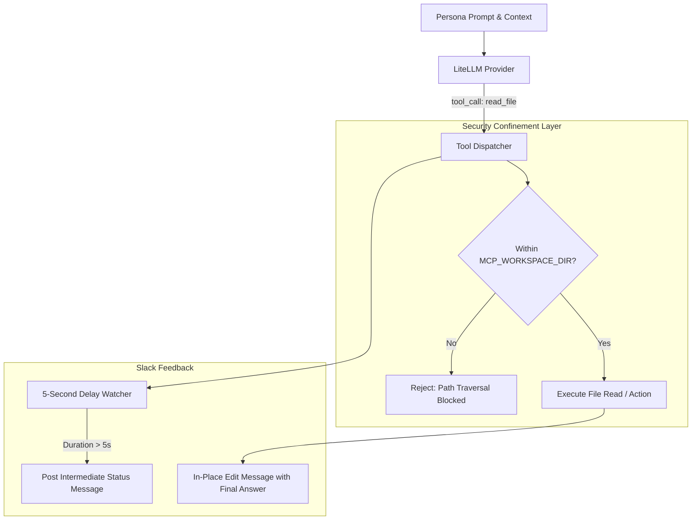

# Model Context Protocol (MCP) & Tool Execution

This document details **Izvor**'s tool execution architecture, Model Context Protocol (MCP) integration, security confinement, and non-blocking Slack progress updates.

---

## 🛠️ MCP Tool Integration

Izvor integrates with the Model Context Protocol (MCP) to allow personas to interact with workspace environments, execute code inspection, and access files safely.

The integration is managed by [`services/mcp_tools.py`](file:///c:/Users/Hp/Documents/agy2-projects/Izvor/services/mcp_tools.py), translating MCP tool schemas into standard JSON function definitions compatible with LiteLLM.



---

## 🛡️ Security Confinement & Boundary Checks

Allowing language models to read or write files carries security risks if unconstrained. Izvor enforces strict sandboxing:

### 1. Workspace Boundary Guard
All filesystem tools resolve relative to the root path defined by `MCP_WORKSPACE_DIR` (default: `.`).
```python
def resolve_safe_workspace_path(requested_path: str) -> Path:
    base = Path(MCP_WORKSPACE_DIR).resolve()
    target = (base / requested_path).resolve()
    if not target.is_relative_to(base):
        raise SecurityException(f"Path traversal denied: {requested_path}")
    return target
```

### 2. Forbidden System Files
Attempts to read sensitive files (such as `.env`, private keys, or system configuration) are intercepted and rejected, returning an error string directly to the model.

---

## ⏱️ Wall-Clock Execution Timeout

When LLMs use iterative tool loops (e.g., searching, reading output, making another search), an agent can get stuck in a recursive loop.

Izvor enforces a strict wall-clock timeout:
- **Parameter**: `TOOL_CALL_LOOP_TIMEOUT_SECONDS` (default: `60` seconds).
- **Mechanism**: The execution stage wraps the iterative tool loop in `asyncio.wait_for`. If the loop exceeds the timeout, execution is safely terminated, and the agent synthesizes the best available answer with the context gathered so far.

---

## 💬 The 5-Second Delayed Status UX

Posting immediate status messages for every tool call creates Slack notification noise and UI flicker. Izvor implements a subtle **5-Second Delayed Status Rule**:

1. **Fast Calls (< 5 seconds)**:
   If the tool call completes quickly (e.g. cached RAG query or quick file read), no intermediate placeholder message is posted. The completed answer is delivered directly.
2. **Slow Calls (≥ 5 seconds)**:
   If tool reasoning or external network search takes longer than 5 seconds, an intermediate message is posted under the agent's identity:
   > _🔍 *Visionary* is searching the web for industry benchmarks..._
3. **In-Place Resolution**:
   When the tool completes, Izvor calls Slack’s `chat.update` API to edit the placeholder in-place with the final markdown response. This keeps the thread clean and free of leftover status messages.
