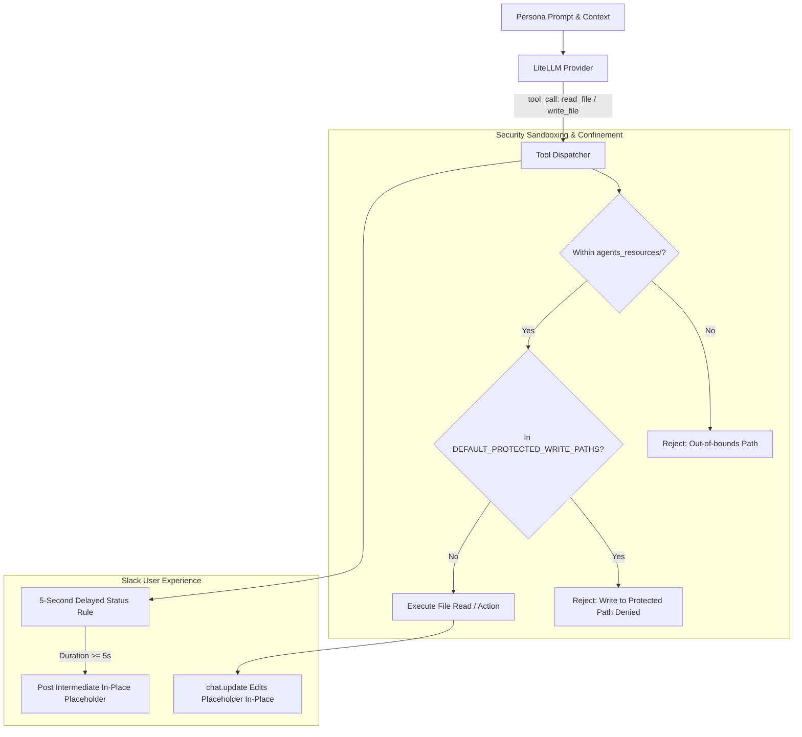

# Model Context Protocol (MCP) & Tool Execution

This document details **Izvor**'s tool execution architecture, Model Context Protocol (MCP) integration, filesystem sandboxing, and non-blocking Slack progress updates.

---

## 🛠️ MCP Tool Integration

Izvor integrates with the Model Context Protocol (MCP) to allow personas to interact with workspace environments, execute code inspection, and access files safely.

The integration is managed by [`services/mcp_tools.py`](file:///c:/Users/Hp/Documents/agy2-projects/Izvor/services/mcp_tools.py), translating MCP tool schemas into standard JSON function definitions compatible with LiteLLM.

---

## 🛡️ Filesystem Sandboxing & Protected Write Paths

Allowing language models to read or write files carries security risks if unconstrained. Izvor enforces strict multi-layered isolation:

### 1. Workspace Segregation: `agents_resources/` vs `system_resources/`
All agent-generated files, temporary drafts, and inspection artifacts must reside strictly within `agents_resources/`.
- Attempts to read or write within `system_resources/` or root project directories are rejected with a security denial.
- Path traversal escapes (`../`, null bytes, symlinks) are caught and rejected prior to filesystem access.

### 2. Protected Write Paths (`DEFAULT_PROTECTED_WRITE_PATHS`)
Configured in [`orchestration/system_settings.py`](file:///c:/Users/Hp/Documents/agy2-projects/Izvor/orchestration/system_settings.py), the following critical locations cannot be modified by any tool execution:
- `.env` (environment secrets and API tokens)
- `.git/` (version control repository integrity)
- `audit/` (tamper-evident audit logs and backups)
- `system_resources/` (internal project configurations)
- `data/settings/agent_settings.json`
- `data/settings/app_settings.json`
- `data/settings/system_settings.json`

### 3. Fail-Closed Authorization
[`SkillRegistry`](file:///c:/Users/Hp/Documents/agy2-projects/Izvor/skills/registry.py) executes tools under a strict fail-closed contract. If an agent calls a tool that has not been explicitly granted in its configuration or active thread skills, the invocation is immediately aborted and logged.

---

## ⏱️ Wall-Clock Execution Timeout

When LLMs use iterative tool loops (e.g., searching, reading output, making another search), an agent can get stuck in a recursive loop.

Izvor enforces a strict wall-clock timeout:
- **Parameter**: `tool_call_loop_timeout_seconds` (default: `60.0` seconds in [`data/settings/system_settings.json`](file:///c:/Users/Hp/Documents/agy2-projects/Izvor/data/settings/system_settings.json)).
- **Mechanism**: The execution stage wraps the iterative tool loop in `asyncio.wait_for`. If the loop exceeds the timeout, execution is safely terminated, and the agent synthesizes the best available answer with the context gathered so far.

---

## 💬 The 5-Second Delayed Status UX

Posting immediate status messages for every tool call creates Slack notification noise and UI flicker. Izvor implements the **5-Second Delayed Status Rule** in [`orchestration/stages/tool_status.py`](file:///c:/Users/Hp/Documents/agy2-projects/Izvor/orchestration/stages/tool_status.py):

1. **Fast Calls (< 5 seconds)**:
   If the tool call completes quickly (e.g., cached RAG query or quick file read), no intermediate placeholder message is posted. The completed answer is delivered directly.
2. **Slow Calls (≥ 5 seconds)**:
   If tool reasoning or external network search takes longer than 5 seconds, an intermediate message is posted under the agent's identity:
   > _🔍 *Visionary* is searching the web for industry benchmarks..._
3. **In-Place Resolution**:
   When the tool completes, Izvor calls Slack’s `chat.update` API to edit the placeholder in-place with the final markdown response. This leaves zero redundant messages in the Slack thread.
