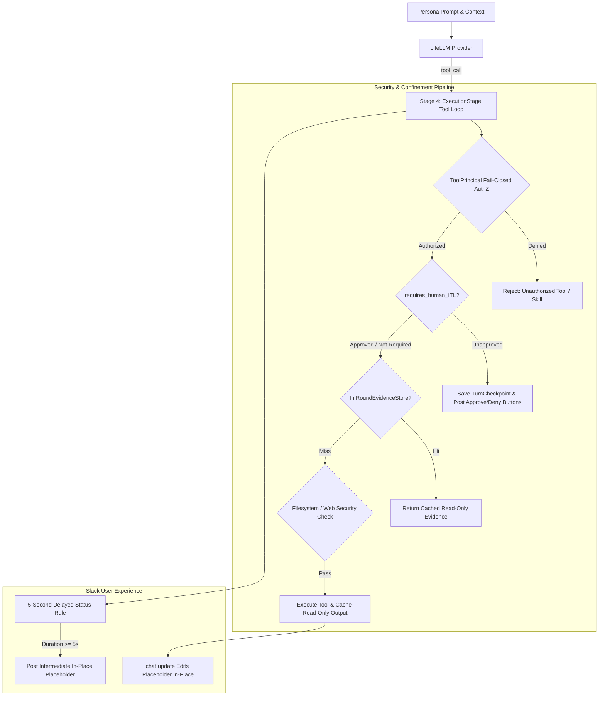

# Model Context Protocol (MCP) & Tool Execution Security

This document details **Izvor**'s tool execution architecture, Model Context Protocol (MCP) integration, `ToolPrincipal` fail-closed authorization, filesystem sandboxing, outbound web security (`PinnedIPTransport`), and non-blocking Slack progress updates.

---

## 🛠️ MCP & Native Tool Integration

Izvor integrates with the Model Context Protocol (MCP) and built-in skill tools via [`services/mcp_tools.py`](file:///c:/Users/Hp/Documents/agy2-projects/Izvor/services/mcp_tools.py) and [`services/web_tools.py`](file:///c:/Users/Hp/Documents/agy2-projects/Izvor/services/web_tools.py), translating tool schemas into standard JSON function definitions compatible with LiteLLM.

---

## 🔐 Fail-Closed `ToolPrincipal` Authorization

Every tool execution in **Stage 4 (`ExecutionStage`)** is bound to an immutable [`ToolPrincipal`](file:///c:/Users/Hp/Documents/agy2-projects/Izvor/core/domain.py) identity object containing:
- `agent_key`: The persona requesting the tool call.
- `user_id`: The human Slack user who initiated the turn.
- `thread_ts`: The active Slack thread identifier.
- `allowed_skills`: The set of skills explicitly authorized for this agent in this thread (combining `agent_settings.json` baseline skills, `global: true` skills like `control_plane`, and active `ThreadSkillsManager` grants).

[`SkillLoader`](file:///c:/Users/Hp/Documents/agy2-projects/Izvor/skills/loader.py) verifies `ToolPrincipal` before any tool handler is invoked. If `ToolPrincipal` is missing or the tool does not belong to `allowed_skills`, execution fails closed immediately.

---

## 🛡️ Filesystem Sandboxing & Protected Write Paths

Allowing language models to read or write files carries security risks if unconstrained. Izvor enforces multi-layered isolation in [`services/mcp_tools.py`](file:///c:/Users/Hp/Documents/agy2-projects/Izvor/services/mcp_tools.py):

### 1. Workspace Segregation: `agents_resources/` vs `system_resources/`
All agent-accessible file operations (`list_documents`, `read_document`, `write_document`) are strictly confined to `agents_resources/`.
- Attempts to read or write within `system_resources/` or root project directories are rejected with a security denial.

### 2. Filename & Path Traversal Hardening (`validate_resource_filename`)
Before accessing the filesystem, `validate_resource_filename()` validates every path component:
- Rejects path traversal sequences (`..`), null bytes (`\x00`), and symbolic link escapes (`Path.resolve()`).
- Blocks **Windows reserved device names** (`CON`, `PRN`, `AUX`, `NUL`, `COM1`–`COM9`, `LPT1`–`LPT9`, with or without extensions) to prevent OS handle hangs on Windows hosts.
- Blocks **NTFS Alternate Data Streams (ADS)** by rejecting colons (`:`) in relative paths.
- Enforces `max_write_bytes` (default: `1048576` bytes / **1 MB** in `system_settings.json`) on `write_document` payloads to prevent disk exhaustion.

### 3. Protected Write Paths (`DEFAULT_PROTECTED_WRITE_PATHS`)
Configured in [`orchestration/system_settings.py`](file:///c:/Users/Hp/Documents/agy2-projects/Izvor/orchestration/system_settings.py) (and extensible via `workspace_write_blacklist_additional`), the following critical locations cannot be modified by any tool execution:
- `.env` (environment secrets and API tokens)
- `.git/` (version control repository integrity)
- `audit/` (tamper-evident audit logs and backups)
- `system_resources/` (internal project configurations)
- `data/settings/agent_settings.json`, `data/settings/app_settings.json`, `data/settings/system_settings.json`

---

## 🌐 Outbound Web Security & SSRF Defense

Implemented in [`services/web_tools.py`](file:///c:/Users/Hp/Documents/agy2-projects/Izvor/services/web_tools.py) and configured via `web_security` in `system_settings.json`, outbound `web_search` and `fetch_web_page` calls enforce:
1. **DNS-Rebinding Defense (`PinnedIPTransport`)**: Resolves hostnames once, validates all resolved IPv4 and IPv6 addresses against private/loopback/link-local/multicast/reserved ranges (including IPv4-mapped IPv6 and NAT64 `64:ff9b::/96`), and pins the TCP connection directly to the validated IP while preserving TLS SNI and `Host` headers.
2. **Port & Domain Restrictions**: Restricts connections to `allowed_ports` (default `[80, 443]`), enforces `allowed_domains` when configured, and strips query strings on untrusted domains (`strip_query_on_untrusted_domains: true`) to prevent data exfiltration via URL parameters.
3. **Per-Turn Web Request Budget (`max_fetches_per_turn: 10`)**: Tracks outbound web requests per turn via a `contextvars.ContextVar` counter, rejecting excessive requests within a single turn.

---

## ⏱️ Wall-Clock Execution Timeout & Iteration Cap

Izvor bounds tool calling loops with two limits in [`data/settings/system_settings.json`](file:///c:/Users/Hp/Documents/agy2-projects/Izvor/data/settings/system_settings.json):
- **`max_tool_iterations`** (default: `3`): Maximum sequential tool-calling rounds per agent turn.
- **`tool_call_loop_timeout_seconds`** (default: `60.0` seconds): Maximum wall-clock time for the iterative tool loop. If exceeded, execution is safely terminated and the persona synthesizes the best answer from the evidence gathered so far.

---

## 💬 The 5-Second Delayed Status UX

Posting immediate status messages for every tool call creates Slack notification noise and UI flicker. Izvor implements the **5-Second Delayed Status Rule** in [`orchestration/stages/tool_status.py`](file:///c:/Users/Hp/Documents/agy2-projects/Izvor/orchestration/stages/tool_status.py):

1. **Fast Calls (< 5 seconds)**:
   If the tool call completes quickly (e.g., cached `RoundEvidenceStore` hit or quick file read), no intermediate placeholder message is posted. The completed answer is delivered directly.
2. **Slow Calls (≥ 5 seconds)**:
   If tool reasoning or external network search takes longer than 5 seconds, an intermediate message is posted under the agent's identity:
   > _🔍 *Visionary* is searching the web for industry benchmarks..._
3. **In-Place Resolution**:
   When the tool completes, Izvor calls Slack’s `chat.update` API to edit the placeholder in-place with the final markdown response. This leaves zero redundant messages in the Slack thread.
