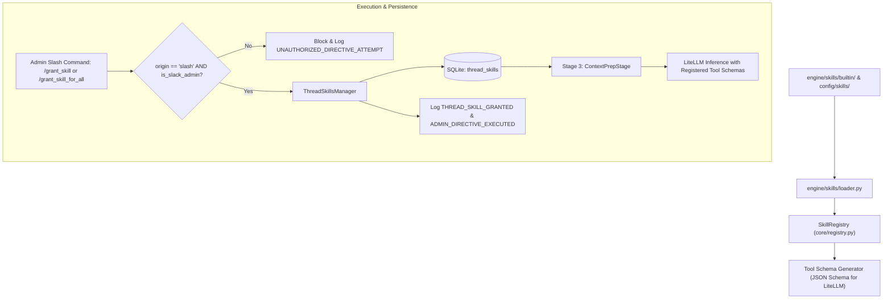
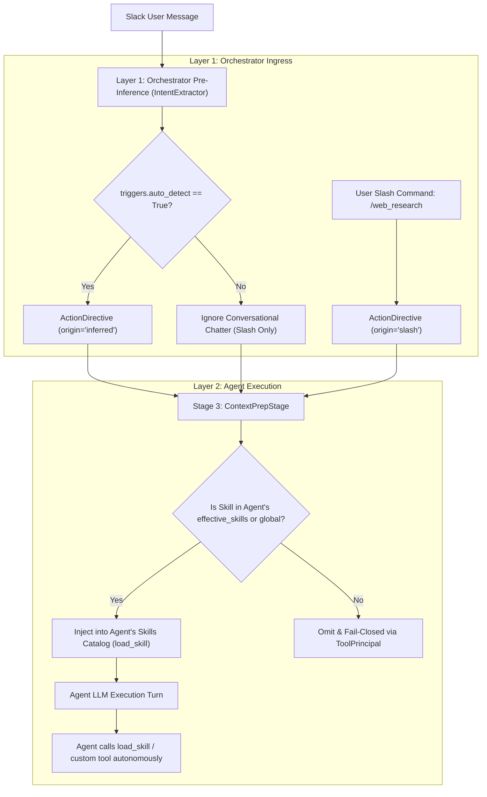

# Skills Framework & Dynamic Registration

This document details the architecture of **Izvor**'s dynamic skills system across all **21 built-in skills**, explaining how capabilities are discovered, registered, granted, revoked, persisted in SQLite, and safely executed by personas.

---

## 🧩 Architectural Overview

In Izvor, a **Skill** is a modular capability that can be dynamically attached to or detached from personas, either statically via configuration or dynamically during conversation turns via user directives and slash commands.

Skills fall into three distinct categories:
1. **Tool-Backed Agent Skills**: Provide executable tools (such as web search, file reading/writing, or RAG queries) that the LLM invokes via function calling.
2. **Global Control Plane Skills**: Provide structured orchestration tools (`control_plane`: `nominate_next_speaker`, `request_user_clarification`, `signal_consensus_convergence`) available to all personas (`global: true`).
3. **Behavioral Constraint & Orchestrator Directives**: Inject deterministic prompt guidelines, mechanical limits (such as minimum/maximum word counts or round caps), or speaker routing rules.



---

## 🧠 The Two Inference Layers in Izvor

A critical architectural distinction in Izvor is that **"inference" occurs at two completely separate layers**:



### The Separation of Concerns:
1. **`triggers.auto_detect` ONLY governs Layer 1 (Orchestrator Pre-Inference):**
   - It controls whether free-form user chatter in Slack can automatically pre-arm or infer an `ActionDirective`.
   - **Default is `false` (fail-closed / secure-by-default).**
   - It **does NOT** stop an agent from using an authorized tool during Layer 2.
2. **Layer 2 (Agent Function Calling) is governed by `ToolPrincipal` permissions:**
   - As long as a skill is authorized for an agent (via `agent_settings.json`, `global: true`, or an admin `/grant_skill`), the agent can autonomously invoke `load_skill` and execute its tools, enforced at runtime by [`ToolPrincipal`](file:///engine/core/domain.py).

---

## 📜 Complete `SKILL.md` Manifest Specification

Every skill is defined by a `SKILL.md` file located in `config/skills/<skill_name>/SKILL.md` (implementer tool skills) or `engine/skills/builtin/<skill_name>/SKILL.md` (built-in engine directives & modifiers). The file consists of a YAML frontmatter header followed by Markdown operational instructions/guidelines.

### 1. Top-Level Frontmatter Properties

| Property | Type | Default | What It Does | Where It Applies | Where It Does NOT Apply |
| :--- | :--- | :--- | :--- | :--- | :--- |
| `name` | `string` | Directory name | Unique technical identifier for the skill (e.g., `web_research`). | Everywhere (Registry, Directives, Tool calls). | N/A |
| `display_name` | `string` | Capitalized name | User-facing display name in Slack messages and UI directory. | Slack formatted messages and directory listings. | Internal code routing. |
| `description` | `string` | `""` | Description of what the skill does. | Injected into agent Skills Catalogs and `IntentExtractor` prompt. | Tool argument validation. |
| `scope` | `string` | `"agent"` | Architectural domain of the skill (`agent`, `orchestrator`, or `prompt_modifier`). | Determines pipeline execution path. See Scope Matrix below. | Does not restrict tool parameter types. |
| `tools` | `list[str]` | `[]` | List of tool names exposed by this skill (implemented in `tools.py`). | Agent function-calling loop and sandbox authorization. | Orchestrator actions (`action.py`). |
| `requires_human_ITL` | `boolean` | `false` | Human-in-the-Loop gate. If `true`, tool execution saves a `TurnCheckpoint` and sends an Approve/Deny button to Slack. | Layer 2 tool execution in `execution.py`. | Orchestrator pipeline actions or Layer 1 parsing. |
| `global` (or `all_agents`) | `boolean` | `false` | If `true`, automatically available to all agents across all threads without needing `/grant_skill` (e.g., `control_plane`). | Agent authorization checks in `loader.py`. | Does not bypass `requires_human_ITL`. |
| `handles_files` | `boolean` | `false` | Marks this skill as the designated file content processor for attached Slack files. | File attachment routing in `DirectiveParser` & `ContextPrepStage`. | Pure text prompts without attachments. |
| `extraction_rule` | `string` | `""` | Natural language rule instructing the micro-LLM how to recognize and extract this skill. | Micro-LLM system prompt in `IntentExtractor`. | Deterministic slash command parsing. |

---

### 2. `triggers` Object Properties

The `triggers:` dictionary configures how the skill is detected from user input in Slack.

| Property | Type | Default | What It Does | Where It Applies | Where It Does NOT Apply |
| :--- | :--- | :--- | :--- | :--- | :--- |
| `auto_detect` | `boolean` | **`false`** | **Orchestrator Pre-Inference Toggle.** When `true`, allows the micro-LLM `IntentExtractor` to infer this skill from natural user conversation (`origin="inferred"`). | **Layer 1 only:** `IntentExtractor` prompt & `ValidationStage` privilege checks. | **Layer 2:** Does NOT restrict agents from calling authorized tools via `load_skill`. |
| `slash` | `list[str]` | `[]` | List of slash command aliases (e.g. `["/web_research", "/webresearch"]`). | Deterministic slash parser in `DirectiveParser` (`origin="slash"`). | Natural language prompts without slash prefixes. |
| `arg_type` | `string` | `"string"` | Parser strategy for extracting arguments following the slash command. Supported: `terminal_flag`, `int`, `int_or_off`, `agent_list`, `token`, `agent_token`, `grant_skill`, `list`, `file_target`, `none`. | `DirectiveParser` parameter extraction. | Agent LLM internal reasoning. |
| `param_name` | `string` | `None` | Parameter key under which parsed argument is stored in `ActionDirective.params`. | Parameter dictionary construction in `DirectiveParser`. | Unparameterized flag skills. |
| `terminal` | `boolean` | `false` | If `true`, halts debate immediately upon detection (e.g. `/stop`). | Short-circuit stop check in `DirectiveParser` & Slack event adapter. | Non-terminal conversational skills. |

---

### 3. Scope Matrix (`scope`)

| Scope | Executed By | Handler File | Storage in TurnContext | Agent Catalog Injection |
| :--- | :--- | :--- | :--- | :--- |
| **`agent`** | Debate Agent LLM | `tools.py` | `ctx.actions` (`ActionDirective`) | **Yes** (Listed under `AVAILABLE SKILLS` via `load_skill`) |
| **`orchestrator`** | Turn Pipeline Stage / Control Plane | `action.py` / `tools.py` | `ctx.actions` (`ActionDirective`) | **No** (Unless `global: true` with `tools`, e.g., `control_plane`) |
| **`prompt_modifier`** | System Prompt Builder | Markdown body | `ctx.modifiers` (Key-value dict) | **No** (Directly alters agent prompt constraints) |

---

## 🔍 Discovery & Registration Lifecycle

### 1. Skill Discovery ([`skills/loader.py`](file:///engine/skills/loader.py))
During application boot, the loader scans both [`engine/skills/builtin/`](file:///engine/skills/builtin) (built-in directives and modifiers) and [`config/skills/`](file:///config/skills) (implementer tool skills). Every subdirectory containing a valid `SKILL.md` file is evaluated.

### 2. Manifest & Schema Parsing
The loader extracts all top-level and trigger metadata, validates required fields, registers custom tools from `tools.py`, and checks for action handlers in `action.py`.

### 3. Registry Storage ([`core/registry.py`](file:///engine/core/registry.py))
Valid skills are registered into the global `SkillRegistry`. They can be queried via the administrative REST endpoint (`GET /api/skills`) or listed inside Slack via `/list_skills` or `[list_skills]`.

---

## 🔄 Dynamic Grant, Revoke & Slack Admin Authorization

Izvor provides fine-grained control over skill assignment through [`ThreadSkillsManager`](file:///engine/orchestration/thread_skills_manager.py) and [`orchestration/stages/directive_handlers.py`](file:///engine/orchestration/stages/directive_handlers.py):

### 1. Static Configuration (Baseline)
Personas can be assigned permanent baseline skills in [`config/settings/agent_settings.json`](file:///config/settings/agent_settings.json) (e.g., `SecurityArchitect` defaults with `knowledge_base_rag` and `document_reader`).

### 2. Runtime Dynamic Granting (Slack Admin Only)
Workspace administrators (`is_slack_admin`) can grant skills on the fly within an active thread using slash syntax:
- `/grant_skill web_research to Visionary`
- `/grant_skill_for_all web_research`

### 3. Runtime Revocation & Constraint Reset (Slack Admin Only)
- `/revoke_skill_for_all web_research` — Revokes the tool thread-wide from all participating personas.
- `/revoke_constraint max_words` (or `/max_words off`, `/min_words off`, `/scribe_max_words off`, `/scribe_min_words off`, `/exclude off`, `/include off`) — Clears active thread constraints.

### 4. Dual Privilege Boundary Enforcement (`origin == "slash"` + `is_slack_admin`)
- **Origin Boundary**: Directives inferred heuristically from free-form user chatter (`origin: "inferred"`) are strictly prohibited from executing privileged operations.
- **Slack Admin Gate (`require_directive_admin`)**: In [`directive_handlers.py`](file:///engine/orchestration/stages/directive_handlers.py), `/grant_skill`, `/grant_skill_for_all`, `/revoke_skill_for_all`, `/revoke_constraint`, and turning active constraints `off` verify `is_slack_admin(ctx.user_id)`.
- Non-admin attempts are rejected with a thread warning and emit an `UNAUTHORIZED_DIRECTIVE_ATTEMPT` security audit event; authorized executions emit `ADMIN_DIRECTIVE_EXECUTED`.

### 5. SQLite Persistence & Audit Logging
All dynamic grants are persisted into the SQLite database (`data/izvor.db`) in table `thread_skills`:
```sql
CREATE TABLE IF NOT EXISTS thread_skills (
    channel_id TEXT NOT NULL,
    thread_ts TEXT NOT NULL,
    agent_id TEXT NOT NULL,
    skill_name TEXT NOT NULL,
    granted_at REAL NOT NULL,
    expires_at REAL NOT NULL,
    PRIMARY KEY (channel_id, thread_ts, agent_id, skill_name)
);
```
Every grant and revocation emits a non-repudiable audit event to `data/audit/`:
- `THREAD_SKILL_GRANTED`
- `THREAD_SKILL_REVOKED`

---

## 🛡️ Tool Sandboxing & Confinement

Tool execution occurs inside a protected sandbox:
- **Fail-Closed Identity Check**: [`ToolPrincipal`](file:///engine/core/domain.py) verifies the calling agent's authorization before any tool handler executes.
- **Filesystem Confinement**: File paths are validated via `validate_resource_filename` against `agents_resources/`, blocking Windows reserved device names (`CON`, `PRN`, `AUX`, `NUL`, `COM1–9`, `LPT1–9`), NTFS Alternate Data Streams (`:`), path traversal, and `DEFAULT_PROTECTED_WRITE_PATHS`, with writes capped at `max_write_bytes` (1 MB).
- **Network Confinement**: Outbound web research enforces DNS-rebinding protection (`PinnedIPTransport`), IPv6/NAT64 private range blocking, port/domain rules, and a per-turn web fetch cap (`max_fetches_per_turn: 10`).
