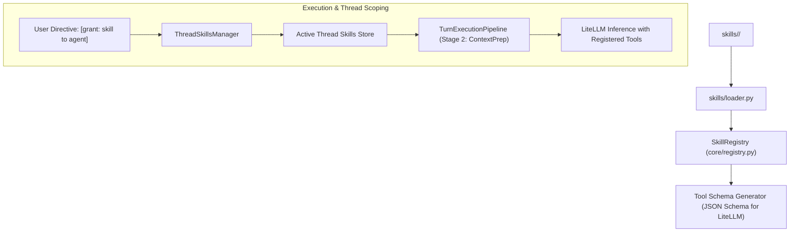

# Skills Framework & Dynamic Registration

This document details the architecture of **Izvor**'s dynamic skills system, explaining how capabilities are discovered, registered, granted, revoked, and executed by personas.

---

## 🧩 Architectural Overview

In Izvor, a **Skill** is a modular capability that can be dynamically attached to or detached from personas, either statically via configuration or dynamically during conversation turns via user directives.

Skills fall into two distinct categories:
1. **Tool-Backed Skills**: Provide executable tools (such as web search, file reading, or RAG queries) that the LLM invokes via function calling.
2. **Behavioral Constraint Skills**: Inject deterministic prompt guidelines or mechanical limits (such as minimum/maximum word counts or round caps).

---

## 🔍 Discovery & Registration Lifecycle

### 1. Skill Discovery ([`skills/loader.py`](file:///c:/Users/Hp/Documents/agy2-projects/Izvor/skills/loader.py))
During application boot, the loader scans the [`skills/`](file:///c:/Users/Hp/Documents/agy2-projects/Izvor/skills) root directory. Every subdirectory containing a valid `SKILL.md` file is evaluated.

### 2. Manifest & Schema Parsing
The loader extracts:
- `name`: Unique skill identifier (e.g., `web_research`).
- `display_name`: Human-readable label for Slack UI.
- `description`: Explanatory text injected into LLM system prompts or tool definitions.
- `parameters`: JSON schema specifying expected input arguments.

### 3. Registry Storage ([`core/registry.py`](file:///c:/Users/Hp/Documents/agy2-projects/Izvor/core/registry.py))
Valid skills are registered into the global `SkillRegistry`. They can be queried via the administrative REST endpoint (`GET /api/skills`) or listed inside Slack via `[list_skills]`.

---

## 🔄 Dynamic Grant & Revoke Mechanics

Izvor provides fine-grained control over skill assignment through [`ThreadSkillsManager`](file:///c:/Users/Hp/Documents/agy2-projects/Izvor/orchestration/thread_skills_manager.py):

### 1. Static Configuration (Baseline)
Personas can be assigned permanent baseline skills in [`data/settings/agent_settings.json`](file:///c:/Users/Hp/Documents/agy2-projects/Izvor/data/settings/agent_settings.json) (e.g. `SecurityArchitect` defaults with `knowledge_base_rag` and `document_reader`).

### 2. Runtime Dynamic Granting
Users can grant skills on the fly within an active thread:
- `[grant: web_research to Visionary]` -> Grants `web_research` exclusively to `Visionary`.
- `[grant_all: web_research]` -> Grants `web_research` to all participating personas.

### 3. Runtime Revocation
- `[revoke: web_research from Visionary]` -> Removes tool access from `Visionary`.
- `[revoke_all: web_research]` -> Strips the tool from all participants.
- `[revoke_constraint: max_words]` -> Clears active word limit constraints.

---

## 🛡️ Tool Sandboxing & Confinement

Tool execution occurs inside a protected sandbox:
- File paths are validated against `MCP_WORKSPACE_DIR` to prevent directory traversal (`../`).
- Network requests from web research tools enforce timeouts and domain filtering.
- Non-blocking asynchronous handlers prevent worker pool starvation.
