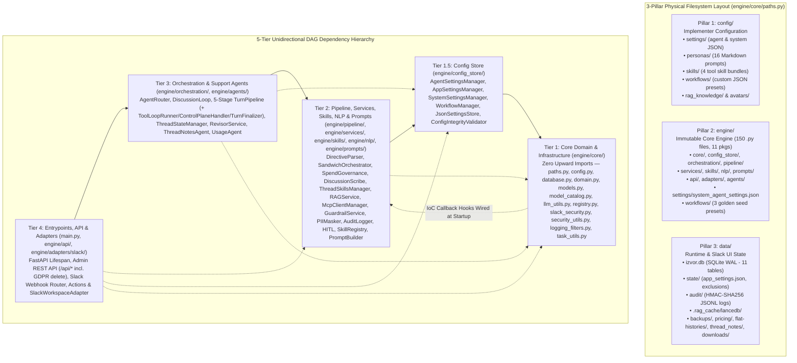
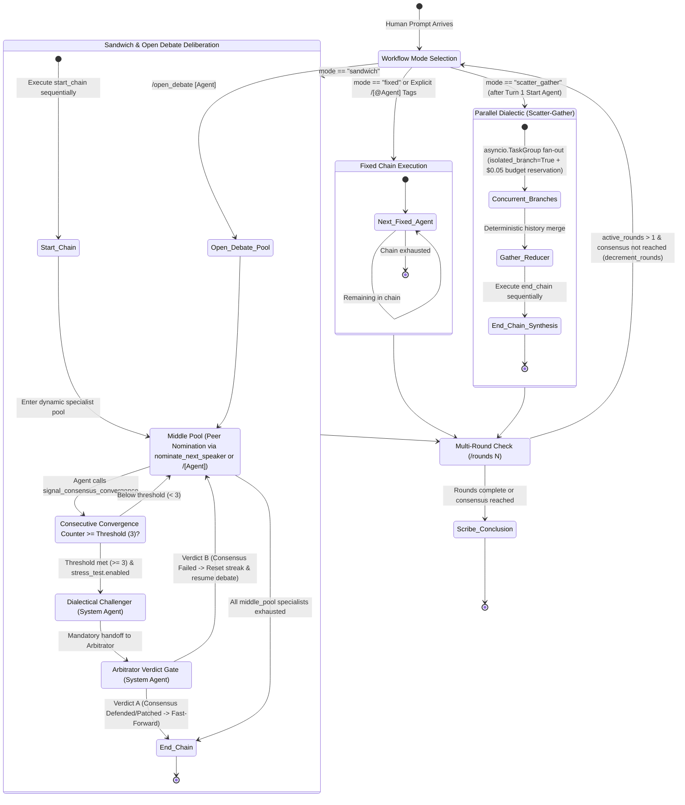
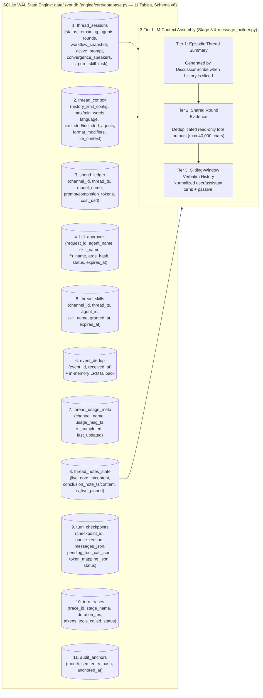
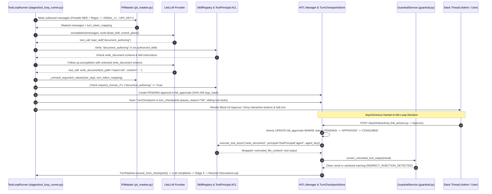

# Izvor — Comprehensive System Specification, Features & Architecture Reference (`v0.10.0`)

## 1. Executive Definition & Platform Vision

**Izvor** (`v0.10.0`, Python `>=3.11`) is an asynchronous **Multi-Agent Dialectical Deliberation & Slack Orchestration Platform**. It integrates Slack workspaces (via the Slack Events API, Interactive Block Kit Components, and Slack App Home) with heterogeneous Large Language Model (LLM) providers through [LiteLLM](https://github.com/BerriAI/litellm), an embedded ACID SQLite state engine (WAL mode), a serverless hybrid vector + full-text Retrieval-Augmented Generation (RAG) engine (LanceDB + Tantivy BM25), two-way privacy masking (Microsoft Presidio + deterministic regex), and external Model Context Protocol (MCP) tool servers.

### 1.1 The Problem Izvor Solves
Conventional single-agent chat assistants suffer from three structural limitations in complex decision-making:
1. **Single-Perspective Sycophancy**: A single assistant tends to agree with the user's framing rather than stress-testing assumptions across competing engineering, security, legal, financial, and product dimensions.
2. **Stateless Context Drift & Hallucination Propagation**: Long multi-turn threads either exceed context windows or allow unverified claims by one turn to be repeated as ground truth by subsequent turns.
3. **Unbounded Operational Risk**: Unmonitored tool loops, unmasked PII/secrets sent to third-party APIs, and runaway token spend create compliance and budget hazards.

### 1.2 How Izvor Solves It
Izvor replaces isolated prompt-response pairs with structured **dialectical panels** of **multiple domain-specialized personas** (16 default OOB) and **5 built-in system agents**:
- **Structured Topologies**: Supports *Sandwich*, *Parallel Dialectic (Scatter-Gather)*, *Fixed Chain*, *Open Debate*, and *Ad-Hoc Tagged* workflows.
- **Adversarial Stress-Testing**: Intercepts premature agreement streaks with a mandatory **Challenger → Arbitrator** gate before allowing a debate to conclude.
- **Cascading Hallucination Prevention**: Runs a post-turn **Two-Stage `InternalRevisor`** barrier that verifies every agent turn against isolated ground truth (`<initial_user_prompt>` and `<retrieved_evidence>`), preventing inter-agent hallucination contagion.
- **Zero-Infrastructure Durability**: Persists all session state, spend ledgers, Human-in-the-Loop (HITL) checkpoints, telemetry traces, and cryptographic audit anchors in standard-library SQLite (`data/izvor.db`) and atomic JSON stores with automated rolling backups.

---

## 2. Physical & Layered Architecture

Izvor combines a **3-Pillar Physical Separation** on disk ([engine/core/paths.py](../../engine/core/paths.py)) with a strict **5-Tier Unidirectional DAG Dependency Architecture** enforced via AST static analysis ([tests/unit/test_architecture_layers.py](../../tests/unit/test_architecture_layers.py)).

### Diagram 1: 3-Pillar Physical Layout & 5-Tier Unidirectional DAG Hierarchy



### 2.1 The 3 Physical Pillars ([engine/core/paths.py](../../engine/core/paths.py))

All filesystem paths are centrally anchored in [engine/core/paths.py](../../engine/core/paths.py) (which imports only Python's standard-library `os` and `pathlib.Path` to guarantee zero circular imports) and support `IZVOR_*` environment variable overrides for hermetic testing:

| Pillar | Canonical Path Constant | Contents & Responsibility |
| :--- | :--- | :--- |
| **`config/`** *(Implementer Tier)* | `CONFIG_DIR` | Declarative domain customization: [agent_settings.json](../../config/settings/agent_settings.json), [system_settings.json](../../config/settings/system_settings.json), 16 persona prompts in [config/personas/](../../config/personas), 4 configurable agent skills in [config/skills/](../../config/skills), custom workflow presets in [config/workflows/](../../config/workflows), RAG documents in [config/rag_knowledge/](../../config/rag_knowledge), and custom avatars in [config/avatars/](../../config/avatars). |
| **`engine/`** *(Core Engine Tier)* | `ENGINE_DIR` | Immutable application logic (**150 Python modules** across 11 packages), built-in system agent definitions in [engine/settings/system_agent_settings.json](../../engine/settings/system_agent_settings.json), 3 protected seed workflows in [engine/workflows/](../../engine/workflows), **18 built-in** directive/control-plane skills in [engine/skills/builtin/](../../engine/skills/builtin), system agent prompts in [engine/prompts/system_agents/](../../engine/prompts/system_agents), and fallback avatars in [engine/avatars/](../../engine/avatars). |
| **`data/`** *(Runtime & UI Tier)* | `DATA_DIR` | Mutable operational state: SQLite WAL database (`data/izvor.db`), Slack App Home settings ([data/state/app_settings.json](../../data/state/app_settings.json)), Presidio skill vocabulary exclusions ([data/state/presidio_skill_exclusions.json](../../data/state/presidio_skill_exclusions.json)), monthly HMAC audit logs (`data/audit/`), rolling backups (`data/backups/`), pricing cache (`data/pricing/`), exported Markdown transcripts (`data/flat-histories/`), Scribe thread notes (`data/thread_notes/`), thread-scoped attachment downloads (`data/downloads/`), and LanceDB vector indices (`data/.rag_cache/lancedb/`). |
| **`agents_resources/`** *(Sandbox)* | `AGENTS_RESOURCES_DIR` | Strictly sandboxed read/write workspace for agent document tools (`read_document`, `write_document`, `list_documents`). |

### 2.2 Strict Layer Isolation & Inversion-of-Control (IoC) Wiring
As verified by [test_architecture_layers.py](../../tests/unit/test_architecture_layers.py):
- **5-Tier Unidirectional DAG (`test_strict_five_tier_dag_layer_boundaries`)**: No module may import from a higher tier (`core` 1.0 → `config_store` 1.5 → `services`/`skills`/`nlp`/`prompts`/`pipeline` 2.0 → `orchestration`/`agents` 3.0 → `adapters`/`api`/`main.py` 4.0).
- **Lateral Tier-4 Isolation (`test_api_and_adapters_do_not_cross_import`)**: First-party HTTP transport ([engine/api/](../../engine/api/__init__.py)) and external messaging platform adapters ([engine/adapters/](../../engine/adapters/__init__.py)) never cross-import each other.
- **Zero Upward Imports in `engine/core/`**: Modules in `engine/core/` never import from `config_store`, `adapters`, `api`, `orchestration`, `agents`, `services`, `pipeline`, `skills`, or `prompts` (neither top-level nor deferred).
- **Startup IoC Hook Registration**: Higher-layer services inject callbacks into `engine/core/` and `services/retention_service.py` during startup in [main.py](../../main.py):
  - `set_audit_logger_hook(log_audit_event)` & `set_secret_scanner_hook(scan_output_for_secrets)`
  - `set_pii_masker_instance(pii_masker)` & `set_prompt_builder_hook(build_agent_prompt)`
  - `set_default_workspace_adapter_factory(SlackWorkspaceAdapter)` & `register_token_recorder(record_thread_tokens)`
  - `set_initial_agents_provider(get_initial_agents)` & `set_thread_state_provider(lambda: thread_state_manager)`
  - `register_thread_purge_hook(...)` (`usage_tracker`, `thread_notes`, `thread_state`)
  - `set_skill_registry_provider(...)` (wired in [engine/skills/registry.py](../../engine/skills/registry.py))
  - `set_db_busy_timeout_provider(...)` & `set_burst_limits_provider(...)` (wired in [engine/config_store/system_settings.py](../../engine/config_store/system_settings.py))
- **Sanitized Slack Egress Boundary**: Direct calls to `chat_postMessage`, `chat_update`, or `chat_postEphemeral` outside `engine/services/slack/` are prohibited by AST test `test_slack_client_chat_not_called_outside_allowed_modules`, ensuring every outbound message passes through mention sanitization (`<!here>`, `<!channel>`, `<!everyone>` neutralization) and secret scanning.
- **No `await` Inside Synchronous DB Transactions**: Enforced by AST test `test_no_await_inside_sync_db_transactions` across the entire repository to prevent SQLite connection lock deadlocks.

---

## 3. Ingress Lifecycle, FastAPI Lifespan & Background Services

Izvor enforces a strict single-worker (`WEB_CONCURRENCY=1`, failing fast if `> 1`) asynchronous ASGI lifecycle in [main.py](../../main.py) to coordinate in-memory `asyncio.Task` cancellation, generation-based turn superseding, and clean task draining on shutdown.

### Diagram 2: Webhook Ingress, FastAPI Lifespan & Background Daemons

```mermaid
sequenceDiagram
    autonumber
    participant Slack as Slack Platform
    participant Security as slack_security.py
    participant Dedup as EventDeduplicationCache (events.py)
    participant Router as ThreadStateManager / DiscussionLoop
    participant Lifespan as FastAPI Lifespan (main.py)
    participant DB as SQLite WAL (izvor.db)

    Note over Lifespan,DB: Server Startup & Shutdown Phase (main.py lifespan)
    Lifespan->>Lifespan: Fail-fast if WEB_CONCURRENCY > 1
    Lifespan->>DB: init_db() — WAL mode + 6 numbered migrations (11 tables)
    Lifespan->>Lifespan: validate_audit_configuration() + skill_registry.reload()
    Lifespan->>Lifespan: Check audit log integrity (HMAC keyring continuity)
    Lifespan->>Lifespan: asyncio.gather(pricing warm-up, RAG reconcile, retention prune, Presidio warm-up, MCP discovery)
    Lifespan->>Lifespan: Spawn 5 periodic background tasks; on shutdown: _drain_active_tasks_and_close_db()

    Note over Slack,DB: Runtime Webhook Ingress (/slack/events, /slack/actions & /slack/interactivity)
    Slack->>Security: HTTP POST with X-Slack-Signature & X-Slack-Request-Timestamp
    Security->>Security: Verify 300s replay window & constant-time HMAC-SHA256
    alt Signature Invalid
        Security->>Security: Sliding-window burst limiter (5/60s per client)
        Security-->>Slack: HTTP 401/403 (Throttled AUTH_FAILURE audit event)
    else Signature Valid
        Security->>Dedup: Filter allowed subtypes + forward verified event
        Dedup->>DB: INSERT OR IGNORE event_id (bounded in-memory LRU fallback on DB error)
        alt Duplicate Event Retry
            Dedup-->>Slack: HTTP 200 OK (Ignored)
        else New Event
            Dedup->>Router: dispatch_discussion_task(process_and_respond)
            Dedup-->>Slack: Immediate HTTP 200 OK (<3s Slack timeout)
            Router->>DB: Increment thread generation & execute DiscussionLoop
        end
    end
```

### 3.1 Startup Initialization & Lifespan Daemons ([main.py](../../main.py#L205-L345))
During FastAPI `lifespan` startup and shutdown, Izvor executes fail-fast checks, concurrent warm-ups, and clean draining:
1. **Single-Worker Enforcement & Explicit Skill Reload**: Rejects `WEB_CONCURRENCY > 1` with `RuntimeError` before DB initialization; explicitly invokes `skill_registry.reload()` (preserving lazy `auto_load=False` module imports).
2. **SQLite Schema & Migrations (`init_db()`)**: Initializes `data/izvor.db` in `WAL` mode and runs 6 numbered `PRAGMA user_version` migrations across 11 tables ([engine/core/database.py](../../engine/core/database.py#L281-L288)).
3. **Audit Configuration & Startup Integrity Verification**: Calls `validate_audit_configuration()` (requiring `AUDIT_HMAC_SECRET` or `AUDIT_HMAC_KEYS_JSON` in production) and `AppIntegrityValidator.check_audit_log_integrity()` ([integrity_checks.py](../../engine/orchestration/integrity_checks.py)). If hash chain corruption or key discrepancies are detected, dispatches an immediate DM alert to `SLACK_ADMIN_USER_IDS`.
4. **Concurrent Warm-Up Gather & Shutdown Drain**: Concurrently awaits `pricing_service.warm_up_cache()`, `rag_sync_engine.reconcile()`, `prune_expired_records()`, `pii_masker.warm_up()`, and `mcp_client_manager.discover_all_enabled_servers()`. On shutdown, `_drain_active_tasks_and_close_db(timeout=5.0)` cancels active tasks, awaits completion, closes SQLite connections, and shuts down MCP sessions.
5. **Five Continuous Background Daemons**:
   - `keep_loop_alive()` (Windows `win32` only): Wakes `ProactorEventLoop` every `0.5s` so idle sockets never freeze.
   - `periodic_thread_state_cleanup()`: Runs every `600s` (`thread_cleanup_interval_seconds`) to evict expired in-memory thread states (`ttl_seconds=3600s`, `max_tracked_threads=500`) and purge old Slack file downloads.
   - `periodic_audit_integrity_guard()`: Runs every `43,200s` (12 hours, `audit_integrity_check_interval_seconds`) to verify cryptographic hash continuity and SQLite `audit_anchors` head hashes.
   - `periodic_retention_prune()`: Runs every `86,400s` (24 hours) via [retention_service.py](../../engine/services/retention_service.py) to redact sensitive payloads from resolved checkpoints and purge expired rows (`turn_checkpoints`: 7d, `turn_traces`: 30d, `event_dedup`: 1d).
   - `periodic_skill_exclusions_sync()`: Runs every `86,400s` (24 hours, `skill_exclusions_sync_interval_seconds`) to reload `SkillRegistry` and synchronize skill/tool names into `data/state/presidio_skill_exclusions.json` so Presidio NER never masks legitimate skill or persona identifiers.

---

## 4. Agent Roster: Debate Personas & System Agents

### 4.1 The 16 Debate Panel Personas ([config/settings/agent_settings.json](../../config/settings/agent_settings.json))
Each persona is defined by a Markdown system prompt in [config/personas/](../../config/personas) (`agent-10001.md` through `agent-10016.md`) and configured in `config/settings/agent_settings.json`:

| Agent ID | Username | Display Name | Default Model | Short Output (`70w`) | Default Assigned Skills |
| :--- | :--- | :--- | :--- | :---: | :--- |
| `agent-10001` | `Visionary` | Visionary | `gemini/gemini-3.8-flash` | No | *(None)* |
| `agent-10002` | `Innovator` | Innovator | `anthropic/claude-opus-5` | No | `document_authoring`, `document_reader`, `knowledge_base_rag` |
| `agent-10003` | `Sceptic` | Sceptic | `anthropic/claude-opus-5` | No | *(None)* |
| `agent-10004` | `CompliancePrivacyAndGovernanceOfficer` | Compliance, Privacy And Governance Officer | `mistral/mistral-large-latest` | **Yes** | *(None)* |
| `agent-10005` | `ScopeOptimizer` | Scope Optimizer | `mistral/mistral-large-latest` | **Yes** | *(None)* |
| `agent-10006` | `ROIStrategist` | ROI Strategist | `gemini/gemini-3.8-flash` | No | `document_authoring`, `document_reader`, `knowledge_base_rag` |
| `agent-10007` | `UserAdvocate` | User Advocate | `openai/gpt-5.6-terra` | No | *(None)* |
| `agent-10008` | `SecurityArchitect` | Security Architect | `mistral/mistral-large-latest` | No | `document_reader`, `knowledge_base_rag` |
| `agent-10009` | `MarketAndCompetitionResearchExpert` | Market & Competition Research Expert | `mistral/mistral-large-latest` | No | `web_research` |
| `agent-10010` | `SalesAdvisor` | Sales Advisor | `gemini/gemini-3.8-flash` | **Yes** | `knowledge_base_rag`, `web_research` |
| `agent-10011` | `LegalAdvisor` | Legal Advisor | `gemini/gemini-3.8-flash` | **Yes** | `knowledge_base_rag`, `web_research` |
| `agent-10012` | `ProductStrategist` | Product Strategist | `openai/gpt-5.6-terra` | No | *(None)* |
| `agent-10013` | `RiskAuditor` | Risk Auditor | `gemini/gemini-3.8-flash` | No | *(None)* |
| `agent-10014` | `Tactician` | Tactician | `gemini/gemini-3.8-flash` | No | *(None)* |
| `agent-10015` | `Revisor` | Revisor | `gemini/gemini-3.8-flash` | No | `web_research`, `knowledge_base_rag` |
| `agent-10016` | `CreativeAdvisor` | Creative Advisor | `gemini/gemini-3.8-flash` | No | `document_authoring`, `document_reader`, `knowledge_base_rag`, `web_research` |

### 4.2 The 5 System Agents & Orchestrator ([engine/settings/system_agent_settings.json](../../engine/settings/system_agent_settings.json))
System agents handle dialectical governance, verification, and synthesis, with prompt templates stored in [engine/prompts/system_agents/](../../engine/prompts/system_agents):
1. **`Challenger` (*Dialectical Challenger*, `mistral/mistral-large-latest`)**: Turn-taking dialectical system agent equipped with `document_reader`, `knowledge_base_rag`, and `control_plane`. Injected automatically when premature consensus is reached to attack unexamined assumptions.
2. **`Arbitrator` (*Arbitrator*, `mistral/mistral-large-latest`)**: Turn-taking dialectical judge equipped with `document_reader`, `knowledge_base_rag`, and `control_plane`. Evaluates the *Challenger*'s critique and renders **Verdict A** (consensus upheld → fast-forward to `end_chain`) or **Verdict B** (consensus failed → return to open debate).
3. **`InternalRevisor` (*Internal Revisor*, `mistral/mistral-small-latest`)**: Post-turn fact-checker that screens every completed turn against `<authoritative_ground_truth>` and escalates flagged hallucinations to the reasoning confirmation model (`orchestrator.reasoning_model`).
4. **`DiscussionScribe` (*Discussion Scribe*, `mistral/mistral-small-latest`)**: Generates live pinned thread briefs (`Discussion_Scribe_Live.md`) and final structured conclusion notes (`Discussion_Scribe_Conclusion.md`), persisted to SQLite `thread_notes_state` and `data/thread_notes/` (channel-scoped filenames).
5. **`list_skills` (*Skills Directory Presenter*, `gemini/gemini-3.8-flash`)**: Invoked by `/list_skills` to present the thread-aware catalog of skills and authorized personas.
6. **Auxiliary NLP & Pricing Prompts**: `Intent_Extractor.md` ([intent_extractor.py](../../engine/nlp/intent_extractor.py)), `Language_Detector.md` ([language_detector.py](../../engine/nlp/language_detector.py)), and `Pricing_Agent.md` ([pricing_service.py](../../engine/services/pricing_service.py)), driven by `orchestrator.fast_model` (`gemini/gemini-3.8-flash`) and `orchestrator.reasoning_model` (`mistral/mistral-large-latest`).

---

## 5. Orchestration Engine: `DiscussionLoop` & 5-Stage `TurnPipeline`

### 5.1 `DiscussionLoop` ([engine/orchestration/discussion_loop.py](../../engine/orchestration/discussion_loop.py))
`DiscussionLoop` executes multi-turn deliberations in-memory without relying on Slack webhook bounce-backs:
- **Workflow Snapshotting**: Snapshots the active workflow configuration at Turn 1 (`thread_state_manager.set_workflow_snapshot`) so mid-debate admin edits in Slack App Home never corrupt an in-flight thread.
- **Generation-Based Superseding**: When a human posts a new message in an active thread, `thread_state_manager.increment_generation` increments the thread's generation counter and cancels the prior `asyncio.Task`. In-flight stages check `ctx.is_superseded()` before LLM calls, tool loops, and Slack posts, aborting cleanly if superseded.
- **Re-Entrant Resumption**: Seamless continuation after a HITL approval or circuit-breaker override via `continue_discussion_from_turn_result` and `TurnPipeline.resume_from_checkpoint`.

### Diagram 3: The 5-Stage `TurnPipeline` & Two-Stage `InternalRevisor` Barrier

```mermaid
flowchart TD
    Start(["TurnPipeline.run(ctx: TurnContext)"]) --> GenCheck["Increment generation (if human trigger)\nRegister active asyncio.Task & reset web budget"]

    subgraph S1["Stage 1: ValidationStage (stages/validation.py)"]
        S1_Branch{"ctx.input.is_bot_trigger?"}
        S1_Human["User Turn Only:\n1. Heuristic + Sliding-Window Prompt Injection Guardrail\n2. Fetch Slack thread files & Hybrid DirectiveParser\n3. Admin/Slash Directives (/forget_thread GDPR purge, /grant_skill)\n4. Snapshot workflow & lock thread language\n5. Resolve initial target agent & pure-skill task filtering"]
        S1_Bot["Bot-Triggered Turn:\nZero-token fast path (skips guardrail, LLM intent\nextraction & file fetch).\nResolves next nominated/queued agent from remaining pool."]
        S1_Branch -->|"False (Human)"| S1_Human
        S1_Branch -->|"True (Agent)"| S1_Bot
    end

    GenCheck --> S1_Branch
    S1_Human & S1_Bot --> Trace1["Record 'validation' span in turn_traces"]

    subgraph S2["Stage 2: ResolutionStage (stages/resolution.py)"]
        S2_Lookup["Lookup agent_cfg in AgentSettingsManager\nFallback rotation if agent unconfigured"]
        S2_Spend["SpendGovernanceCircuitBreaker.is_budget_exceeded()\nCheck per-thread threshold ($1.50) & daily cap ($10.00)"]
        S2_Halt["If Tripped: Save TurnCheckpoint (pause_reason='circuit_breaker'),\npost Block Kit 'Continue Sequence' button & suspend thread"]
        S2_Lookup --> S2_Spend
        S2_Spend -->|"Exceeded"| S2_Halt
    end

    Trace1 --> S2_Lookup
    S2_Spend -->|"Within Budget"| Trace2["Record 'resolution' span in turn_traces"]

    subgraph S3["Stage 3: ContextPrepStage (stages/context_prep.py)"]
        S3_Hist["Slice history (/history N) & build 3-Tier Context:\n• Tier 1: Episodic Summary (DiscussionScribe)\n• Tier 2: Shared Round Evidence (RoundEvidenceStore)\n• Tier 3: Normalized sliding-window messages"]
        S3_Skills["Filter candidate skills via filter_skills_for_caller()\nDetect missing_required_skills & passive file_context"]
        S3_Prompt["build_agent_prompt() (prompts/builder.py):\nPersona + fixed_constraints + output_constraints (150w/70w or <60w compact)\n+ nomination_rules + workspace_context + thread-aware skills directory"]
        S3_Hist --> S3_Skills --> S3_Prompt
    end

    Trace2 --> S3_Hist
    S3_Prompt --> Trace3["Record 'context_prep' span in turn_traces"]

    subgraph S4["Stage 4: ExecutionStage, ToolLoopRunner & ControlPlaneHandler"]
        S4_Short{"Pure-skill task &\nmissing skill / file ACL?"}
        S4_DetNotice["Deterministic Missing-Skill Short-Circuit:\nZero-LLM-call concise refusal + single authorized\nagent username recommendation"]
        S4_LLM["execute_llm_with_retry() (core/llm_utils.py):\nTwo-way Presidio/Regex PII masking + LiteLLM acompletion"]
        S4_Tools["ToolLoopRunner (max 3 iterations, 60s timeout):\n• 5s delayed Slack status placeholder (tool_status.py)\n• load_skill + ToolPrincipal ACL + Indirect Output Screening\n• ControlPlaneHandler & TurnFinalizer\n• HITL pause -> save TurnCheckpoint (pause_reason='hitl')"]
        S4_Short -->|"Yes"| S4_DetNotice
        S4_Short -->|"No"| S4_LLM --> S4_Tools
    end

    Trace3 --> S4_Short
    S4_DetNotice & S4_Tools --> Trace4["Record 'execution' span in turn_traces"]

    subgraph S5["Stage 5: PostRecordStage (stages/post_record.py)"]
        S5_Word["apply_mechanical_word_limit() (max_words + 50w grace buffer)\nwhile preserving trailing /[Agent] nomination tags"]
        S5_Format["markdown_to_slack() + enforce_valid_nomination()\nAppend 'Skills used: [...]' & '{model : prompt/completion}' footer"]
        S5_Post["Post/update Slack message via SlackWorkspaceAdapter\nTrigger async ThreadNotesAgent, UsageAgent & FlatHistoryRecorder"]
        S5_Err["Centralized Error Handler:\n503 specialist deferral before end_chain | 429 retry queue"]
        S5_Word --> S5_Format --> S5_Post
    end

    Trace4 --> S5_Word
    S5_Post --> Trace5["Record 'post_record' span in turn_traces"]

    subgraph Rev["Post-Turn Barrier: Two-Stage InternalRevisor (revisor_service.py)"]
        R1["Stage 1 Fast Screen (mistral-small-latest):\nVerify <target_message_to_verify> strictly against\n<initial_user_prompt> & <retrieved_evidence>"]
        R2{"Flagged\nATTENTION?"}
        R3["Stage 2 Confirmation (mistral-large-latest):\nFilter false positives; if confirmed, post warning\nto Slack & append [Internal Revisor Warning] to history"]
        R1 --> R2
        R2 -->|"Yes"| R3
    end

    Trace5 --> R1
```



### 5.2 Key Stage Innovations Verified in Live Code
- **User-Only Stage 1 Parsing & Guardrail Pre-Filtering**: Expensive operations—two-step prompt injection checks (`guardrail_service.is_prompt_injection`: zero-cost heuristic regex + capped sliding-window LanceDB embeddings), hybrid regex + LLM directive extraction (`directive_parser.parse`), language locking, `/forget_thread` GDPR purge short-circuiting, and Slack attachment downloads—execute **only** when `not ctx.input.is_bot_trigger`. Subsequent agent turns bypass these steps at zero token cost.
- **Stage 4 Collaboration Split (`ToolLoopRunner`, `ControlPlaneHandler`, `TurnFinalizer`)**: Interactive tool execution runs in [tool_loop_runner.py](../../engine/orchestration/stages/tool_loop_runner.py) (enforcing `ToolPrincipal` ACLs, mid-turn budget checks, and indirect injection screening on tool outputs via `guardrail_service.screen_untrusted_tool_output()`), structured control-plane parsing runs in [control_plane_handler.py](../../engine/orchestration/stages/control_plane_handler.py), and response normalization runs in [turn_finalizer.py](../../engine/orchestration/stages/turn_finalizer.py).
- **Deterministic Missing-Skill Short-Circuit**: When a user prompt is a pure skill task (`is_pure_skill_task == True`, e.g., reading a document or searching the web) and the current agent lacks the required skill or file ACL (with no prior verified skill output in the round), `ExecutionStage` short-circuits the LLM call and emits a deterministic notice recommending a single best-fit authorized agent by `username` ([select_recommended_agent_from_keys](../../engine/skills/recommender.py)).
- **Dual-Layer Word Limit Enforcement**:
  1. *Prompt Layer ([builder.py](../../engine/prompts/builder.py#L187-L243))*: Injects `default_max_words` (`150`) or `short_max_words` (`70` for `is_short_output: true` agents), or switches to **Compact Override Mode** when `max_words < 60` (stripping multi-section `<output_contract>` blocks).
  2. *Mechanical Fail-Safe Layer ([post_record.py](../../engine/orchestration/stages/post_record.py#L61-L99))*: `apply_mechanical_word_limit` truncates responses exceeding `max_words + word_limit_grace_buffer` (`50` words, or `0` buffer when `max_words < 20`) while extracting and preserving trailing `/[Agent]` nomination tags so turn handoffs never break.
- **503 High-Demand Specialist Rotation & 429 Retry Queue**: If an LLM provider returns HTTP 503 during a *Sandwich* middle-pool turn, `PostRecordStage.handle_error` defers the faulted agent right before the `end_chain` and hands off to the next specialist so the discussion continues uninterrupted.

---

## 6. Deliberation Topologies, Workflows & Dialectical Convergence

### 6.1 Two-Tier Workflow Preset Management ([engine/config_store/workflow_manager.py](../../engine/config_store/workflow_manager.py))
`WorkflowManager` merges two directories of workflow presets while protecting reserved system default IDs (`REQUIRED_DEFAULT_WORKFLOW_IDS`):
1. **Immutable Engine Seed Workflows ([engine/workflows/](../../engine/workflows))**:
   - [default_review_flow.json](../../engine/workflows/default_review_flow.json) (`mode: "fixed"`): `Visionary` → `Innovator` → `Sceptic` → `Tactician` → `ProductStrategist`.
   - [default_sandwich.json](../../engine/workflows/default_sandwich.json) (`mode: "sandwich"`):
     - `start_chain`: `ScopeOptimizer` (`agent-10005`), `Visionary` (`agent-10001`), `UserAdvocate` (`agent-10007`)
     - `middle_pool`: All remaining enabled debate personas (dynamic peer nomination)
     - `end_chain`: `SecurityArchitect` (`agent-10008`), `Sceptic` (`agent-10003`), `Revisor` (`agent-10015`)
   - [parallel_dialectic_flow.json](../../engine/workflows/parallel_dialectic_flow.json) (`mode: "scatter_gather"`):
     - `start_chain`: `Visionary` (`agent-10001`)
     - `scatter_agents`: All remaining non-end-chain specialists executing concurrently in isolated `asyncio.TaskGroup` branches
     - `end_chain`: `ROIStrategist` (`agent-10006`)
2. **Implementer Custom Workflows ([config/workflows/](../../config/workflows))**:
   - [idea_architecture_feasibility_review.json](../../config/workflows/idea_architecture_feasibility_review.json) (`mode: "fixed"`, 9-turn chain)
   - [idea_conceptual_feasibility_review.json](../../config/workflows/idea_conceptual_feasibility_review.json) (`mode: "fixed"`, 9-turn chain)
   - [quick_tech_triage.json](../../config/workflows/quick_tech_triage.json) (`mode: "fixed"`, `LegalAdvisor` → `SecurityArchitect`)

### Diagram 4: Topologies & Challenger → Arbitrator Convergence State Machine



---

## 7. Hybrid State Persistence & 3-Tier Context Memory

### 7.1 `ThreadStateManager` Facade ([engine/orchestration/thread_state.py](../../engine/orchestration/thread_state.py))
`ThreadStateManager` coordinates four specialized domain stores in [engine/orchestration/state/](../../engine/orchestration/state/__init__.py) backed by SQLite WAL transactions:
1. **`DiscussionStateStore` ([discussion_store.py](../../engine/orchestration/state/discussion_store.py))**: Tracks active `asyncio.Task` handles, `remaining_agents` (nullable to distinguish uninitialized vs. exhausted queues), `custom_flow`, `open_debate`, `stop_requested`, `rounds`, `round_sequence`, `workflow_snapshot`, `consensus_reached`, `convergence_speakers`, `initial_prompt`, `active_prompt`, and `is_pure_skill_task`.
2. **`TurnRetryStateStore` ([retry_store.py](../../engine/orchestration/state/retry_store.py))**: Manages per-thread generation counters (`get_generation`, `increment_generation`), 429 rate-limit retry queues, and 503 high-demand error tracking.
3. **`ThreadContextStore` ([context_store.py](../../engine/orchestration/state/context_store.py))**: Persists `/history` window cutoffs (`HistoryLimitConfig`), `max_words`, `min_words`, `scribe_max_words`, `scribe_min_words`, locked thread `language`, `excluded_agents`, `included_agents`, `format_modifiers`, and attached `file_context` (`FileContext`).
4. **`RoundEvidenceStore` ([evidence_store.py](../../engine/orchestration/state/evidence_store.py))**: Caches read-only tool outputs (`web_search`, `fetch_web_page`, `read_document`, `list_documents`, `search_knowledge_rag`) per round so downstream agents and `InternalRevisor` share verified evidence without redundant tool calls.

### Diagram 5: 3-Tier Memory Architecture & 11-Table SQLite Schema (`data/izvor.db`)



---

## 8. Declarative Skills Engine, Hybrid RAG & External MCP Integration

### 8.1 Declarative `SKILL.md` Architecture ([engine/skills/registry.py](../../engine/skills/registry.py))
Every skill in Izvor is defined by a `SKILL.md` file with mandatory YAML frontmatter (`name`, `display_name`, `description`, `scope`, `requires_human_ITL`, `requires_admin`, `triggers`) and optional `action.py` (orchestrator/directive handler) or `tools.py` (custom tool schemas and handlers). Modularized across [parser.py](../../engine/skills/parser.py), [policy.py](../../engine/skills/policy.py), [recommender.py](../../engine/skills/recommender.py), and [registry.py](../../engine/skills/registry.py), `SkillRegistry` uses lazy initialization (`auto_load=False` at import time) populated cleanly during startup `reload()`.

#### A. Extensible Implementer-Configurable Agent Tool Skills (4 OOB in [config/skills/](../../config/skills))
| Skill Name | Scope | Slash Triggers | Requires Admin | Requires HITL | Bound Tools & Capabilities |
| :--- | :--- | :--- | :---: | :---: | :--- |
| [`document_reader`](../../config/skills/document_reader/SKILL.md) | `agent` | `/read_file`, `/read-file`, `/file`, `/attachment`, `/document_reader` | No | No | `list_documents`, `read_document` (sandboxed to `agents_resources/`, supports TXT/MD/PDF via `pypdf`, enforces per-file `authorized_agents` ACLs, `handles_files: true`). |
| [`document_authoring`](../../config/skills/document_authoring/SKILL.md) | `agent` | `/document_authoring`, `/authoring`, `/write_doc` | No | **Yes** | `write_document` (sandboxed to `agents_resources/`, blocks protected paths & >1MB writes, requires Slack HITL approval). |
| [`knowledge_base_rag`](../../config/skills/knowledge_base_rag/SKILL.md) | `agent` | `/rag`, `/search_docs`, `/knowledge` | No | No | `search_knowledge_rag` ([tools.py](../../config/skills/knowledge_base_rag/tools.py)) — queries `RAGService` across `scope="all"` (shared + agent knowledge) or `scope="self"`. |
| [`web_research`](../../config/skills/web_research/SKILL.md) | `agent` | `/web_research`, `/webresearch` | No | No | `web_search` (multi-engine `ddgs` scraper) and `fetch_web_page` (DNS-pinned, SSRF/Slowloris-guarded HTTPX scraper, max 5 fetches/turn). |

#### B. 18 Built-in Control-Plane & Directive Skills ([engine/skills/builtin/](../../engine/skills/builtin))
| Skill Name | Scope | Registered Slash Triggers (`SKILL.md`) | Requires Admin | Purpose & Behavior |
| :--- | :--- | :--- | :---: | :--- |
| [`control_plane`](../../engine/skills/builtin/control_plane/SKILL.md) | `orchestrator` (`global: true`) | *(None — Agent Tool)* | No | Provides `nominate_next_speaker` (with dynamic non-self peer enum), `request_user_clarification`, and `signal_consensus_convergence`. |
| [`first`](../../engine/skills/builtin/first/SKILL.md) | `orchestrator` | `/first` | No | Designates the first speaker for the debate while preserving the remaining panel (`auto_detect: false`). |
| [`open_debate`](../../engine/skills/builtin/open_debate/SKILL.md) | `orchestrator` | `/open_debate`, `/open-debate`, `/opendebate` | No | Starts an open debate with a designated speaker without fixed start/end chains (`auto_detect: false`). |
| [`rounds`](../../engine/skills/builtin/rounds/SKILL.md) | `orchestrator` | `/rounds`, `/round`, `/next_round`, `/next-round`, `/nextround` | No | Sets or advances deliberation rounds (`1..5`) for the thread (`auto_detect: false`, slash-origin gated). |
| [`stop_discussion`](../../engine/skills/builtin/stop_discussion/SKILL.md) | `orchestrator` | `/stop` | No | Terminal command (`terminal: true`, `auto_detect: false`) that immediately halts active tasks in the thread. |
| [`exclude_agents`](../../engine/skills/builtin/exclude_agents/SKILL.md) | `orchestrator` | `/exclude` | No (`off`=Admin) | Excludes specified personas from participating in the thread (`auto_detect: true`). |
| [`include_agents`](../../engine/skills/builtin/include_agents/SKILL.md) | `orchestrator` | `/include` | No (`off`=Admin) | Explicitly adds personas to the thread's active deliberation pool (`auto_detect: true`). |
| [`grant_skill`](../../engine/skills/builtin/grant_skill/SKILL.md) | `orchestrator` | `/grant_skill`, `/grant-skill` | **Yes** | Grants an ephemeral thread-scoped skill to specific agent(s) (`auto_detect: false`). |
| [`grant_skill_for_all`](../../engine/skills/builtin/grant_skill_for_all/SKILL.md) | `orchestrator` | `/grant_skill_for_all`, `/grant-skill-for-all`, `/grant_for_all`, `/grant-for-all` | **Yes** | Grants skill(s) to all agents in the thread for `thread_skill_expiration_time` hours (`auto_detect: false`). |
| [`revoke_skill_for_all`](../../engine/skills/builtin/revoke_skill_for_all/SKILL.md) | `orchestrator` | `/revoke_skill_for_all`, `/revoke-skill-for-all`, `/revoke_for_all` | **Yes** | Revokes thread-scoped skill grants (`auto_detect: false`). |
| [`list_skills`](../../engine/skills/builtin/list_skills/SKILL.md) | `orchestrator` | `/list_skills`, `/list-skills`, `/skills` | No | Invokes the `list_skills` system agent to display all skills and agent permissions (`auto_detect: false`). |
| [`max_words`](../../engine/skills/builtin/max_words/SKILL.md) | `prompt_modifier` | `/max_words`, `/max-words`, `/maxwords`, `/max` | No (`off`=Admin) | Sets maximum word limit per turn (`1..2000` or `off`, `auto_detect: true`). |
| [`min_words`](../../engine/skills/builtin/min_words/SKILL.md) | `prompt_modifier` | `/min_words`, `/min-words`, `/minwords`, `/min` | No (`off`=Admin) | Sets minimum word length per turn (`1..1000` or `off`, `auto_detect: true`). |
| [`scribe_max_words`](../../engine/skills/builtin/scribe_max_words/SKILL.md) | `orchestrator` | `/scribe_max_words`, `/scribe-max-words`, `/scribemaxwords` | No (`off`=Admin) | Sets word ceiling (`1..2000` or `off`) for Discussion Scribe notes (`auto_detect: true`). |
| [`scribe_min_words`](../../engine/skills/builtin/scribe_min_words/SKILL.md) | `orchestrator` | `/scribe_min_words`, `/scribe-min-words`, `/scribeminwords` | No (`off`=Admin) | Sets minimum word count (`1..2000` or `off`) for Discussion Scribe notes (`auto_detect: true`). |
| [`thread_history`](../../engine/skills/builtin/thread_history/SKILL.md) | `orchestrator` | `/history` | No | Truncates prior thread history window to the last `N` messages (`0..50`, `auto_detect: true`). |
| [`revoke_constraint`](../../engine/skills/builtin/revoke_constraint/SKILL.md) | `orchestrator` | `/revoke_constraint`, `/revoke-constraint`, `/revoke` | **Yes** | Clears thread word limits, language lock, inclusions, exclusions, modifiers, or `all` (`auto_detect: false`). |
| [`forget_thread`](../../engine/skills/builtin/forget_thread/SKILL.md) | `orchestrator` | `/forget_thread`, `/forget-thread` | **Yes** | Permanently purges persisted DB state, flat histories, Scribe notes, downloads, and caches for `(channel_id, thread_ts)` (`auto_detect: false`). |

### 8.2 Hybrid Local RAG Engine ([engine/services/rag/](../../engine/services/rag/service.py))
- **Incremental Sync & Auto-Reindex ([sync_engine.py](../../engine/services/rag/sync_engine.py), [document_parser.py](../../engine/services/rag/document_parser.py))**: Scans `config/rag_knowledge/shared/` and per-agent subdirectories (`config/rag_knowledge/agent-10008/`), tracks SHA-256 hashes + `__meta__.config_hash` in `data/.rag_cache/file_manifest.json` (auto-reindexing on embedding/PII/chunk config drift), parses Markdown outside fenced ` ``` ` / `~~~` blocks, uses collision-free 8-char SHA-256 `sanitize_id`, shares document-level PII `token_mapping` across chunks during `"AT_INGESTION"` masking, and generates 3072-dim embeddings via LiteLLM (`gemini/gemini-embedding-001` in [embeddings.py](../../engine/services/rag/embeddings.py)).
- **Hybrid Search ([vector_store.py](../../engine/services/rag/vector_store.py))**: Combines dense cosine similarity search in LanceDB (`data/.rag_cache/lancedb/`) with Tantivy BM25 full-text search using Reciprocal Rank Fusion (RRF), validates SQL filter literals with Unicode `_SAFE_ID_RE = ^[\w.:/ '-]{1,256}$`, and falls back gracefully to BM25 if embedding generation fails.
- **Retrieval-Time PII Masking**: Respects `rag.pii_masking` (`"AT_RETRIEVAL"`, `"AT_INGESTION"`, or `"NONE"`) and appends citation fidelity rules ([citation_instructions.md](../../engine/services/rag/citation_instructions.md)).

### 8.3 External Model Context Protocol (MCP) Client Integration ([engine/services/mcp/](../../engine/services/mcp/client_manager.py))
- **Transports**: Supports `stdio` subprocess servers and `sse` / `streamable_http` remote servers configured in `system_settings.json` (`mcp_servers`).
- **Process & Environment Hardening ([windows_process.py](../../engine/services/mcp/windows_process.py), [security_bridge.py](../../engine/services/mcp/security_bridge.py))**: Strips sensitive host environment variables (`SLACK_*`, `*_API_KEY`, `AUDIT_HMAC_SECRET`) before spawning `stdio` MCP servers, assigns child processes to a Windows Job Object (`JOB_OBJECT_LIMIT_KILL_ON_JOB_CLOSE`) to prevent orphan processes, namespaces tools as `mcp__{server}__{tool}`, and enforces HITL approval on mutating/destructive MCP tools.

---

## 9. Security, Privacy, HITL Checkpointing & Audit Architecture

### Diagram 6: Progressive Skill Disclosure, HITL Durable Checkpointing & Security Boundary



### 9.1 Six-Layer Defense-in-Depth Security Model
1. **Ingress Authentication, Burst Rate Limiting & Anti-IDOR**:
   - Slack requests require HMAC-SHA256 verification (`verify_slack_signature` in [slack_security.py](../../engine/core/slack_security.py)); admin-gated interactive actions enforce `SLACK_ADMIN_USER_IDS` and emit `ADMIN_ACTION_DENIED` on unauthorized attempts.
   - Scribe conclusion downloads ([scribe_actions.py](../../engine/adapters/slack/actions/scribe_actions.py)) verify workspace channel membership before file dispatch (`403` / `UNAUTHORIZED_SCRIBE_DOWNLOAD`).
   - Admin REST API endpoints (`/api/*` in [engine/api/router.py](../../engine/api/router.py) & [engine/api/dependencies.py](../../engine/api/dependencies.py)) require HTTP Basic Auth (`secrets.compare_digest`) protected by a sliding-window IP brute-force limiter ([rate_limiter.py](../../engine/services/rate_limiter.py), max 5 failures per 60s).
2. **Hybrid Prompt Injection & Indirect Tool-Output Guardrail ([guardrail.py](../../engine/services/security/guardrail.py))**:
   - Runs fast heuristic signature pre-checks (`PROMPT_INJECTION_BLOCKED`), embeds sliding prompt windows (`800`-char window, `200`-char stride, max `8` windows; 500-entry LRU cache), and queries the LanceDB `guardrail_signatures` table using cosine distance (`threshold = 0.85`) with configurable `guardrail_fail_mode` (`"open"` or `"closed"`).
   - Screens untrusted tool outputs (`screen_untrusted_tool_output`) inside the tool loop and HITL resume paths, replacing detected payloads with a sanitized warning and logging `INDIRECT_INJECTION_DETECTED`.
3. **Two-Way PII, Secret Masking & Log Scrubbing ([pii_masker.py](../../engine/services/security/pii_masker.py), [logging_filters.py](../../engine/core/logging_filters.py))**:
   - When `strict_privacy_mode_enabled` is active, outbound LLM prompts are scrubbed via hardened deterministic regexes (API keys, padded JWTs, full PEM envelopes, `xox*` Slack tokens, emails, SSNs, Luhn-validated credit cards, international phone numbers, validated IPv4 octets) and a configurable multi-language `pii_ner_models` Microsoft Presidio NER registry (`PERSON`, `LOCATION`, `NRP`), replacing values with reversible placeholders (`<PERSON_1>`, `<EMAIL_1>`). Tool arguments and final Slack responses are unmasked via `turn_token_mapping`, outbound responses are scanned by `scan_output_for_secrets`, and `logging_filters.py` attaches secret/Basic-auth scrubbing filters across root, `uvicorn*`, and `httpx` loggers.
4. **Prompt Injection Delimiter Containment ([security_utils.py](../../engine/core/security_utils.py))**:
   - All external file contents, web pages, RAG excerpts, and tool results are sanitized (neutralizing any embedded closing tags) and wrapped in `<untrusted_file_content>...</untrusted_file_content>` tags.
5. **Fail-Closed `ToolPrincipal` ACLs & SSRF/FS-Safe Tools ([local_tools.py](../../engine/services/local_tools.py), [web_tools.py](../../engine/services/web_tools.py))**:
   - Every tool invocation requires an explicit `ToolPrincipal(kind, id)` verified against `authorized_skills` and per-file `authorized_agents`.
   - `web_tools.py` serializes `DDGS` searches under `_DDGS_ENGINE_LOCK`, resolves DNS once, blocks private/loopback/link-local/cloud-metadata IP ranges (`169.254.169.254`, RFC1918, IPv6 unique-local), pins validated IPs at the transport layer, restricts default HTTP/HTTPS ports to `[80, 443]`, enforces fail-closed `Content-Type` allowlists, bounds slow responses with a monotonic Slowloris deadline, and caps response bodies at 2MB.
   - `local_tools.py` normalizes Unicode filenames, filters symlink escapes outside `agents_resources/`, caps reads at `MAX_READ_DOCUMENT_CHARS = 50000`, and performs atomic temp-file + `os.replace()` document writes.
6. **Non-Repudiable Cryptographic Audit Logging ([audit_logger.py](../../engine/services/audit_logger.py), [integrity_checks.py](../../engine/orchestration/integrity_checks.py))**:
   - Security and administrative events are written to monthly `data/audit/audit_YYYY_MM.jsonl` files protected by a cross-process file lock (`.audit.lock`).
   - Each entry contains a monotonic sequence number `seq`, `prev_hash`, `key_id`, and an `HMAC-SHA256` `entry_hash` signed via rotating multi-key keyring (`AUDIT_HMAC_KEYS_JSON`, `AUDIT_HMAC_ACTIVE_KEY_ID`, with single-key `AUDIT_HMAC_SECRET` fallback).
   - Head hashes are anchored in the SQLite `audit_anchors` table to detect log truncation or trailing-line deletion, and `CRITICAL` security events dispatch real-time Slack DM alerts to workspace admins.

---

## 10. Spend Governance, Slack App Home & Admin REST API

### 10.1 Spend Governance & Autonomous Pricing ([pricing_service.py](../../engine/services/pricing_service.py), [circuit_breaker.py](../../engine/pipeline/spend_governance/circuit_breaker.py))
- **Token & USD Accounting**: Every LLM completion and embedding batch records prompt/completion tokens and USD cost into the SQLite `spend_ledger` table.
- **3-Tier Pricing Resolution**: Resolves per-token rates from (1) `data/pricing/model_pricing_cache.json` (7-day TTL refreshed asynchronously by `Pricing_Agent`), (2) `litellm.model_cost`, and (3) `data/pricing/baseline_prices.json`.
- **Two-Tiered Circuit Breaker**: Enforces both per-thread limits (`circuit_breaker_threshold_usd`, default `$1.50`) and global workspace daily caps (`daily_budget_usd`, default `$10.00`), including mid-turn tool-loop budget checks (`_is_mid_turn_budget_exceeded` in [tool_loop_runner.py](../../engine/orchestration/stages/tool_loop_runner.py)) and atomic `$0.05` branch reservations during Scatter-Gather execution.

### 10.2 Slack App Home Control Plane ([engine/services/slack_home/](../../engine/services/slack_home/__init__.py))
Workspace administrators (`SLACK_ADMIN_USER_IDS`) manage the platform live inside the Slack App Home UI across three modular tabs backed by [views.py](../../engine/services/slack/views.py) (per-user publish locks, Block Kit text sanitization, and payload-hash deduplication):
1. **Agents Tab ([agents_tab.py](../../engine/services/slack_home/agents_tab.py))**: Enable/disable debate personas, assign LLM models from `model_provider_catalog.json`, toggle short output mode (`is_short_output`), assign skills, and configure system agents (`Challenger`, `Arbitrator`, `InternalRevisor`, `DiscussionScribe`, `Orchestrator`).
2. **Workflows Tab ([workflows_tab.py](../../engine/services/slack_home/workflows_tab.py))**: Select/load the active workflow preset (`select_workflow_preset`, `load_workflow_preset_button`), or create/edit/delete custom `sandwich`, `fixed`, and `scatter_gather` workflows (all actions enforce `admin_required=True` and log `ADMIN_ACTION_DENIED` on unauthorized attempts).
3. **Governance & System Settings Tab ([governance_tab.py](../../engine/services/slack_home/governance_tab.py))**: Configure circuit breakers, daily USD budgets, Scribe toggles, convergence fast-forward, strict privacy mode, output word limits, and one-click backup restores (`data/backups/`).

### 10.3 HTTP & Admin REST API Endpoints ([api/router.py](../../engine/api/router.py), [adapters/slack/router.py](../../engine/adapters/slack/router.py))

| Endpoint | Method | Auth | Handler | Description |
| :--- | :---: | :--- | :--- | :--- |
| `/`, `/health` | `GET` | Public | `api.router.health_check` | Lightweight liveness probe returning `{"status": "healthy", "service": "Izvor Multi-Agent Hub"}`. |
| `/static/*`, `/avatars/*` | `GET` | Public | `MultiDirStaticFiles` | Serves persona avatars from `config/avatars/` with fallback to `engine/avatars/`. |
| `/slack/events` | `POST` | Slack HMAC | `events.handle_slack_events` | Receives Slack Events API webhooks (`app_mention`, `message`, `app_home_opened`). |
| `/slack/interactivity`, `/slack/actions` | `POST` | Slack HMAC | `interactivity.handle_slack_interactivity` | Processes Block Kit button clicks, modal submissions, HITL approvals, and App Home actions. |
| `/api/health` | `GET` | Basic Auth | `api.router.admin_health_check` | Returns service status and list of registered agent keys (`16` personas). |
| `/api/skills` | `GET` | Basic Auth | `api.router.get_registered_skills` | Lists all `22` registered skills, descriptions, and LiteLLM tool schemas. |
| `/api/rag/status` | `GET` | Basic Auth | `api.router.get_rag_status` | Returns RAG manifest status and indexed document records. |
| `/api/rag/reconcile` | `POST` | Basic Auth | `api.router.trigger_rag_reconciliation` | Triggers on-demand `rag_sync_engine.reconcile()`, returning `new`/`modified`/`deleted`/`unchanged` counts and logging `RAG_RECONCILE_COMPLETED`. |
| `/api/audit/status` | `GET` | Basic Auth | `api.router.get_audit_status` | Runs `AppIntegrityValidator.check_audit_log_integrity()` and returns verification report. |
| `/api/threads/{channel_id}/{thread_ts}` | `DELETE` | Basic Auth | `api.router.delete_thread_data` | Permanently purges persisted DB state, flat histories, Scribe notes, downloads, and caches via `forget_thread()` and logs `GDPR_THREAD_FORGOTTEN`. |

---

## 11. Test Suite Architecture & Verification Harness

Izvor maintains a 3-tier automated test hierarchy in [tests/](../../tests) (**111 test modules** total — **103** default unit + integration modules executing **1,025 tests**, plus **8** opt-in E2E modules):
1. **Unit Tests (`tests/unit/` — 66 modules)**: Fast, isolated tests verifying parsers, domain models, prompt construction, 5-tier AST layer invariants ([test_architecture_layers.py](../../tests/unit/test_architecture_layers.py)), documentation link and source hygiene ([test_code_hygiene.py](../../tests/unit/test_code_hygiene.py)), PII masking, nominate repair, and word-limit truncation.
2. **Integration Tests (`tests/integration/` — 37 modules)**: Multi-component tests validating the 5-stage `TurnPipeline`, `DiscussionLoop`, SQLite WAL migrations, HITL checkpoint resumption, RAG indexing/search, MCP client sessions, and FastAPI endpoints using dependency injection (`PipelineDeps`, `configure_paths()`, and `IZVOR_*` environment overrides).
3. **End-to-End Behavioral Harness (`tests/e2e/` — 8 modules)**: Synthetic Slack webhook and multi-turn deliberation simulation harness ([docs/development-and-testing/e2e-testing-harness.md](../../docs/development-and-testing/e2e-testing-harness.md)) capable of exercising both mocked and live multi-provider LLM topologies.

