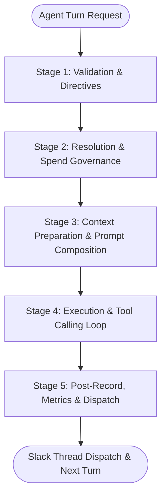

# Turn Execution Pipeline Architecture

The execution of every agent turn in **Izvor** is orchestrated by the [`TurnPipeline`](file:///c:/Users/Hp/Documents/agy2-projects/Izvor/orchestration/turn_pipeline.py), a decoupled, dependency-injected 5-stage pipeline designed for resilience, strict governance, and clean Slack UX.

---

## 🌊 Pipeline Stage Overview



The pipeline operates on a centralized state container: [`TurnContext`](file:///c:/Users/Hp/Documents/agy2-projects/Izvor/orchestration/turn_pipeline.py), transitioning the turn through five distinct stages located in [`orchestration/stages/`](file:///c:/Users/Hp/Documents/agy2-projects/Izvor/orchestration/stages/):

1. **Stage 1: Validation** ([`orchestration/stages/validation.py`](file:///c:/Users/Hp/Documents/agy2-projects/Izvor/orchestration/stages/validation.py))
2. **Stage 2: Resolution & Governance** ([`orchestration/stages/resolution.py`](file:///c:/Users/Hp/Documents/agy2-projects/Izvor/orchestration/stages/resolution.py))
3. **Stage 3: Context Preparation** ([`orchestration/stages/context_prep.py`](file:///c:/Users/Hp/Documents/agy2-projects/Izvor/orchestration/stages/context_prep.py))
4. **Stage 4: Execution & Tool Calling Loop** ([`orchestration/stages/execution.py`](file:///c:/Users/Hp/Documents/agy2-projects/Izvor/orchestration/stages/execution.py))
5. **Stage 5: Post-Record & Metrics** ([`orchestration/stages/post_record.py`](file:///c:/Users/Hp/Documents/agy2-projects/Izvor/orchestration/stages/post_record.py))

---

## 🔍 Stage-by-Stage Breakdown

### Stage 1: Validation (`validation.py`)
- **File**: [`orchestration/stages/validation.py`](file:///c:/Users/Hp/Documents/agy2-projects/Izvor/orchestration/stages/validation.py)
- **Responsibilities**:
  1. **Thread Generation Guard**: Checks whether the turn is superseded (`ctx.is_superseded()`) by verifying if a newer user prompt incremented the generation count in [`ThreadStateManager`](file:///c:/Users/Hp/Documents/agy2-projects/Izvor/orchestration/thread_state.py). Superseded turns abort immediately.
  2. **Directive Parsing & Tag Sanitization**: Extracts bracketed directives (`[rounds: N]`, `[max_words: N]`, `[history: N]`, `[stop]`) or slash equivalents (`/rounds`, `/stop`), validating numeric clamps (`rounds ≤ 5`, `max_words ≤ 2000`, `history ≤ 50`). Sanitizes raw text into `ctx.raw_text_cleaned`.
  3. **File Inspection**: If files are attached in the Slack thread, queries Slack API, verifies safety boundaries, and prepares `ctx.thread_files`.
  4. **Dynamic Exclude/Include Lists**: Manages agent exclusion and inclusion filters specified in prompt directives.

### Stage 2: Resolution & Governance (`resolution.py`)
- **File**: [`orchestration/stages/resolution.py`](file:///c:/Users/Hp/Documents/agy2-projects/Izvor/orchestration/stages/resolution.py)
- **Responsibilities**:
  1. **Agent Configuration Lookup**: Resolves `ctx.agent_key` against active persona configurations via [`AgentSettingsManager`](file:///c:/Users/Hp/Documents/agy2-projects/Izvor/orchestration/agent_settings.py).
  2. **Nomination Fallback Loop**: If the nominated agent key is unconfigured or invalid, iterates through the candidate queue in [`ThreadStateManager`](file:///c:/Users/Hp/Documents/agy2-projects/Izvor/orchestration/thread_state.py) to select an eligible replacement, preventing runtime `KeyError` crashes.
  3. **Spend Governance & Circuit Breakers**:
     - Evaluates thread-level spend against `circuit_breaker_threshold_usd` (enabled by default).
     - Checks global daily budget constraints against `daily_budget_usd`.
     - Halts execution and posts an administrative warning if thresholds are exceeded.
  4. **Sandwich Queue & Topology Resolution**: Manages speaker sequencing for debate and collaboration topologies, popping next eligible candidates cleanly.

### Stage 3: Context Preparation (`context_prep.py`)
- **File**: [`orchestration/stages/context_prep.py`](file:///c:/Users/Hp/Documents/agy2-projects/Izvor/orchestration/stages/context_prep.py)
- **Responsibilities**:
  1. **Thread History Assembly & Slicing**: Compiles chronological Slack thread history using `history_fetcher`, filtering bot control artifacts, and applying history limits (`history_limit`).
  2. **Dynamic Skill Injection**: Reads active thread skills from [`ThreadSkillsManager`](file:///c:/Users/Hp/Documents/agy2-projects/Izvor/orchestration/thread_skills_manager.py) and registers corresponding LiteLLM tool definitions.
  3. **Prompt Composition**: Employs [`prompts/builder.py`](file:///c:/Users/Hp/Documents/agy2-projects/Izvor/prompts/builder.py) to assemble the agent persona system prompt, injecting debate rules, word count bounds (`min_words`, `max_words`), thread language context, and attached file context.
  4. **PII Masking**: Pre-scans user input and context to redact sensitive patterns (emails, phone numbers, API keys) into synthetic tokens prior to LLM submission.

### Stage 4: Execution & Tool Calling Loop (`execution.py`)
- **File**: [`orchestration/stages/execution.py`](file:///c:/Users/Hp/Documents/agy2-projects/Izvor/orchestration/stages/execution.py)
- **Responsibilities**:
  1. **LiteLLM Invocation with Resilient Retry**: Submits the prepared message sequence to the configured model endpoint via [`core/llm_utils.py`](file:///c:/Users/Hp/Documents/agy2-projects/Izvor/core/llm_utils.py), with jittered exponential backoff for rate limits (HTTP 429) and transient provider disconnects.
  2. **In-Place Status Updates (5-Second Rule)**:
     - Implemented via [`orchestration/stages/tool_status.py`](file:///c:/Users/Hp/Documents/agy2-projects/Izvor/orchestration/stages/tool_status.py).
     - If tool execution finishes within 5 seconds, no intermediate progress indicator is posted, preventing UI spam.
     - If tool execution runs longer than 5 seconds, an intermediate status message is posted (e.g. `_🔍 *Visionary* is searching the web..._`), later updated in-place via `chat.update` with the final response.
  3. **Tool Loop & Fail-Closed Authorization**:
     - Dispatches authorized tool calls through [`SkillLoader`](file:///c:/Users/Hp/Documents/agy2-projects/Izvor/skills/loader.py). Unregistered or unauthorized tool executions fail closed.
     - **PII Unmasking**: Reverses tokenized synthetic values (`<EMAIL_0>`) back into original values using `pii_masker.unmask()` before passing arguments to tools.
     - **JSON Error Resilience**: Handles malformed LLM tool argument strings (`json.loads` failures) by returning error feedback directly into the conversation turn rather than crashing.
     - **Execution Timeout Guard**: Constrains iterations with `tool_call_loop_timeout_seconds` (default: 60s) to eliminate infinite tool loops.

### Stage 5: Post-Record & Metrics (`post_record.py`)
- **File**: [`orchestration/stages/post_record.py`](file:///c:/Users/Hp/Documents/agy2-projects/Izvor/orchestration/stages/post_record.py)
- **Responsibilities**:
  1. **Nomination Extraction**: Parses agent output for unicode-safe peer nomination tags (e.g. `[Scope Optimizer]`, `[Security Architect]`, or diacritics like `[Tehnički Vođa]`) using `NOMINATION_TAG_RE`.
  2. **Slack Thread Dispatch**: Posts the synthesized response to the Slack thread under the persona's bot profile, or updates the existing intermediate message.
  3. **Token Accounting & Pricing**: Computes prompt and completion token usage, updating thread metrics via [`calculate_thread_costs`](file:///c:/Users/Hp/Documents/agy2-projects/Izvor/agents/usage_agent.py).
  4. **Off-Thread Flat History Archival**: Invokes [`async_record_flat_history`](file:///c:/Users/Hp/Documents/agy2-projects/Izvor/services/flat_history_recorder.py) using Starlette's `run_in_threadpool` to append the completed turn to disk without blocking the asyncio event loop.
  5. **Thread State Transition**: Updates the active turn count, speaker history, and remaining agent queue in [`ThreadStateManager`](file:///c:/Users/Hp/Documents/agy2-projects/Izvor/orchestration/thread_state.py).

---

## 💉 Dependency Injection & Stage Composition

`TurnPipeline` is composed modularly, allowing individual hooks and stages to be mocked or substituted in tests:

```python
pipeline = TurnPipeline(
    router_module=router,
    llm_executor=mock_llm_executor,
    slack_poster=mock_slack_poster,
    history_fetcher=mock_history_fetcher,
    files_fetcher=mock_files_fetcher,
    token_recorder=mock_token_recorder,
    notes_updater=mock_notes_updater,
    usage_updater=mock_usage_updater,
    post_system_message_fn=mock_post_system_message,
    update_message_fn=mock_update_message,
    calc_costs_fn=mock_calc_costs,
)
```

Each stage is tested in isolation with isolated mock suites ([`tests/test_turn_pipeline_di.py`](file:///c:/Users/Hp/Documents/agy2-projects/Izvor/tests/test_turn_pipeline_di.py)) as well as end-to-end integration flows.
