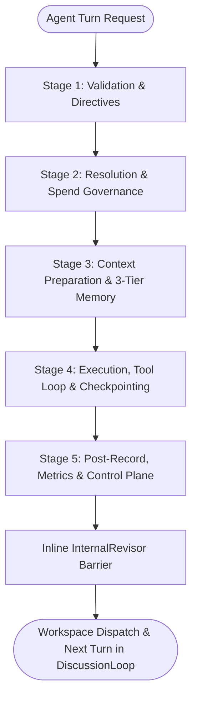

# Turn Execution Pipeline & Discussion Loop Architecture

Multi-turn deliberation in **Izvor** is coordinated by [`DiscussionLoop`](file:///c:/Users/Hp/Documents/agy2-projects/Izvor/engine/orchestration/discussion_loop.py) (invoked via [`orchestration/agent_router.py`](file:///c:/Users/Hp/Documents/agy2-projects/Izvor/engine/orchestration/agent_router.py)), while the execution of every individual agent turn is orchestrated by [`TurnPipeline`](file:///c:/Users/Hp/Documents/agy2-projects/Izvor/engine/orchestration/turn_pipeline.py)—a decoupled, hexagonal 5-stage pipeline with durable mid-turn checkpointing and inline quality revision.

---

## 🌊 Pipeline Stage Overview



The pipeline operates on a structured state container: [`TurnContext`](file:///c:/Users/Hp/Documents/agy2-projects/Izvor/engine/orchestration/turn_pipeline.py), which organizes state into four typed sub-containers (while preserving top-level property accessors):
- **`TurnInput` (`ctx.inp`)**: Immutable turn inputs (`channel_id`, `thread_ts`, `user_id`, `raw_text`, `agent_key`, `preflight_directives`, `detected_language`).
- **`TurnControlPlane` (`ctx.control_plane`)**: Routing & control state (`custom_flow`, `remaining`, `turn_count`, `current_round`, `max_rounds`, `halted`, `paused_for_hitl`, `checkpoint_id`).
- **`TurnOutput` (`ctx.out`)**: Execution outputs (`reply_text`, `nominated_agents`, `total_prompt_tokens`, `total_completion_tokens`, `revisor_warning`).
- **`SessionContext` (`ctx.session`)**: Thread-level constraints, history slice, and attached files.

Each turn transitions through five distinct stages in [`orchestration/stages/`](file:///c:/Users/Hp/Documents/agy2-projects/Izvor/engine/orchestration/stages/), with stage latency and status spans recorded asynchronously via [`TurnTraceRecorder`](file:///c:/Users/Hp/Documents/agy2-projects/Izvor/engine/services/telemetry.py):

1. **Stage 1: Validation & Directives** ([`orchestration/stages/validation.py`](file:///c:/Users/Hp/Documents/agy2-projects/Izvor/engine/orchestration/stages/validation.py) & [`orchestration/stages/directive_handlers.py`](file:///c:/Users/Hp/Documents/agy2-projects/Izvor/engine/orchestration/stages/directive_handlers.py))
2. **Stage 2: Resolution & Governance** ([`orchestration/stages/resolution.py`](file:///c:/Users/Hp/Documents/agy2-projects/Izvor/engine/orchestration/stages/resolution.py))
3. **Stage 3: Context Preparation** ([`orchestration/stages/context_prep.py`](file:///c:/Users/Hp/Documents/agy2-projects/Izvor/engine/orchestration/stages/context_prep.py))
4. **Stage 4: Execution & Tool Calling Loop** ([`orchestration/stages/execution.py`](file:///c:/Users/Hp/Documents/agy2-projects/Izvor/engine/orchestration/stages/execution.py))
5. **Stage 5: Post-Record & Metrics** ([`orchestration/stages/post_record.py`](file:///c:/Users/Hp/Documents/agy2-projects/Izvor/engine/orchestration/stages/post_record.py))

---

## 🔍 Stage-by-Stage Breakdown

### Stage 1: Validation & Directives (`validation.py` & `directive_handlers.py`)
- **Files**: [`orchestration/stages/validation.py`](file:///c:/Users/Hp/Documents/agy2-projects/Izvor/engine/orchestration/stages/validation.py), [`orchestration/stages/directive_handlers.py`](file:///c:/Users/Hp/Documents/agy2-projects/Izvor/engine/orchestration/stages/directive_handlers.py)
- **Responsibilities**:
  1. **Thread Generation Guard**: Checks whether the turn is superseded (`ctx.is_superseded()`) by verifying if a newer user prompt incremented the generation count in [`ThreadStateManager`](file:///c:/Users/Hp/Documents/agy2-projects/Izvor/engine/orchestration/thread_state.py). Superseded turns abort immediately.
  2. **Unified Pre-Flight Intent & Language Extraction**: [`IntentExtractor`](file:///c:/Users/Hp/Documents/agy2-projects/Izvor/engine/nlp/intent_extractor.py) extracts both natural-language directives and the user's `detected_language` in a single pre-flight LLM pass, eliminating redundant LLM calls inside `TurnPipeline`.
  3. **Directive Parsing & Slack Admin Authorization**: Extracts bracketed directives (`[rounds: N]`, `[max_words: N]`, `[history: N]`, `[stop]`) or slash equivalents (`/rounds`, `/stop`), validating numeric clamps (`rounds ≤ 5`, `max_words ≤ 2000`, `history ≤ 50`). Privileged directives (`/grant_skill`, `/grant_skill_for_all`, `/revoke_skill_for_all`, `/revoke_constraint`, and disabling constraints via `=off`) are gated by `is_slack_admin(ctx.user_id)` in [`directive_handlers.py`](file:///c:/Users/Hp/Documents/agy2-projects/Izvor/engine/orchestration/stages/directive_handlers.py).
  4. **File Inspection**: If files are attached in the Slack thread, queries the workspace adapter, enforces extension neutralization (`SAFE_DOWNLOAD_EXTENSIONS`), and prepares `ctx.thread_files`.
  5. **Dynamic Exclude/Include Lists**: Manages agent exclusion and inclusion filters specified in prompt directives.

### Stage 2: Resolution & Governance (`resolution.py`)
- **File**: [`orchestration/stages/resolution.py`](file:///c:/Users/Hp/Documents/agy2-projects/Izvor/engine/orchestration/stages/resolution.py)
- **Responsibilities**:
  1. **Agent Configuration Lookup**: Resolves `ctx.agent_key` against active persona configurations via [`AgentSettingsManager`](file:///c:/Users/Hp/Documents/agy2-projects/Izvor/engine/orchestration/agent_settings.py).
  2. **Nomination Fallback Loop**: If the nominated agent key is unconfigured or invalid, iterates through the candidate queue in [`ThreadStateManager`](file:///c:/Users/Hp/Documents/agy2-projects/Izvor/engine/orchestration/thread_state.py) to select an eligible replacement, preventing runtime `KeyError` crashes.
  3. **Spend Governance & Circuit Breakers**:
     - Enforces the global `daily_budget_usd` ceiling **unconditionally** across all turns.
     - Evaluates thread-level spend against `circuit_breaker_threshold_usd` when the per-thread circuit breaker is enabled.
     - Halts execution, saves a resumable checkpoint, and posts an interactive warning if thresholds are exceeded.
  4. **Sandwich Queue & Topology Resolution**: Manages speaker sequencing for debate and collaboration topologies, popping next eligible candidates cleanly.

### Stage 3: Context Preparation (`context_prep.py`)
- **File**: [`orchestration/stages/context_prep.py`](file:///c:/Users/Hp/Documents/agy2-projects/Izvor/engine/orchestration/stages/context_prep.py)
- **Responsibilities**:
  1. **3-Tier Hierarchical Memory Assembly**:
     - **Tier 1 (Sliding Turn Window)**: Slices chronological Slack thread history to `history_limit` (`/history N`).
     - **Tier 2 (Episodic Thread Summary)**: When earlier turns are truncated by the sliding window, injects the latest Scribe note into `<episodic_thread_summary>` so long-horizon context is never lost.
     - **Tier 3 (Shared Round Evidence)**: Injects cached read-only tool outputs from [`RoundEvidenceStore`](file:///c:/Users/Hp/Documents/agy2-projects/Izvor/engine/orchestration/state/evidence_store.py) into `<shared_round_evidence>` so consecutive personas do not repeat identical web searches or RAG queries.
  2. **Dynamic Skill & Control Plane Injection**: Reads active thread skills from [`ThreadSkillsManager`](file:///c:/Users/Hp/Documents/agy2-projects/Izvor/engine/orchestration/thread_skills_manager.py) alongside the global `control_plane` skill (`nominate_next_speaker`, `request_user_clarification`, `signal_consensus_convergence`) and registers corresponding LiteLLM tool definitions.
  3. **Prompt Composition**: Employs [`prompts/builder.py`](file:///c:/Users/Hp/Documents/agy2-projects/Izvor/engine/prompts/builder.py) to assemble the persona system prompt, injecting debate rules, word count bounds (`min_words`, `max_words`), thread language context, and attached file context.
  4. **Non-Blocking PII Masking**: Pre-scans user input and context via `pii_masker.async_mask()` to redact sensitive patterns into synthetic tokens prior to LLM submission.

### Stage 4: Execution, Tool Loop & Durable Checkpointing (`execution.py`)
- **File**: [`orchestration/stages/execution.py`](file:///c:/Users/Hp/Documents/agy2-projects/Izvor/engine/orchestration/stages/execution.py)
- **Responsibilities**:
  1. **LiteLLM Invocation with Resilient Retry**: Submits the prepared message sequence to the configured model endpoint via [`core/llm_utils.py`](file:///c:/Users/Hp/Documents/agy2-projects/Izvor/engine/core/llm_utils.py), with jittered exponential backoff (`llm_max_retries: 3`).
  2. **In-Place Status Updates (5-Second Rule)**:
     - Implemented via [`orchestration/stages/tool_status.py`](file:///c:/Users/Hp/Documents/agy2-projects/Izvor/engine/orchestration/stages/tool_status.py).
     - If tool execution finishes within 5 seconds, no intermediate progress indicator is posted. If longer, an intermediate status message is posted and updated in-place via `chat.update`.
  3. **Strict Tool Loop Security Ordering**:
     For every tool call requested by the LLM (up to `max_tool_iterations: 3` and `tool_call_loop_timeout_seconds: 60.0`), `ExecutionStage` enforces:
     - **Step 1 — Fail-Closed `ToolPrincipal` Authorization**: Constructs a [`ToolPrincipal`](file:///c:/Users/Hp/Documents/agy2-projects/Izvor/engine/core/domain.py) (`agent_key`, `user_id`, `thread_ts`, `allowed_skills`) and verifies the tool belongs to an authorized skill via [`SkillLoader`](file:///c:/Users/Hp/Documents/agy2-projects/Izvor/engine/skills/loader.py). Unauthorized calls fail closed immediately.
     - **Step 2 — Atomic HITL Approval Gate**: Checks if the skill requires Human-in-the-Loop approval (`requires_human_ITL: true`). If unapproved, saves a durable mid-turn snapshot in [`TurnCheckpointStore`](file:///c:/Users/Hp/Documents/agy2-projects/Izvor/engine/services/turn_checkpoint_store.py) (synthesizing `TOOL EXECUTION DEFERRED` responses for any sibling tool calls in a multi-tool batch) and pauses the turn until an admin clicks Approve or Deny (`TurnPipeline.resume_from_checkpoint()`).
     - **Step 3 — `RoundEvidenceStore` Cache Lookup**: Checks if an identical read-only tool call was already executed in the current round; if so, returns the cached output without re-invoking external APIs.
     - **Step 4 — Tool Execution & Single-Pass PII Unmasking**: Reverses synthetic tokens (`pii_masker.unmask()`) in a single regex pass and executes the tool inside a per-turn web request budget (`max_fetches_per_turn: 10`).
     - **Step 5 — Evidence Cache Recording**: Stores read-only tool results in `RoundEvidenceStore` (bounded LRU, with `search_knowledge_rag` scoped by `agent_key`).

### Stage 5: Post-Record, Metrics & Inline Revisor (`post_record.py`)
- **File**: [`orchestration/stages/post_record.py`](file:///c:/Users/Hp/Documents/agy2-projects/Izvor/engine/orchestration/stages/post_record.py)
- **Responsibilities**:
  1. **Structured Control Plane & Nomination Extraction**: Processes structured `control_plane` tool calls (`nominate_next_speaker`, `request_user_clarification`, `signal_consensus_convergence`) with fallback to unicode-safe text nomination tags (`NOMINATION_TAG_RE`).
  2. **Workspace Thread Dispatch**: Posts the synthesized response via the [`WorkspaceAdapter`](file:///c:/Users/Hp/Documents/agy2-projects/Izvor/engine/adapters/slack/workspace_adapter.py) under the persona's bot profile, or updates the existing intermediate message.
  3. **Token Accounting & Pricing**: Computes prompt and completion token usage, updating SQLite `spend_ledger` and `thread_usage_meta` via [`calculate_thread_costs`](file:///c:/Users/Hp/Documents/agy2-projects/Izvor/engine/agents/usage_agent.py).
  4. **Off-Thread Flat History Archival**: Invokes [`async_record_flat_history`](file:///c:/Users/Hp/Documents/agy2-projects/Izvor/engine/services/flat_history_recorder.py) to append the completed turn to `data/flat-histories/` without blocking the asyncio event loop.
  5. **Inline `InternalRevisor` Barrier**: At the end of `TurnPipeline.run()` and `resume_from_checkpoint()`, [`run_inline_revisor_check`](file:///c:/Users/Hp/Documents/agy2-projects/Izvor/engine/orchestration/revisor_service.py) evaluates the response against thread constraints with a 3.5-second timeout. Any detected compliance warning is appended to accumulated thread history (`[Internal Revisor Warning]`) so subsequent speakers self-correct.

---

## 💉 Hexagonal Dependency Injection (`PipelineDeps` & `WorkspaceAdapter`)

`TurnPipeline` decouples orchestration from transport and storage via [`PipelineDeps`](file:///c:/Users/Hp/Documents/agy2-projects/Izvor/engine/orchestration/protocols.py) and [`WorkspaceAdapter`](file:///c:/Users/Hp/Documents/agy2-projects/Izvor/engine/adapters/slack/workspace_adapter.py) (`SlackWorkspaceAdapter` in production, `InMemoryWorkspaceAdapter` in tests):

```python
from orchestration.protocols import PipelineDeps
from orchestration.turn_pipeline import TurnPipeline

deps = PipelineDeps(
    workspace_adapter=in_memory_workspace_adapter,
    llm_executor=mock_llm_executor,
    token_recorder=mock_token_recorder,
    notes_updater=mock_notes_updater,
    usage_updater=mock_usage_updater,
    calc_costs_fn=mock_calc_costs,
)
pipeline = TurnPipeline(deps=deps)
```

Each stage and hook is tested in isolation ([`tests/integration/test_turn_pipeline_di.py`](file:///c:/Users/Hp/Documents/agy2-projects/Izvor/tests/integration/test_turn_pipeline_di.py), [`tests/integration/test_turn_pipeline_hooks.py`](file:///c:/Users/Hp/Documents/agy2-projects/Izvor/tests/integration/test_turn_pipeline_hooks.py), [`tests/unit/test_workspace_adapter_port.py`](file:///c:/Users/Hp/Documents/agy2-projects/Izvor/tests/unit/test_workspace_adapter_port.py), and [`tests/integration/test_hitl_checkpoint_resume.py`](file:///c:/Users/Hp/Documents/agy2-projects/Izvor/tests/integration/test_hitl_checkpoint_resume.py)).
