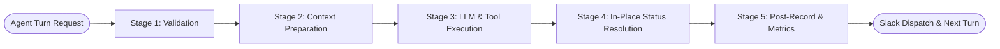

# Turn Execution Pipeline Architecture

The execution of every agent turn in **Izvor** is orchestrated by the [`TurnExecutionPipeline`](file:///c:/Users/Hp/Documents/agy2-projects/Izvor/orchestration/turn_pipeline.py), a decoupled, dependency-injected 5-stage pipeline designed for resilience, observability, and clean Slack UX.

---

## 🌊 Pipeline Stage Overview



The pipeline operates on a shared state object ([`SessionContext`](file:///c:/Users/Hp/Documents/agy2-projects/Izvor/core/domain.py) and [`Turn`](file:///c:/Users/Hp/Documents/agy2-projects/Izvor/core/domain.py)), transitioning the turn cleanly through five distinct stages located in [`orchestration/stages/`](file:///c:/Users/Hp/Documents/agy2-projects/Izvor/orchestration/stages).

---

## 🔍 Stage-by-Stage Breakdown

### Stage 1: Validation (`validation.py`)
- **File**: [`orchestration/stages/validation.py`](file:///c:/Users/Hp/Documents/agy2-projects/Izvor/orchestration/stages/validation.py)
- **Responsibilities**:
  1. **Thread Generation Guard**: Verifies whether the active turn matches the current generation count in [`ThreadStateManager`](file:///c:/Users/Hp/Documents/agy2-projects/Izvor/orchestration/thread_state.py). If a newer user message arrived, the turn is cancelled immediately.
  2. **Spend & Circuit Breaker Check**: Evaluates cumulative thread spend against the configured budget threshold. If the limit has been reached, raises a circuit breaker halt.
  3. **Round Limit Check**: Ensures current discussion rounds do not exceed user-configured or directive constraints (`[rounds: N]`).
  4. **Stop Signal Check**: Verifies whether a `stop_discussion` skill or directive has been triggered.

### Stage 2: Context Preparation (`context_prep.py`)
- **File**: [`orchestration/stages/context_prep.py`](file:///c:/Users/Hp/Documents/agy2-projects/Izvor/orchestration/stages/context_prep.py)
- **Responsibilities**:
  1. **Thread History Assembly**: Compiles chronological Slack thread history, filtering bot artifacts and identifying human directives.
  2. **Dynamic Skill Injection**: Reads active thread skills from [`ThreadSkillsManager`](file:///c:/Users/Hp/Documents/agy2-projects/Izvor/orchestration/thread_skills_manager.py) and registers corresponding tool schemas.
  3. **Prompt Composition**: Combines the persona's system prompt from [`prompts/`](file:///c:/Users/Hp/Documents/agy2-projects/Izvor/prompts) with behavioral guidelines, word count constraints (`min_words`, `max_words`), and active debate topology instructions.

### Stage 3: LLM & Tool Execution (`execution.py`)
- **File**: [`orchestration/stages/execution.py`](file:///c:/Users/Hp/Documents/agy2-projects/Izvor/orchestration/stages/execution.py)
- **Responsibilities**:
  1. **LiteLLM Provider Invocation**: Dispatches prompt context to the configured LLM provider (OpenRouter, Anthropic, OpenAI, etc.).
  2. **Exponential Backoff & Retries**: Utilizes [`core/llm_utils.py`](file:///c:/Users/Hp/Documents/agy2-projects/Izvor/core/llm_utils.py) to automatically handle rate limits (HTTP 429), server errors (5xx), and transient network disconnects with jittered backoff.
  3. **Tool Calling Loop & Fail-Closed Authorization**:
     - Executes tools strictly within authorized boundaries: `skill_registry.execute_tool` operates **fail-closed** (unauthorized or default-none callers are blocked and logged).
     - **PII & Secret Unmasking**: Tool call arguments generated with pseudonym placeholders (e.g., `<EMAIL_0>`) are unmasked back to real values via `pii_masker.unmask()` before reaching execution handlers.
     - Feeds the tool output back into the conversation context.
     - Enforces `tool_call_loop_timeout_seconds` (default: 60s in [`data/settings/system_settings.json`](file:///c:/Users/Hp/Documents/agy2-projects/Izvor/data/settings/system_settings.json)) to prevent runaway execution loops.

### Stage 4: In-Place Status Resolution (`tool_status.py`)
- **File**: [`orchestration/stages/tool_status.py`](file:///c:/Users/Hp/Documents/agy2-projects/Izvor/orchestration/stages/tool_status.py)
- **Responsibilities**:
  1. **Delayed Progress Indicator (5s Rule)**:
     - If tool execution completes within 5 seconds, no intermediate progress indicator is posted to Slack, preventing UI flicker.
     - If tool execution exceeds 5 seconds, an intermediate status message is posted under the agent persona (e.g., `_🔍 *Visionary* is searching the web..._`).
  2. **In-Place Update**: Upon completion of tool reasoning, the intermediate status message is updated in-place via `chat.update` with the final synthesized markdown response, leaving zero junk messages in the Slack thread.

### Stage 5: Post-Record & Metrics (`post_record.py`)
- **File**: [`orchestration/stages/post_record.py`](file:///c:/Users/Hp/Documents/agy2-projects/Izvor/orchestration/stages/post_record.py)
- **Responsibilities**:
  1. **Token Accounting & Spend Recording**: Logs prompt and completion token counts and records USD cost via [`services/pricing_service.py`](file:///c:/Users/Hp/Documents/agy2-projects/Izvor/services/pricing_service.py).
  2. **Nomination Extraction**: Parses the persona's response text for bracketed peer nominations (e.g., `[Pragmatist]`, `[Security Architect]`).
  3. **Flat History Archival**: Appends the completed turn to the disk-backed flat markdown history file in `flat-histories/` via [`services/flat_history_recorder.py`](file:///c:/Users/Hp/Documents/agy2-projects/Izvor/services/flat_history_recorder.py).
  4. **Thread State Update**: Updates the active turn counter, speaker sequence, and timestamp in [`ThreadStateManager`](file:///c:/Users/Hp/Documents/agy2-projects/Izvor/orchestration/thread_state.py).

---

## 💉 Dependency Injection & Testability

The pipeline is assembled using dependency injection:

```python
pipeline = TurnExecutionPipeline(
    validation_stage=ValidationStage(...),
    context_prep_stage=ContextPrepStage(...),
    execution_stage=ExecutionStage(...),
    tool_status_stage=ToolStatusStage(...),
    post_record_stage=PostRecordStage(...),
)
```

This architecture ensures each stage is tested independently in isolation with mocks ([`tests/test_turn_pipeline_di.py`](file:///c:/Users/Hp/Documents/agy2-projects/Izvor/tests/test_turn_pipeline_di.py)), as well as end-to-end within the integration harness.
