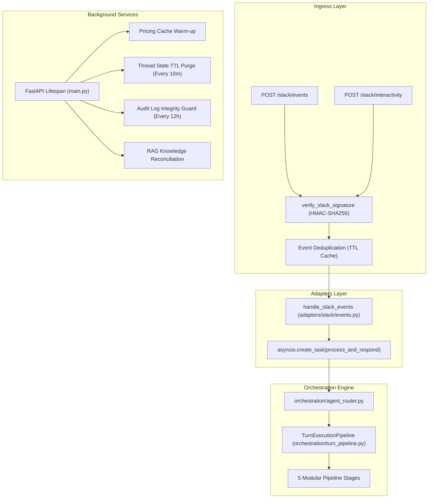

# System Design & Lifecycle Architecture

This document details the core architectural design, module boundaries, and execution lifecycle of **Izvor**.

---

## 🏛️ Architecture Overview

Izvor is built as an asynchronous, event-driven service leveraging Python 3.11+, [FastAPI](https://fastapi.tiangolo.com/), and [Slack Bolt / SDK](https://slack.dev/python-slack-sdk/). It is structured into clear, decoupled layers:



---

## 🔄 The Ingress Lifecycle

### 1. Slack Signature Verification
Every inbound HTTP request arriving at `/slack/*` must pass cryptographic validation in [`core/slack_security.py`](file:///c:/Users/Hp/Documents/agy2-projects/SilvanAgora/core/slack_security.py):
- The `X-Slack-Signature` and `X-Slack-Request-Timestamp` headers are inspected.
- The timestamp is verified to prevent replay attacks (tolerance window: 300 seconds).
- An HMAC-SHA256 signature is calculated using `SLACK_SIGNING_SECRET` over `v0:{timestamp}:{raw_body}`.
- Constant-time comparison (`hmac.compare_digest`) prevents timing side-channel attacks.

### 2. URL Verification Challenge
Slack sends a `url_verification` challenge during initial webhook setup. The handler immediately returns `{"challenge": req.challenge}` with HTTP 200 without invoking agent pipelines.

### 3. Event Deduplication
Slack re-delivers events if a webhook does not respond within 3 seconds. To prevent duplicate executions:
- [`adapters/slack/events.py`](file:///c:/Users/Hp/Documents/agy2-projects/SilvanAgora/adapters/slack/events.py) maintains an in-memory TTL set (`PROCESSED_EVENTS`).
- The unique `event_id` is tracked. If seen within the window, the request is immediately acknowledged with HTTP 200 and ignored.

### 4. Non-Blocking Fast Acknowledgment
To satisfy Slack’s strict 3-second webhook timeout:
- The HTTP handler acknowledges the webhook immediately (`HTTP 200 OK`).
- The multi-agent debate is scheduled as an unawaited background task using `asyncio.create_task(process_and_respond(...))`.

---

## ⚙️ FastAPI Lifespan Background Services

Izvor uses the modern async context manager lifespan pattern in [`main.py`](file:///c:/Users/Hp/Documents/agy2-projects/SilvanAgora/main.py#L102-L181). During application startup and shutdown, several continuous support services are initialized:

### 1. Windows Event Loop Heartbeat (`keep_loop_alive`)
- **File**: [`main.py:L46-L53`](file:///c:/Users/Hp/Documents/agy2-projects/SilvanAgora/main.py#L46-L53)
- **Purpose**: On Windows systems running `ProactorEventLoop`, an idle event loop with no active socket operations can freeze. A lightweight periodic coroutine wakes the loop every 500ms.

### 2. Periodic Thread State Cleanup (`periodic_thread_state_cleanup`)
- **File**: [`main.py:L55-L69`](file:///c:/Users/Hp/Documents/agy2-projects/SilvanAgora/main.py#L55-L69)
- **Schedule**: Every 10 minutes (600 seconds).
- **Behavior**: Calls [`thread_state_manager.cleanup_expired_threads()`](file:///c:/Users/Hp/Documents/agy2-projects/SilvanAgora/orchestration/thread_state.py). Frees in-memory session contexts that have exceeded their idle time-to-live (TTL).

### 3. Audit Log Integrity Guard (`periodic_audit_integrity_guard`)
- **File**: [`main.py:L71-L100`](file:///c:/Users/Hp/Documents/agy2-projects/SilvanAgora/main.py#L71-L100)
- **Schedule**: Every 12 hours.
- **Behavior**: Executes [`AppIntegrityValidator.check_audit_log_integrity()`](file:///c:/Users/Hp/Documents/agy2-projects/SilvanAgora/core/integrity_checks.py). Verifies hash continuity across active and historical audit files. If a discrepancy or HMAC secret mismatch is found, a high-severity alert is dispatched to the admin Slack channel.

### 4. Model Pricing Cache Warmup (`warm_up_pricing_cache`)
- **File**: [`services/pricing_service.py`](file:///c:/Users/Hp/Documents/agy2-projects/SilvanAgora/services/pricing_service.py)
- **Behavior**: Validates whether `data/model_pricing_cache.json` exists and is fresher than 7 days. If missing or expired, triggers background pricing research asynchronously without blocking server readiness.

### 5. RAG Knowledge Reconciliation (`rag_sync_engine.reconcile`)
- **File**: [`services/rag/sync_engine.py`](file:///c:/Users/Hp/Documents/agy2-projects/SilvanAgora/services/rag/sync_engine.py)
- **Behavior**: Scans `rag_knowledge/` for new, changed, or deleted documents, updating manifest hashes and index vectors.

---

## 🧩 Module Directory Boundaries

```
SilvanAgora/
├── adapters/slack/             # Slack Webhook listeners, event routing, interactivity modals
├── core/                       # Core configuration, models, domain entities, cryptographic security
├── orchestration/              # Main router, turn pipeline, thread state manager, nomination
├── pipeline/                   # Modular pipeline subsystems (entity resolver, scribe, spend)
├── prompts/                    # Persona system prompts and system agent prompt templates
├── services/                   # Slack API client, pricing service, audit logger, MCP tools, RAG
├── skills/                     # 18 dynamic skills, tool definitions, and skill registry
└── e2e_testing_harness/        # Behavioral testing suite, scenario runners, and synthetic Slack mock
```
