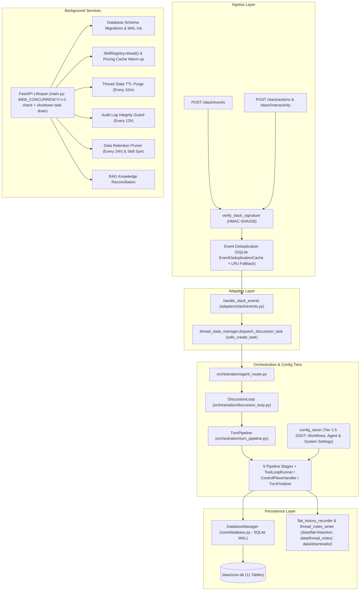

# System Design & Lifecycle Architecture

This document details the core architectural design, module boundaries, and execution lifecycle of **Izvor**.

---

## 🏛️ Architecture Overview

Izvor is built as an asynchronous, event-driven service leveraging Python 3.11+, [FastAPI](https://fastapi.tiangolo.com/), and [Slack Bolt / SDK](https://slack.dev/python-slack-sdk/). It is structured into clear, decoupled layers:



---

## 🔄 The Ingress Lifecycle

### 1. Slack Signature Verification
Every inbound HTTP request arriving at `/slack/*` must pass cryptographic validation in [`core/slack_security.py`](file:///engine/core/slack_security.py):
- The `X-Slack-Signature` and `X-Slack-Request-Timestamp` headers are inspected.
- The timestamp is verified to prevent replay attacks (tolerance window: 300 seconds).
- An HMAC-SHA256 signature is calculated using `SLACK_SIGNING_SECRET` over `v0:{timestamp}:{raw_body}`.
- Constant-time comparison (`hmac.compare_digest`) prevents timing side-channel attacks.

### 2. URL Verification Challenge
Slack sends a `url_verification` challenge during initial webhook setup. The handler immediately returns `{"challenge": req.challenge}` with HTTP 200 without invoking agent pipelines.

### 3. Event Deduplication & Subtype Filtering
Slack re-delivers events if a webhook does not respond within 3 seconds. To prevent duplicate executions and unwanted noise:
- [`adapters/slack/events.py`](file:///engine/adapters/slack/events.py) filters message events to `_ALLOWED_MESSAGE_SUBTYPES` (`{None, "file_share", "thread_broadcast"}`) and accepts file-only DM uploads (`has_files`) alongside text prompts.
- [`EventDeduplicationCache`](file:///engine/adapters/slack/events.py) claims each unique `event_id` in the SQLite `event_dedup` table and automatically degrades to a bounded in-memory `OrderedDict` LRU/TTL fallback cache if SQLite is temporarily unreachable. Duplicates return HTTP `200` immediately.

### 4. Non-Blocking Fast Acknowledgment
To satisfy Slack’s strict 3-second webhook timeout:
- The HTTP handler acknowledges the webhook immediately (`HTTP 200 OK`).
- The multi-agent debate is dispatched cleanly via `thread_state_manager.dispatch_discussion_task(...)` (using `safe_create_task`) for tracked cancellation on interruption or server shutdown.

### 5. Amplification Defense & Sliding-Window Rate Limiting
To protect against denial-of-service attempts or audit-log disk exhaustion attacks:
- Failed signature verifications (`AUTH_FAILURE`) are throttled using a 60-second sliding-window burst limiter.
- Up to 5 discrete failure events are logged per client within each 60-second window, after which subsequent attempts are suppressed and emitted as an aggregated summary event.

---

## ⚙️ FastAPI Lifespan Background Services

Izvor uses the modern async context manager lifespan pattern in [`main.py`](file:///main.py). During application startup and shutdown, several continuous support services are initialized:

### 1. Database Schema Initialization & Numbered Migrations
- **File**: [`core/database.py`](file:///engine/core/database.py)
- **Behavior**: Initializes `data/izvor.db` (configurable via `IZVOR_DB_PATH`) with WAL journal mode, 5,000ms (5.0s) busy timeout (managed via `db_busy_timeout_seconds` in system settings), dead-thread connection eviction, nested-transaction guards (`RuntimeError` on nested `transaction()` calls), and `PRAGMA user_version` numbered `MIGRATIONS` across **11 schema tables**:
  1. `thread_sessions` (thread state & generation counters)
  2. `thread_context` (key-value dynamic session context)
  3. `spend_ledger` (token and USD cost ledger)
  4. `hitl_approvals` (atomic Human-in-the-Loop approval records)
  5. `thread_skills` (ephemeral thread-scoped skill grants)
  6. `event_dedup` (Slack webhook event deduplication)
  7. `thread_usage_meta` (thread cost & message metadata managed by `ThreadUsageTracker`)
  8. `thread_notes_state` (Scribe live & conclusion note state managed by `ThreadNotesAgent`)
  9. `turn_checkpoints` (durable mid-turn snapshots for HITL and circuit-breaker pauses)
  10. `turn_traces` (stage-by-stage execution telemetry spans with write-behind flushing)
  11. `audit_anchors` (cryptographic head-hash anchors for monthly JSONL audit logs)

### 2. Windows Event Loop Heartbeat (`keep_loop_alive`)
- **File**: [`main.py`](file:///main.py)
- **Purpose**: On Windows systems running `ProactorEventLoop`, an idle event loop with no active socket operations can freeze. A lightweight periodic coroutine wakes the loop every 500ms.

### 3. Periodic Thread State Cleanup (`periodic_thread_state_cleanup`)
- **File**: [`main.py`](file:///main.py)
- **Schedule**: Dynamically loaded from `thread_cleanup_interval_seconds` in `system_settings.json` (default: 600.0 seconds / 10 minutes).
- **Behavior**: Calls [`thread_state_manager.cleanup_expired_threads()`](file:///engine/orchestration/thread_state.py) and `cleanup_old_downloads()`. Frees in-memory session contexts and cached file downloads that have exceeded their idle time-to-live (TTL).

### 4. Audit Log Integrity Guard (`periodic_audit_integrity_guard`)
- **File**: [`main.py`](file:///main.py)
- **Schedule**: Dynamically loaded from `audit_integrity_check_interval_seconds` in `system_settings.json` (default: 43200.0 seconds / 12 hours).
- **Behavior**: Executes [`AppIntegrityValidator.check_audit_log_integrity()`](file:///engine/orchestration/integrity_checks.py). Verifies hash continuity and `audit_anchors` head-hash consistency across active and historical audit files. If a discrepancy or HMAC secret mismatch is found, a high-severity alert is dispatched to all configured Slack admins (`SLACK_ADMIN_USER_IDS`).

### 5. Data Retention & Privacy Pruner (`periodic_retention_prune`)
- **File**: [`services/retention_service.py`](file:///engine/services/retention_service.py)
- **Schedule**: Runs immediately at startup and every 24 hours (`86400` seconds).
- **Behavior**: Executes `prune_expired_records()`, redacting sensitive `messages_json` and `pending_tool_calls_json` from resolved `turn_checkpoints` rows immediately and deleting expired rows from `turn_checkpoints` (`retention_checkpoints_days`: 7d), `turn_traces` (`retention_traces_days`: 30d), and `event_dedup` (`retention_event_dedup_days`: 1d). Also provides channel-scoped GDPR `forget_thread(channel_id, thread_ts)` erasure (purging DB tables, flat histories, Scribe notes, `data/downloads/<cid>_<tts>/`, guardrail LRU embeddings, and registered purge hooks).

### 6. Model Pricing Cache Warmup (`warm_up_pricing_cache`)
- **File**: [`services/pricing_service.py`](file:///engine/services/pricing_service.py)
- **Behavior**: Validates whether `data/pricing/model_pricing_cache.json` exists and is fresher than 7 days. If missing or expired, triggers background pricing research asynchronously without blocking server readiness.

### 7. RAG Knowledge Reconciliation (`rag_sync_engine.reconcile`)
- **File**: [`services/rag/sync_engine.py`](file:///engine/services/rag/sync_engine.py)
- **Behavior**: Scans `config/rag_knowledge/` for new, changed, or deleted documents, updating manifest hashes, `__meta__.config_hash` drift re-indexing, and LanceDB/Tantivy index vectors.

---

## 🗂️ 3-Tier Codebase Architecture (`config/`, `engine/`, `data/`)

Izvor enforces a strict 3-tier architectural separation to isolate **implementer configuration** from **immutable core engine logic** and **runtime operational state**:

1. **`config/` (Implementer Configuration Tier)**:
   - Contains all assets intended to be customized by implementers when deploying or tailoring Izvor to a specific domain or organization:
     - `config/settings/agent_settings.json` — Debate panel agent roster, models, default skills, and active workflow topology.
     - `config/settings/system_settings.json` — System operational parameters, timeouts, model defaults, RAG chunking/embedding settings, P2 guardrail/PII NER/audit keyring config, and security burst limits.
     - `config/personas/` — System prompt markdown templates for debate panel personas (`agent-10001.md` through `agent-10016.md`).
     - `config/workflows/` — Implementer-defined custom workflow presets (`idea_architecture_feasibility_review.json`, `idea_conceptual_feasibility_review.json`, `quick_tech_triage.json`, etc.).
     - `config/skills/` — Implementer-configurable agent tool skills (`document_authoring`, `document_reader`, `knowledge_base_rag`, `web_research`).
     - `config/avatars/` — Custom persona avatar images served at `/static/*` and `/avatars/*`.
     - `config/rag_knowledge/` — Per-agent and shared knowledge base documents indexed by the RAG engine.
2. **`engine/` (Immutable Core Engine & Built-ins Tier)**:
   - Contains core application packages (**150 `.py` files** across **11 packages** enforced by a 5-tier unidirectional DAG) and built-in engine definitions:
     - `engine/settings/system_agent_settings.json` — Engine-level configuration for the `orchestrator` and internal `system_agents` (`InternalRevisor`, `list_skills`, `Challenger`, `Arbitrator`, `DiscussionScribe`).
     - `engine/workflows/` — Immutable seed workflow templates (`default_review_flow.json`, `default_sandwich.json`, `parallel_dialectic_flow.json`) used for integrity validation and factory resets.
     - `engine/skills/builtin/` — **18 built-in** orchestration modifier, directive, and control-plane skills (`control_plane`, `first`, `forget_thread`, `rounds`, `max_words`, `min_words`, `open_debate`, `grant_skill`, `revoke_constraint`, `stop_discussion`, etc.).
     - `engine/avatars/` — Built-in fallback avatar assets (`image_99.png`).
     - Core Python packages across 5 tiers: `core` (`L1`), `config_store` (`L1.5`), `services`, `skills`, `nlp`, `prompts`, `pipeline` (`L2`), `orchestration`, `agents` (`L3`), `adapters`, `api` (`L4`).
3. **`data/` (Runtime & Slack UI State Tier)**:
   - Contains dynamic runtime state, databases, caches, and Slack App Home UI state:
     - `data/state/app_settings.json` & `data/state/presidio_skill_exclusions.json` — Live Slack App Home toggles and automated Presidio keyword exclusions.
     - `data/izvor.db` — SQLite WAL state database (11 tables).
     - `data/audit/` — Cryptographically chained, HMAC-keyring-verified monthly JSONL audit logs.
     - `data/backups/` — Automated rolling backups for `agent_settings_backup.json`, `system_agent_settings_backup.json`, `system_settings_backup.json`, `app_settings_backup.json`, and `workflows/`.
     - `data/flat-histories/`, `data/thread_notes/`, `data/downloads/`, `data/pricing/`, `data/thread/`, `data/.rag_cache/`.

---

## 🧩 Module Directory Boundaries

```
Izvor/
├── config/                         # PILLAR 1: Implementer Configuration (Customizable)
│   ├── avatars/                    # Persona avatar images (image_01.png .. image_99.png)
│   ├── personas/                   # Debate persona system prompts (agent-10001.md .. agent-10016.md)
│   ├── rag_knowledge/              # Per-agent & shared RAG knowledge documents
│   ├── settings/                   # agent_settings.json & system_settings.json
│   ├── skills/                     # Configurable agent tool skills (web_research, knowledge_base_rag, etc.)
│   └── workflows/                  # Custom workflow topology presets
├── engine/                         # PILLAR 2: Immutable Core Engine (150 .py files, 11 packages, 5 DAG Tiers)
│   ├── adapters/slack/             # Tier 4: Slack Webhook listeners, event routing, WorkspaceAdapter port
│   │   └── actions/                # agent_actions, governance_actions, hitl_actions, scribe_actions, workflow_presets
│   ├── agents/                     # Tier 3: System support agents (ThreadNotesAgent, UsageAgent)
│   ├── api/                        # Tier 4: First-party HTTP/REST API, OpenAPI docs gating, Pydantic DTOs & Basic Auth
│   ├── avatars/                    # Built-in fallback avatar assets
│   ├── config_store/               # Tier 1.5: Agent/App/System settings SSOT, JsonSettingsStore, WorkflowManager, Integrity
│   ├── core/                       # Tier 1: Paths SSOT, config, domain models, SQLite manager, security, logging_filters
│   ├── nlp/                        # Tier 2: Pre-flight intent & language extractor, message builder
│   ├── orchestration/              # Tier 3: Agent router, DiscussionLoop, TurnPipeline, ThreadStateManager, RevisorService
│   │   ├── stages/                 # 5 pipeline stages + control_plane_handler, directive_handlers, tool_loop_runner, tool_status, turn_finalizer
│   │   └── state/                  # Domain state stores (discussion, context, evidence, retry stores)
│   ├── pipeline/                   # Tier 2: Entity resolver, directive parser, sandwich orchestrator, scribe, spend governance
│   ├── prompts/                    # Tier 2: Prompt builder, shared rules, and system_agents/ prompt templates
│   ├── services/                   # Tier 2: Pricing, audit logger, HITL, retention, telemetry, thread_skills_store, local/web/MCP tools
│   │   ├── rag/                    # Hybrid LanceDB/Tantivy BM25 RAG engine, parser, sync engine, vector store
│   │   ├── security/               # GuardrailService (heuristic + sliding-window + indirect screening) & PIIMasker
│   │   ├── slack/                  # Modular Slack WebClient wrapper (client_core, messages, files, views)
│   │   └── slack_home/             # Modular App Home tab builders (agents, workflows, governance tabs)
│   ├── settings/                   # system_agent_settings.json (Orchestrator & built-in system agents)
│   ├── skills/                     # Tier 2: parser.py, policy.py, recommender.py, registry.py & 18 builtin/ skills
│   └── workflows/                  # Immutable seed workflows (default_review_flow, default_sandwich, parallel_dialectic_flow)
├── data/                           # PILLAR 3: Runtime & Slack UI State
│   ├── state/                      # app_settings.json & presidio_skill_exclusions.json
│   ├── audit/                      # Chained HMAC-SHA256 monthly audit logs (keyring-capable)
│   ├── backups/                    # Rolling JSON configuration backups
│   ├── downloads/                  # Thread-scoped Slack attachments (<channel_id>_<thread_ts>/)
│   ├── flat-histories/             # Exported channel-scoped Markdown thread transcripts
│   ├── pricing/                    # 7-day LLM token pricing cache
│   ├── thread/                     # Thread usage metadata
│   ├── thread_notes/               # Channel-scoped Scribe live & conclusion note exports
│   └── izvor.db                    # SQLite WAL state engine (11 tables)
└── tests/                          # Test suites (unit/, integration/, e2e/ behavioral harness)
    ├── unit/                       # Isolated component tests, parsers, and static checkers (66 files)
    ├── integration/                # Multi-component, pipeline, SQLite, and Slack API tests (37 files)
    └── e2e/                        # Synthetic Slack event and multi-turn behavioral simulation harness (8 files)
```
