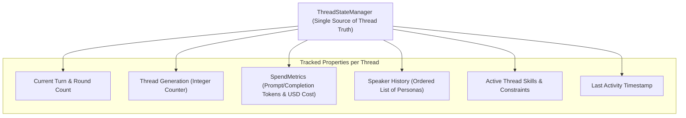

# Thread State Management & Memory Safety

This document describes how **Izvor** maintains stateful conversation context in active Slack threads while preventing memory leaks and avoiding concurrency race conditions.

---

## 🧠 The State Architecture

Multi-turn multi-agent debates require persistent in-memory tracking of conversation progress, turn counters, speaker history, spend accumulators, and active skills.

In Izvor, all thread state is managed by [`ThreadStateManager`](file:///c:/Users/Hp/Documents/agy2-projects/Izvor/orchestration/thread_state.py).



---

## 🛑 Generation-Based Superseding

In an asynchronous multi-agent system, a common race condition occurs when an agent is halfway through a slow LLM inference or tool execution, and a human user posts a new directive or question into the Slack thread.

If left unchecked, the obsolete agent turn would complete and post its answer, confusing the human and desynchronizing the conversation.

### How Izvor Solves This

Izvor utilizes a **Thread Generation Counter**:

1. **Incoming Message Increments Generation**:
   Whenever a human user posts a message in an existing thread, [`adapters/slack/events.py`](file:///c:/Users/Hp/Documents/agy2-projects/Izvor/adapters/slack/events.py) calls:
   ```python
   thread_state_manager.increment_generation(channel_id, thread_ts)
   ```
2. **Turn Captures Local Generation Snapshot**:
   When an agent turn begins, it takes a snapshot of the generation counter at that precise moment:
   ```python
   turn_generation = thread_state.generation
   ```
3. **Continuous Generation Checks**:
   At each stage of the [Turn Execution Pipeline](file:///c:/Users/Hp/Documents/agy2-projects/Izvor/docs/architecture/orchestration-pipeline.md) (before LLM call, after tool execution, and before posting to Slack), the pipeline checks:
   ```python
   if current_thread_state.generation > turn_generation:
       logger.info("Generation mismatch detected. Aborting stale turn.")
       return  # Gracefully discard obsolete turn
   ```
4. **Clean Discard Without Race Conditions**:
   The stale background task terminates cleanly. The newly received human message takes over with its fresh generation number.

---

## 🧹 Memory Safety & TTL Eviction

Because Slack workspaces can run for months with thousands of transient threads, unboundedly accumulating state in memory would cause memory bloat and degrade performance.

Izvor enforces a two-layer bounded memory strategy:

### 1. Opportunistic Capacity Pruning
- **`max_tracked_threads`** (default: `500`):
  [`ThreadStateManager`](file:///c:/Users/Hp/Documents/agy2-projects/Izvor/orchestration/thread_state.py) enforces a soft upper bound on the number of concurrently tracked threads in memory.
- When capacity is exceeded, the least recently active threads (LRU) are evicted opportunistically upon inserting new state.

### 2. Scheduled Inactive TTL Pruning
- **Background Worker**: [`periodic_thread_state_cleanup`](file:///c:/Users/Hp/Documents/agy2-projects/Izvor/main.py#L55-L69) in `main.py` wakes up every 10 minutes (600s).
- **TTL Window**: Threads with no incoming messages or agent turns for more than 2 hours are pruned from memory.
- **Persistent Archival**: Before any thread state is evicted, its final status and transcript are already permanently saved to the disk-backed flat history store in `flat-histories/`.
