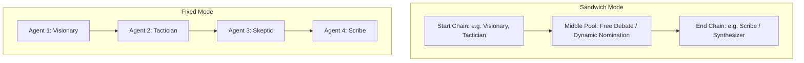

# Discussion Topologies & Entity Routing

This document details how **Izvor** routes conversation turns across multi-agent debate topologies, resolves nominated personas, and paces execution.

---

## 🥪 Topologies Supported

Izvor supports two primary orchestration topologies configured via [`core/models.py`](file:///c:/Users/Hp/Documents/agy2-projects/Izvor/core/models.py) and selectable in the Slack App Home:



### 1. Sandwich Mode (`OrchestrationMode.SANDWICH`)
Sandwich mode is designed for exploratory discussions requiring both divergent ideation and convergent synthesis:
- **Start Chain**: A predetermined sequence of opening personas (e.g., `["Visionary", "Tactician"]`) that unpack the problem from strategic and practical viewpoints.
- **Middle Pool**: Once the start chain finishes, the floor opens to other enabled personas. Speakers can either be dynamically nominated by peers or picked from an unassigned pool.
- **End Chain**: When the middle pool round limits are reached, the discussion automatically routes to closing personas (e.g., `["Scribe"]` or `["Revisor"]`) to synthesize consensus and action items.
- **Collapsed Sequential Pop**: In `ResolutionStage`, candidate agents are popped sequentially from the session's active remaining queue in SQLite, smoothly transitioning between sandwich tiers.

### 2. Fixed Mode (`OrchestrationMode.FIXED`)
Fixed mode executes an immutable, sequential chain of personas:
- Every enabled persona speaks exactly once in the order specified in the preset configuration.
- Peer nomination tags are ignored or deferred until the sequence completes.
- Ideal for structured code reviews, policy audits, or formal sign-offs.

---

## 🏷️ Dynamic Peer Nomination & Unicode Tags

In Sandwich mode or open debate pools, personas have the autonomy to pass the speaking turn to colleagues whose expertise is relevant.

### Syntax & Canonical Formatting
Personas include slash-bracketed tags in their response text:
```markdown
I see substantial scalability concerns with this database schema.
What do you think of this, /[Security Architect]?
Could /[Tactician] or /[Tehnički Vođa] evaluate the migration effort?
```

### Extraction & Resolution
- **Canonical Regex**: `NOMINATION_TAG_REGEX` (aliased as `NOMINATION_TAG_RE` in [`pipeline/entity_resolver/resolver.py`](file:///c:/Users/Hp/Documents/agy2-projects/Izvor/pipeline/entity_resolver/resolver.py)) matches `/[\s*([^\]\r\n]+?)\s*\]` compiled with `re.UNICODE`, safely recognizing international characters and diacritics (e.g., `č`, `ć`, `š`, `ž`).
- **Formatting Helper**: `format_nomination(agent_key)` formats any raw agent key into canonical tag syntax (e.g., `/[agent_key]`).
- **Candidate Filtering**:
  - The currently speaking persona cannot nominate itself.
  - Personas that have already spoken in the current round are deprioritized to prevent circular echo chambers.
  - If multiple personas are nominated, the first eligible valid persona is selected.

### Candidate Validation Fallback Loop
To prevent unhandled `KeyError` crashes when an agent accidentally nominates a nonexistent, misspelt, or disabled persona:
1. [`ResolutionStage`](file:///c:/Users/Hp/Documents/agy2-projects/Izvor/orchestration/stages/resolution.py) checks if `ctx.agent_key` exists in `settings_manager.agents_config`.
2. If absent, it enters an iterative fallback loop, continuously popping candidates from `ThreadStateManager.pop_remaining_agent()` until an active, configured agent is found.
3. If no remaining candidates match, it safely falls back to default rotation or cleanly terminates the debate round.

---

## 🎯 Entity Resolution Engine

Users and agents may refer to personas by nick-names, partial titles, or informal roles. The [`EntityResolver`](file:///c:/Users/Hp/Documents/agy2-projects/Izvor/pipeline/entity_resolver/resolver.py) maps informal mentions to canonical persona identifiers:

| Input Mention | Resolved Persona | Matching Rule |
|---|---|---|
| `/[Legal]` | `LegalAdvisor` | Prefix / partial token match |
| `/[Security]` | `Security Architect` | Substring match |
| `/[architect]` | `Security Architect` | Role keyword match |
| `/[visionary]` | `Visionary` | Case-insensitive exact match |
| `/[summarizer]` | `Scribe` | Semantic alias match |

---

## ⏱️ Turn Pacing & Rate Throttling

To prevent LLM API rate-limit spikes and avoid overwhelming Slack users with an instant wall of text, Izvor enforces controlled pacing between turns:

1. **`debate_turn_pacing_seconds`** (default: `3.0`):
   - Configured in [`data/settings/system_settings.json`](file:///c:/Users/Hp/Documents/agy2-projects/Izvor/data/settings/system_settings.json).
   - An asynchronous sleep between consecutive agent turns in a thread.
2. **`slack_post_pause_seconds`** (default: `2.0`):
   - Configured in [`data/settings/system_settings.json`](file:///c:/Users/Hp/Documents/agy2-projects/Izvor/data/settings/system_settings.json).
   - A brief deliberate pause immediately before posting to Slack, giving the visual appearance of real-time typing and conversational cadence.
