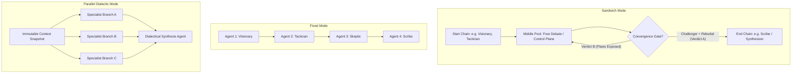

# Discussion Topologies & Entity Routing

This document details how **Izvor** routes conversation turns across multi-agent debate topologies, resolves nominated personas, and paces execution.

---

## 🥪 Topologies Supported

Izvor supports three primary orchestration topologies configured via [`core/models.py`](file:///engine/core/models.py), executed by [`DiscussionLoop`](file:///engine/orchestration/discussion_loop.py), and selectable in the Slack App Home:



### 1. Sandwich Mode (`OrchestrationMode.SANDWICH`)
Sandwich mode is designed for exploratory discussions requiring both divergent ideation and convergent synthesis:
- **Start Chain**: A predetermined sequence of opening personas (e.g., `["Visionary", "Tactician"]`) that unpack the problem from strategic and practical viewpoints.
- **Middle Pool**: Once the start chain finishes, the floor opens to other enabled personas. Speakers can either be dynamically nominated by peers (via `control_plane` `nominate_next_speaker` or `/[Persona]` tags) or picked from an unassigned pool.
- **End Chain**: When the middle pool round limits are reached (or validated consensus convergence occurs), the discussion automatically routes to closing personas (e.g., `["Scribe"]` or `["Synthesizer"]`) to synthesize consensus and action items.
- **Collapsed Sequential Pop**: In `ResolutionStage`, candidate agents are popped sequentially from the session's active remaining queue in SQLite, smoothly transitioning between sandwich tiers.

### 2. Fixed Mode (`OrchestrationMode.FIXED`)
Fixed mode executes an immutable, sequential chain of personas:
- Every enabled persona speaks exactly once in the order specified in the preset configuration.
- Peer nomination tags are ignored or deferred until the sequence completes.
- Ideal for structured code reviews, policy audits, or formal sign-offs.

### 3. Parallel Dialectic Mode (`OrchestrationMode.SCATTER_GATHER`)
Parallel dialectic mode executes concurrent exploration with zero anchor bias inside [`DiscussionLoop._run_scatter_gather_phase`](file:///engine/orchestration/discussion_loop.py):
- **Parallel Specialists**: Multiple specialist personas explore the topic concurrently in isolated `asyncio.TaskGroup` branches.
- **Spend Reservation Guard**: Before launching concurrent branches, `SpendGovernance.reserve_budget()` reserves estimated token spend per branch so concurrent execution cannot bypass thread circuit breakers or daily budget limits; reservations are released in a `finally` block via `release_reservation()`.
- **Anchor Isolation Snapshot**: Each parallel branch receives an immutable snapshot of conversation context (`shared_history_snapshot`), guaranteeing that parallel specialists do not contaminate or bias each other's analysis.
- **Dialectical Synthesis**: Once all parallel branches conclude, their insights are passed to the designated synthesis closing agent for integrated dialectical resolution.

### 4. Open Debate Mode (`/open_debate`)
Initiated via `/open_debate <Agent>` (or `/open-debate`, `/opendebate`):
- Designates the specified agent as the opening speaker and bypasses fixed start/end chains.
- All enabled personas participate in dynamic peer-to-peer nomination across up to 3 debate rounds, converging naturally or halting upon user `/stop`.

---

## ⚖️ Consensus Convergence Fast-Forward & Conditional Rebuttal Gate

To prevent premature groupthink while saving tokens once genuine consensus is reached, Izvor implements a two-stage **Dialectical Stress-Test & Rebuttal Verdict Gate** (configured via `fast_forward_on_convergence` in App Home and `convergence_consecutive_threshold: 2` in `system_settings.json`):

1. **Convergence Signaling (`signal_consensus_convergence`)**:
   - Any persona can invoke the `control_plane` tool `signal_consensus_convergence(summary_of_agreement, confidence)` when they observe that the panel has converged.
2. **Dialectical Stress-Test Injection**:
   - When consecutive convergence signals reach `convergence_consecutive_threshold` (`2`), `DiscussionLoop` does **not** immediately skip to the `end_chain`.
   - Instead, it injects a two-speaker stress-test pair at the front of the queue:
     - **Challenger (`special_role: "CHALLENGER"`)**: e.g., `agent-10003` (**Sceptic**) or `agent-10002` (**Innovator**), tasked with stress-testing the consensus for hidden edge cases or unexamined assumptions.
     - **Rebuttal & Defense Advocate (`special_role: "REBUTTAL"`)**: `agent-10017` (**RebuttalAdvocate**), tasked with defending the proposal against the Challenger's critique and issuing a structured verdict:
       - **`[VERDICT: A — CONSENSUS HOLDS]`**: The consensus survived scrutiny. `DiscussionLoop` fast-forwards directly to the `end_chain` (synthesis/conclusion), bypassing remaining middle-pool rounds.
       - **`[VERDICT: B — FLAWS EXPOSED]`**: The Challenger uncovered substantive flaws. Convergence counters are reset and the remaining middle-pool deliberation resumes to resolve the newly exposed issues.
3. **Human Clarification Suspension (`request_user_clarification`)**:
   - If a persona invokes `request_user_clarification(question, blocking_reason)`, the loop posts a highlighted clarification prompt to the Slack thread and cleanly suspends remaining turns until the user replies.

---

## 🎯 Direct Agent Invocations vs. Broadcast Panel Debates

### Single-Turn Deterministic Direct Tagging
When a user explicitly tags a specific agent persona in their prompt (e.g., `/[Security Architect] what are the risks here?` or `/[Tactician] estimate the timeline`), the orchestration engine recognizes a targeted single-agent query:
- In [`ValidationStage`](file:///engine/orchestration/stages/validation.py), the tagged persona is resolved into `ctx.agent_key`, `ctx.remaining = []`, and `ctx.custom_flow = True`.
- The pipeline executes solely that persona for a single, focused turn.
- It halts cleanly without triggering sequential cascades, multi-turn panel debates, or Scribe synthesis.

---

## 🏷️ Dynamic Peer Nomination & Unicode Tags

In Sandwich mode or open debate pools, personas have the autonomy to pass the speaking turn to colleagues whose expertise is relevant.

### Syntax & Canonical Formatting
Personas include slash-bracketed tags in their response text:
```markdown
I see substantial scalability concerns with this database schema.
What do you think of this, /[Security Architect]?
Could /[Tactician] or /[Product Strategist] evaluate the migration effort?
```

### Extraction & Resolution
- **Canonical Regex**: `NOMINATION_TAG_REGEX` (aliased as `NOMINATION_TAG_RE` in [`pipeline/entity_resolver/resolver.py`](file:///engine/pipeline/entity_resolver/resolver.py)) matches `/[\s*([^\]\r\n]+?)\s*\]` compiled with `re.UNICODE`, safely recognizing international characters and diacritics (e.g., `č`, `ć`, `š`, `ž`).
- **Formatting Helper**: `format_nomination(agent_key)` formats any raw agent key into canonical tag syntax (e.g., `/[agent_key]`).
- **Candidate Filtering**:
  - The currently speaking persona cannot nominate itself.
  - Personas that have already spoken in the current round are deprioritized to prevent circular echo chambers.
  - If multiple personas are nominated, the first eligible valid persona is selected.

### Candidate Validation Fallback Loop
To prevent unhandled `KeyError` crashes when an agent accidentally nominates a nonexistent, misspelt, or disabled persona:
1. [`ResolutionStage`](file:///engine/orchestration/stages/resolution.py) checks if `ctx.agent_key` exists in `settings_manager.agents_config`.
2. If absent, it enters an iterative fallback loop, continuously popping candidates from `ThreadStateManager.pop_remaining_agent()` until an active, configured agent is found.
3. If no remaining candidates match, it safely falls back to default rotation or cleanly terminates the debate round.

---

## 🎯 Entity Resolution Engine

Users and agents may refer to personas by nick-names, partial titles, or informal roles. The [`EntityResolver`](file:///engine/pipeline/entity_resolver/resolver.py) maps informal mentions to canonical persona identifiers:

| Input Mention | Resolved Persona | Matching Rule |
|---|---|---|
| `/[Legal]` | `LegalAdvisor` | Prefix / partial token match |
| `/[Security]` | `Security Architect` | Substring match |
| `/[architect]` | `Security Architect` | Role keyword match |
| `/[visionary]` | `Visionary` | Case-insensitive exact match |
| `/[summarizer]` | `Scribe` | Semantic alias match |

---

## ⏱️ Turn Pacing & Rate Throttling

To prevent LLM API rate-limit spikes and avoid overwhelming Slack users with an instant wall of text, Izvor enforces controlled pacing between turns:

1. **`debate_turn_pacing_seconds`** (default: `3.0`):
   - Configured in [`config/settings/system_settings.json`](file:///config/settings/system_settings.json).
   - An asynchronous sleep between consecutive agent turns in a thread.
2. **`slack_post_pause_seconds`** (default: `2.0`):
   - Configured in [`config/settings/system_settings.json`](file:///config/settings/system_settings.json).
   - A brief deliberate pause immediately before posting to Slack, giving the visual appearance of real-time typing and conversational cadence.
