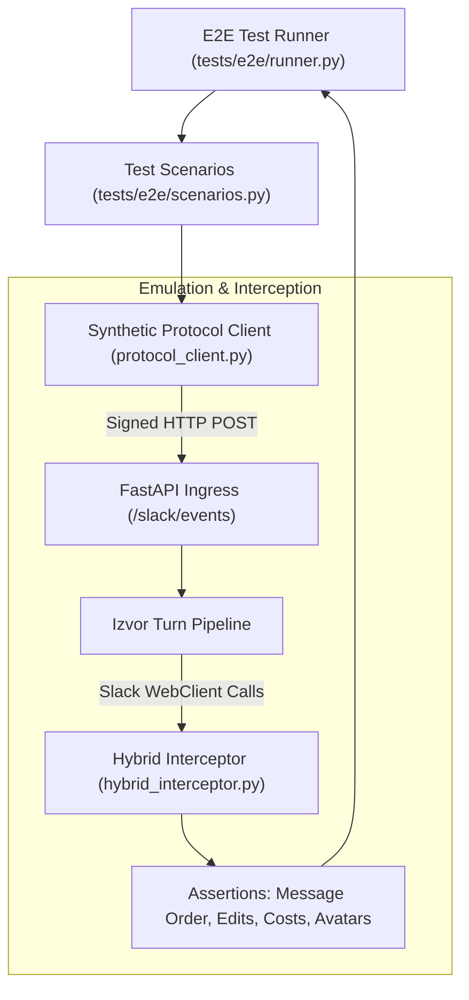

# E2E Behavioral Testing Harness

This document describes the design, architecture, and operation of **Izvor**'s End-to-End (E2E) Behavioral Testing Harness located in [`tests/e2e/`](file:///tests/e2e).

---

## 🎯 Purpose & Philosophy

Testing multi-agent conversational platforms against live Slack servers is slow, costly, and non-deterministic. To solve this, Izvor includes an in-process, high-fidelity synthetic testing harness that emulates Slack Events, Interactivity webhooks, and Slack WebClient responses with millisecond precision.

The harness validates complex behavioral flows such as:
- Sandwich mode chain transitions and dynamic peer nominations.
- Mid-debate human interruptions and generation superseding.
- Circuit breaker tripping under simulated token costs.
- Delayed tool status messages (<5s vs ≥5s) and in-place message edits.

---

## 🏗️ Harness Architecture



---

## 🧩 Core Harness Components

### 1. The Protocol Client (`protocol_client.py`)
- **File**: [`tests/e2e/protocol_client.py`](file:///tests/e2e/protocol_client.py)
- **Role**: Synthesizes authentic Slack Events API payloads (`app_mention`, `message`, `block_actions`).
- Computes valid HMAC-SHA256 signatures with timestamps, exercising the complete security verification path.

### 2. The Hybrid Interceptor (`hybrid_interceptor.py`)
- **File**: [`tests/e2e/hybrid_interceptor.py`](file:///tests/e2e/hybrid_interceptor.py)
- **Role**: Intercepts outbound calls to the Slack WebClient (`chat.postMessage`, `chat.update`, `views.publish`, etc.).
- Records every posted message, placeholder, edit, and avatar override for post-test assertions.
- Supports configurable latency injection to simulate slow or fast LLM/tool executions.

### 3. Scenario Catalog (`scenarios.py`)
- **File**: [`tests/e2e/scenarios.py`](file:///tests/e2e/scenarios.py)
- Implements comprehensive test suites mapped directly to [`SLACK_BEHAVIOURAL_TEST_CASES.md`](file:///tests/e2e/SLACK_BEHAVIOURAL_TEST_CASES.md).

---

## 🏃 Running E2E Harness Tests

Execute the full behavioral harness suite using `pytest`:

```bash
pytest tests/e2e/test_e2e_suite.py -v
```

Or run the standalone scenario runner script:

```bash
python -m tests.e2e.runner --all
```
