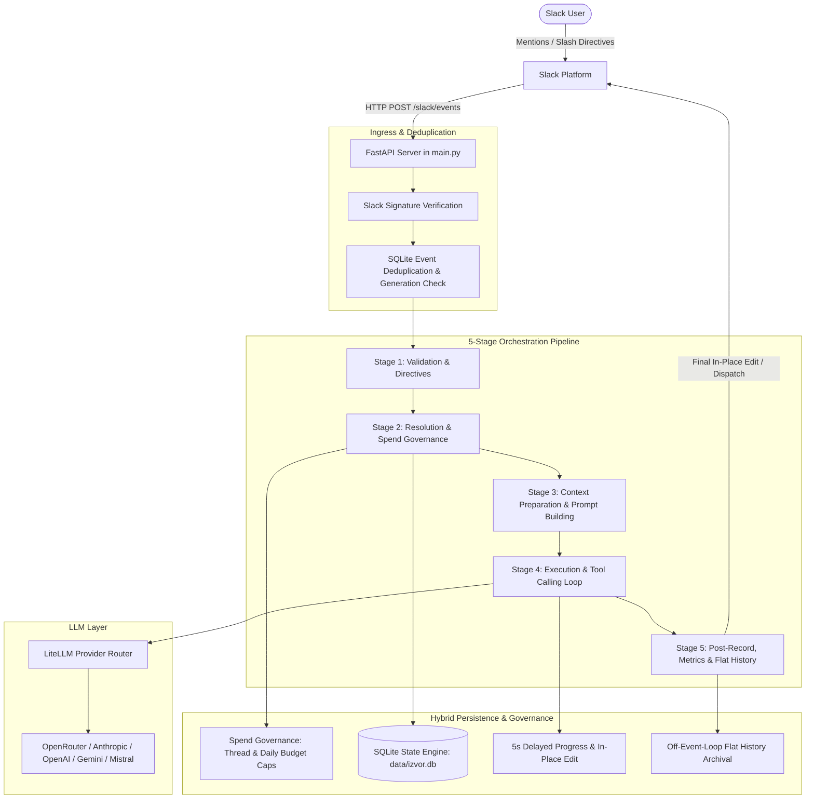

# Izvor Platform Overview

**Izvor** is an asynchronous multi-agent deliberation platform that connects Slack workspaces to specialized LLM personas using [LiteLLM](https://github.com/BerriAI/litellm), standard library SQLite persistence, and [Model Context Protocol (MCP)](https://modelcontextprotocol.io/) tools.

---

## 🎯 Vision & Purpose

In modern collaborative environments, complex engineering, security, and strategic decisions require diverse perspectives. Izvor replaces isolated single-prompt chat interactions with structured, multi-persona deliberations directly inside Slack threads.

Instead of one generic assistant answering every prompt, Izvor orchestrates specialized personas (such as *Visionary*, *Sceptic*, *Security Architect*, *Legal Advisor*, *Sales Advisor*, and *Scribe*) that deliberate, critique, and synthesize decisions using defined orchestration topologies.

---

## 🏗️ High-Level System Architecture

---

## ✨ Key Architectural Pillars

### 1. Multi-Persona Discussion Topologies
Izvor does not rely on rigid turn-taking. It supports distinct workflow topologies:
- **🥪 Sandwich Mode**: Starts with designated initial thinkers (*Start Chain*), transitions through an open debate or peer-nominated pool (*Middle Pool*), and concludes with an authoritative synthesis by designated closers (*End Chain*).
- **⚡ Parallel Dialectic (Scatter-Gather)**: Specialist agents explore concurrently in isolated `asyncio.TaskGroup` branches with zero anchor bias, followed by dialectical synthesis by the designated closing agent.
- **🎯 Fixed Mode**: Executes an ordered, sequential chain of personas defined by the operator or preset.
- **⚡ Open Debate Mode (`/open_debate`)**: Designates an initial speaker and runs an open debate without fixed start/end chains.
- **📝 Live Discussion Scribe**: Live synthesis and real-time pinned summary generation in discussion threads.
- **⚡ Consensus Convergence Fast-Forward**: Early consensus detection and stress-testing (Challenger → Rebuttal) to fast-forward resolved deliberations.
- **Dynamic Peer Nomination**: Personas pass the baton using unicode-safe tags (e.g., `/[Security Architect]`, `/[Scope Optimizer]`, or `/[Tactician]`), parsed automatically by the [`EntityResolver`](file:///c:/Users/Hp/Documents/agy2-projects/Izvor/pipeline/entity_resolver/resolver.py).

### 2. Thread State & Memory Safety (Hybrid In-Memory + SQLite)
- **Fast Runtime Layer**: Managed by [`ThreadStateManager`](file:///c:/Users/Hp/Documents/agy2-projects/Izvor/orchestration/thread_state.py). Inactive threads are evicted after an idle TTL via background pruning ([`periodic_thread_state_cleanup`](file:///c:/Users/Hp/Documents/agy2-projects/Izvor/main.py)).
- **ACID SQLite Persistence**: All thread sessions, contexts, spending ledgers, HITL approvals, and skill grants reside in `data/izvor.db` using WAL mode.
- **Generation-Based Superseding**: If a human user replies to an ongoing deliberation, the thread generation counter increments. Obsolete background agent turns detect generation divergence and gracefully abort without race conditions.

### 3. Asynchronous Tool Execution & Non-Blocking Slack UX
- **Wall-Clock Guard**: Tool loops are bounded by `tool_call_loop_timeout_seconds` (default: 60s in [`data/settings/system_settings.json`](file:///c:/Users/Hp/Documents/agy2-projects/Izvor/data/settings/system_settings.json)) to prevent runaway recursive calls.
- **5-Second Delayed Status Indicator**: If a tool call takes longer than 5 seconds, Izvor posts an intermediate placeholder (e.g., `_🔍 *Visionary* is searching the web..._`). Fast calls (<5s) complete silently without UI jitter.
- **In-Place Message Editing**: When tool output resolves, the placeholder is edited in-place with the final response, avoiding cluttered Slack threads.

### 4. Spend Governance & Model Pricing
- **Autonomous Token & Cost Tracking**: Detailed prompt and completion tokens are recorded in SQLite `spend_ledger` for each turn via [`services/pricing_service.py`](file:///c:/Users/Hp/Documents/agy2-projects/Izvor/services/pricing_service.py).
- **Disk-Backed 7-Day Pricing Cache**: An autonomous pricing agent dynamically checks official model provider pricing tables, caching per-token rates in `data/pricing/model_pricing_cache.json`.
- **Two-Tiered Circuit Breakers**: Protects against runaway costs with both per-thread thresholds (`circuit_breaker_threshold_usd`) and global daily workspace caps (`daily_budget_usd`).

### 5. Interactive Slack App Home & Administrative SSOT
- **Live Configuration**: Slack workspace admins (`is_slack_admin(user_id)`) can configure debate workflows, agent rosters, circuit breaker thresholds, and topologies directly in the Slack App Home tab ([`services/slack_home/`](file:///c:/Users/Hp/Documents/agy2-projects/Izvor/services/slack_home/__init__.py)).
- **Resilient Persistence**: Changes are committed atomically to `data/settings/agent_settings.json` and `data/settings/app_settings.json`, backed by automated rolling backups in `data/backups/`.

### 6. Non-Repudiable Cryptographic Audit Logging
- Every administrative action, security event, and RAG synchronization is recorded in a cryptographically chained, HMAC-verified JSONL audit log ([`services/audit_logger.py`](file:///c:/Users/Hp/Documents/agy2-projects/Izvor/services/audit_logger.py)).
- Continuous integrity scans ([`orchestration/integrity_checks.py`](file:///c:/Users/Hp/Documents/agy2-projects/Izvor/orchestration/integrity_checks.py)) detect any tampering or key mismatch, instantly dispatching high-priority admin alerts.

---

## 🔗 Next Steps

- Proceed to the [Installation Guide](file:///c:/Users/Hp/Documents/agy2-projects/Izvor/docs/getting-started/installation.md) to set up Izvor locally.
- Configure your Slack Bot using the [Slack App Setup Guide](file:///c:/Users/Hp/Documents/agy2-projects/Izvor/docs/getting-started/slack-app-setup.md).
