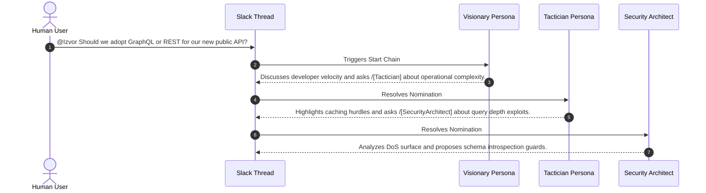

# Interacting in Slack User Guide

This guide explains how end-users, team leads, and product teams interact with **Izvor** inside Slack channels and threads.

---

## 🚀 Starting a Deliberation

### 1. Invite the Bot
Invite `@Izvor` to any public or private channel:
```
/invite @Izvor
```

### 2. Mention to Initiate

#### A. Multi-Agent Panel Debate
Trigger a deliberation by mentioning the bot and stating a question, design dilemma, or review request:
```
@Izvor We are considering migrating our session store from Redis to Postgres row-level JSONB. What are the engineering tradeoffs, security considerations, and cost impacts?
```
Once mentioned:
1. Izvor's Orchestrator evaluates the query.
2. The initial personas (e.g., *Visionary* and *Tactician* in Sandwich mode) enter the thread.
3. Each persona posts using its dedicated avatar and display name.

#### B. Direct Single-Agent Query (Single-Turn Execution)
If you need an answer strictly from a single specialist without kicking off a full multi-turn debate cascade:
```
@Izvor /[Security Architect] What are the encryption requirements for storing PII under GDPR?
```
When an agent is directly tagged with `/[Persona Name]`, Izvor sets the remaining agent queue to empty and executes **only** that persona's turn. It answers directly and halts without escalating to other personas.

#### C. Custom Opening Speaker or Open Debate
- `/first Visionary <prompt>` — Designates the opening speaker, after which normal workflow chains continue.
- `/open_debate Visionary <prompt>` — Designates the opening speaker and runs a dynamic peer-nominated debate across up to 3 rounds.

---

## 💬 The Multi-Agent Conversation Flow



---

## ✋ Interrupting & Steering the Debate

Unlike rigid automation bots, Izvor is fully interactive:

### 1. Mid-Debate Human Interruption
You do not have to wait for the entire multi-round deliberation to finish. You can reply in the thread at any time:
```
Let's focus strictly on AWS serverless options; discount on-premise Kubernetes entirely.
```

### 2. What Happens Automatically
- The moment your reply arrives, Izvor **increments the thread generation counter**.
- Any background agent currently reasoning in the background detects the generation shift and **gracefully cancels** its pending turn.
- The next speaker takes your latest directive as the primary instruction, steering the entire subsequent debate in your chosen direction.

---

## 💡 Best Practices for Engaging Personas

1. **Be Specific in Initial Context**: Frame the decision, target constraints, and current assumptions.
2. **Tag Personas Directly**: If you want a specific persona to open the conversation, specify them:
   ```
   @Izvor /include SecurityArchitect, LegalAdvisor Review our proposed OAuth2 token exchange architecture.
   ```
3. **Use Constraints**: If you need brief answers, add word limits:
   ```
   @Izvor /max_words 100 Give me 3 bullet points each on pros and cons.
   ```
