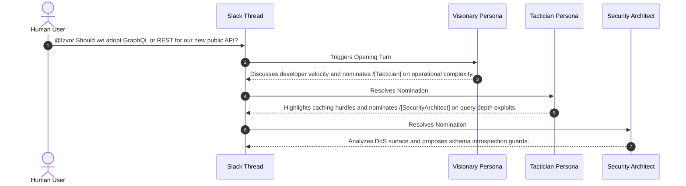

# Interacting in Slack User Guide

This guide explains how end-users, team leads, and product teams interact with **Izvor** inside Slack channels and threads.

---

## 🚀 Starting a Deliberation

### 1. Invite the Bot
Invite `@Izvor` to any public or private channel:
```
/invite @Izvor
```

### 2. Mention to Initiate

#### A. Multi-Agent Panel Debate
Trigger a deliberation by mentioning the bot and stating a question, design dilemma, or review request:
```
@Izvor We are considering migrating our session store from Redis to Postgres row-level JSONB. What are the engineering tradeoffs, security considerations, and cost impacts?
```
Once mentioned:
1. Izvor's Orchestrator snapshots the active workflow preset configured in [`config/settings/agent_settings.json`](file:///config/settings/agent_settings.json) (e.g., `default_review_flow` in `fixed` mode, `default_sandwich` starting with *Scope Optimizer*, *Visionary*, and *User Advocate*, or `parallel_dialectic_flow` in `scatter_gather` mode).
2. Participating personas enter the thread according to the workflow topology.
3. Each persona posts using its dedicated avatar and display name, appending used skills and token usage footers (`{model : prompt/completion}`).

#### B. Direct Single-Agent or Multi-Agent Tagged Query
- **Single-Agent Query (Single-Turn Execution)**: Tagging a single specialist executes **only** that persona's turn and sets the remaining agent queue to empty:
  ```
  @Izvor /[Security Architect] What are the encryption requirements for storing PII under GDPR?
  ```
- **Multi-Agent Ad-Hoc Chain (`custom_flow`)**: Tagging multiple personas in order runs a custom sequential flow across strictly those tagged specialists ([`orchestration/stages/validation.py`](file:///engine/orchestration/stages/validation.py#L276-L290)):
  ```
  @Izvor /[Visionary] /[SecurityArchitect] /[LegalAdvisor] Evaluate this cross-region data replication design.
  ```

#### C. Custom Opening Speaker or Open Debate
- `/first Visionary <prompt>` — Designates the opening speaker, after which the active workflow's remaining agent pool continues.
- `/open_debate Visionary <prompt>` — Designates the opening speaker and opens the floor to all active non-excluded personas for dynamic peer-nominated deliberation without fixed start/end chains (bounded by `max_discussion_turns = 20` or `/rounds N`).

---

## 💬 The Multi-Agent Conversation Flow



---

## ✋ Interrupting, Steering & Interactive Approvals

Unlike rigid automation bots, Izvor is fully interactive throughout a thread's lifecycle:

### 1. Mid-Debate Human Interruption
You do not have to wait for a multi-turn deliberation to finish. You can reply in the thread at any time:
```
Let's focus strictly on AWS serverless options; discount on-premise Kubernetes entirely.
```
- The moment your reply arrives, Izvor **increments the thread generation counter** ([`orchestration/thread_state.py`](file:///engine/orchestration/thread_state.py)).
- Any background agent turn currently in flight detects the generation shift via `ctx.is_superseded()` and **gracefully cancels** its pending work.
- The next speaker takes your latest reply as the active instruction.

### 2. Interactive Thread Pauses & Resumption
A deliberation may automatically pause and wait for human interaction in three scenarios:
1. **Clarification Request (`request_user_clarification`)**: If a prompt lacks essential context, an agent can invoke `request_user_clarification` to ask a direct question in Slack and suspend the loop until you reply.
2. **Human-in-the-Loop (HITL) Tool Approval**: When an agent invokes a mutating tool (such as `write_document` in `document_authoring`), Izvor saves a durable `TurnCheckpoint` ([`services/turn_checkpoint_store.py`](file:///engine/services/turn_checkpoint_store.py)) and renders **Approve** / **Deny** Block Kit buttons. Clicking **Approve** executes the tool and seamlessly resumes the turn and discussion loop.
3. **Spend Governance Circuit Breaker**: If a thread reaches `circuit_breaker_threshold_usd` (default: `$1.50`), Izvor saves a checkpoint, pauses the debate, and renders a **Continue Sequence** button so you can explicitly authorize additional spend.

---

## 💡 Best Practices for Engaging Personas

1. **Be Specific in Initial Context**: Frame the decision, target constraints, and current assumptions.
2. **Invite or Exclude Personas**: Bring in domain specialists or narrow the panel:
   ```
   @Izvor /include SecurityArchitect LegalAdvisor Review our proposed OAuth2 token exchange architecture.
   ```
3. **Use Word & Round Constraints**: Control response length or run multi-round debates:
   ```
   @Izvor /max_words 100 /rounds 2 Give me 3 bullet points each on pros and cons.
   ```
